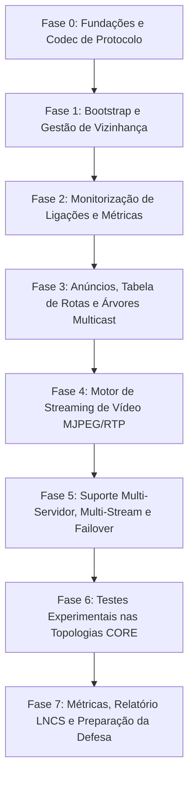

# Plano Detalhado de Implementação e Arquitetura - ESR TP2 (2026/2027)
## Serviço Over-the-Top (OTT) para Entrega de Multimédia em Rede Overlay

Este documento apresenta a análise integral do enunciado do Trabalho Prático 2 de ESR, detalhando a arquitetura conceptual, as decisões de desenho, a especificação dos componentes e a **ordem cronológica passo a passo de implementação**.

---

## 1. Visão Geral e Análise de Requisitos do Enunciado

O objetivo principal é conceber e implementar uma **Rede Overlay Aplicacional (ALM - Application Layer Multicast)** para distribuição eficiente de fluxos de streaming de vídeo e áudio em tempo real, mitigando a congestão na rede física (*underlay*) e eliminando transmissões redundantes através de replicação nos nós intermediários (*relays*).

### 1.1 Requisitos Obrigatórios Fundamentais
1. **Natureza dos Nós Overlay:**
   - Cada nó overlay é um processo aplicacional executado num sistema terminal (PC/Servidor).
   - Um nó atua como cliente e servidor em simultâneo (porta de escuta e conexões de saída com vizinhos em modo full-duplex).
   - Nós podem juntar-se (*join*) ou sair (*leave*) dinamicamente da rede.
2. **Topologia e Vizinhança:**
   - Conexões lógicas (virtuais) mantidas entre vizinhos através de protocolos de transporte IP (TCP para controlo/sinalização e TCP/UDP para streaming).
   - Arranque guiado por nó bem conhecido (**Bootstrap Server**) para descoberta inicial de vizinhos sem intermediar fluxos.
   - Cada nó mantém ativas conexões com $X$ vizinhos (ex.: $X \ge 2$ ou $3$).
3. **Encaminhamento e Gestão de Fluxos:**
   - Construção e manutenção dinâmica de uma **Tabela de Rotas** por fluxo:
     $$\text{Rota} = \{ \text{StreamID}, \text{ServidorID}, \text{Métrica/Custo}, \text{Origem (Next-Hop a montante)}, \text{Destinos (Lista a jusante)}, \text{Estado} \}$$
   - **Ativação a pedido (On-Demand / Reverse Path Tree Activation):** As rotas existem na tabela mas permanecem inativas até que um cliente solicite explicitamente a stream.
   - **Replicação Sem Redundância:** Nós intermediários replicam um único fluxo de entrada para múltiplos vizinhos a jusante inscritos, evitando duplicar tráfego na mesma ligação.
4. **Métricas de Rede e Monitorização:**
   - Uso de métricas ativas de rede (RTT, atraso, jitter, perda de pacotes ou contagem ponderada de saltos) para seleção do caminho ótimo.
   - Mecanismo de *Heartbeat* / *Ping* overlay para avaliação contínua da qualidade das ligações e deteção de falhas/quedas de nós.
5. **Requisito Multi-Servidor e Multi-Stream (Crítico):**
   - Presença obrigatória de **pelo menos 2 servidores**, cada um disponibilizando **no mínimo 2 fluxos distintos** (total $\ge 4$ streams no catálogo).
6. **Streaming de Multimédia:**
   - Envio de vídeo em pacotes numerados (RTP/MJPEG com Sequence Number e Timestamp) com framerate constante.
   - Cliente com interface gráfica para reprodução fluida do fluxo recebido.

---

## 2. Arquitetura da Solução e Estrutura de Classes

O projeto encontra-se estruturado em Java 21 com Maven no pacote base `pt.uminho.esr.ott`:

```
pt.uminho.esr.ott
│
├── app
│   └── OttApplication.java         # Ponto de entrada CLI (inicia Nó, Bootstrap, Servidor ou Cliente)
│
├── bootstrap
│   ├── BootstrapServer.java        # Registo central de nós e atribuição determinística/dinâmica de vizinhos
│   └── NodeRegistry.java           # Tabela de nós ativos e topologia de vizinhança
│
├── overlay
│   ├── OverlayNode.java            # Núcleo do nó overlay (orquestrador de transporte, rotas e streams)
│   ├── NodeRole.java               # Enum: BOOTSTRAP, SERVER, RELAY, CLIENT
│   ├── Neighbor.java               # Representação do nó vizinho (ID, IP, Portas, Estado, Métrica)
│   └── NeighborManager.java        # Manutenção de conexões ativas com vizinhos e keepalive
│
├── transport
│   ├── Transport.java              # Abstração de sockets (TCP para controlo, TCP/UDP para dados)
│   └── Connection.java             # Gestão de canal de comunicação bidirecional com um vizinho
│
├── protocol
│   ├── MessageType.java            # Tipos de mensagens de controlo
│   ├── ControlMessage.java         # Estrutura unificada de mensagens de controlo
│   └── MessageCodec.java           # Serialização/deserialização (JSON ou Binário)
│
├── routing
│   ├── Route.java                  # Representação de uma rota de fluxo
│   ├── RoutingTable.java           # Tabela de rotas do nó (StreamID -> Route)
│   ├── RoutingService.java         # Lógica de difusão de anúncios, seleção de melhor rota e ativação
│   ├── RouteMetric.java            # Cálculo e comparação de custos de rota
│   └── RouteState.java             # Enum: INACTIVE, ACTIVE, STALE
│
├── monitoring
│   ├── LinkMetrics.java            # Métricas da ligação (RTT, Perda, Jitter, Timestamp)
│   └── NetworkMonitor.java         # Sonda periódica de PING/PONG com vizinhos
│
├── streaming
│   ├── StreamPacket.java           # Pacote de vídeo (StreamID, SeqNum, Timestamp, FrameSize, Payload)
│   ├── StreamForwarder.java        # Reencaminhador e replicador de pacotes para vizinhos ativos
│   ├── StreamInfo.java             # Metadados de um fluxo (ID, Nome, Servidor, Resolução, FPS)
│   └── StreamCatalog.java          # Catálogo de fluxos disponíveis na rede
│
├── server
│   ├── StreamingServer.java        # Servidor de conteúdos multimédia
│   └── VideoSource.java            # Leitor de ficheiros de vídeo MJPEG
│
├── client
│   ├── StreamingClient.java        # Cliente de reprodução
│   └── VideoPlayer.java            # Interface gráfica de visualização de vídeo
│
└── config
    ├── NodeConfiguration.java      # Configuração em tempo de execução
    └── ConfigurationLoader.java    # Parser de ficheiros .properties e .json
```

---

## 3. Especificação do Protocolo Aplicacional de Controlo

As mensagens de controlo trocadas entre nós (via canal TCP fiável) utilizam uma estrutura padronizada serializada por `MessageCodec`:

### 3.1 Tipos de Mensagens (`MessageType`)
| Mensagem | Direção | Propósito |
|---|---|---|
| `BOOTSTRAP_REGISTER` | Nó $\rightarrow$ Bootstrap | Registo do nó ao iniciar (informa ID, IP, Portas de escuta). |
| `BOOTSTRAP_RESPONSE` | Bootstrap $\rightarrow$ Nó | Devolve a lista de vizinhos designados ($X$ vizinhos com IP e portas). |
| `NEIGHBOR_HELLO` | Nó $\rightarrow$ Vizinho | Estabelece e valida a ligação direta de vizinhança. |
| `NEIGHBOR_KEEPALIVE` / `PROBE_PING` | Nó $\rightarrow$ Vizinho | Medição de RTT, monitorização contínua e confirmação de vida. |
| `PROBE_PONG` | Vizinho $\rightarrow$ Nó | Resposta ao ping com timestamp de retorno para cálculo de latência. |
| `STREAM_ANNOUNCE` | Servidor $\rightarrow$ Overlay (Flooding) | Anúncio periódico de disponibilidade de uma stream com métrica acumulada. |
| `ROUTE_ACTIVATE` (Join) | Cliente $\rightarrow$ Servidor (Hop-by-hop) | Mensagem de subscrição que ativa a rota e adiciona o nó à árvore de distribuição. |
| `ROUTE_DEACTIVATE` (Prune) | Cliente $\rightarrow$ Servidor (Hop-by-hop) | Remove o vizinho da lista de destinos; se lista ficar vazia, propaga desativação a montante. |
| `NODE_LEAVE` | Nó $\rightarrow$ Vizinhos / Bootstrap | Aviso de encerramento gracioso do nó. |

---

## 4. Ordem Cronológica e Passos de Implementação

A implementação deve seguir rigorosamente a sequência de dependências funcionais, garantindo testes unitários e de integração em cada etapa:



---

### Fase 0: Configuração, Modelos de Dados e Protocolo Base
**Objetivo:** Estabelecer as estruturas fundamentais e a serialização de mensagens sem dependências de rede complexas.

1. **Passo 0.1 - Configuração e Parsing:**
   - Implementar `NodeConfiguration` e `ConfigurationLoader` para leitura de ficheiros `.properties` (ID do nó, portas TCP/UDP, endereço do Bootstrap Server, papel do nó).
2. **Passo 0.2 - Mensagens de Controlo:**
   - Definir enum `MessageType` e a classe `ControlMessage` (campos: `type`, `senderId`, `targetId`, `streamId`, `sequenceNumber`, `metricValue`, `payloadJson`).
3. **Passo 0.3 - Serialização/Deserialização (`MessageCodec`):**
   - Implementar codificação em formato robusto (ex: JSON ou DataOutputStream delimitado por comprimento).
   - Validar com testes unitários em `MessageCodecTest`.

---

### Fase 1: Bootstrap Server e Camada de Vizinhança (Overlay Topology)
**Objetivo:** Permitir que os nós arranquem, se registem no bootstrap, descubram vizinhos e estabeleçam ligações bidirecionais ativas.

1. **Passo 1.1 - Servidor de Bootstrap (`BootstrapServer` & `NodeRegistry`):**
   - O `BootstrapServer` escuta numa porta bem conhecida.
   - Ao receber `BOOTSTRAP_REGISTER`, regista o nó em `NodeRegistry` e responde com `BOOTSTRAP_RESPONSE` contendo a lista de $X$ vizinhos (lidos de `topology.json` ou atribuídos segundo topologia definida).
2. **Passo 1.2 - Camada de Transporte (`Transport` e `Connection`):**
   - Criar `ServerSocket` TCP em cada nó para aceitar conexões de outros vizinhos.
   - Criar `Socket` de saída para os vizinhos fornecidos pelo bootstrap.
   - Gerir threads dedicadas de leitura/escrita para comunicação full-duplex.
3. **Passo 1.3 - Gestão de Vizinhos (`NeighborManager` & `Neighbor`):**
   - Troca de handshake inicial `NEIGHBOR_HELLO`.
   - Manutenção da lista de vizinhos ativos e deteção de desconexão.
   - Validar com teste em `NeighborManagerTest` (estabelecer anel ou malha simples com 3 nós).

---

### Fase 2: Monitorização Ativa e Métricas de Rede
**Objetivo:** Avaliar em tempo real a qualidade de cada ligação overlay para suportar decisões inteligentes de encaminhamento.

1. **Passo 2.1 - Estrutura de Métricas (`LinkMetrics`):**
   - Armazenar RTT (Round Trip Time), taxa de perda de pacotes e número de saltos.
2. **Passo 2.2 - Monitor de Rede (`NetworkMonitor`):**
   - Envio periódico de `PROBE_PING` a cada vizinho (ex.: a cada 1000 ms).
   - Resposta imediata com `PROBE_PONG`.
   - Cálculo de RTT médio com média ponderada exponencial (EWMA):
     $$\text{RTT}_{\text{estimado}} = (1 - \alpha) \cdot \text{RTT}_{\text{anterior}} + \alpha \cdot \text{RTT}_{\text{amostra}}$$
3. **Passo 2.3 - Métrica Composta de Roteamento (`RouteMetric`):**
   - Definir fórmula de custo que combina saltos e latência (ex.: $\text{Custo} = (\text{Saltos} \times W_h) + (\text{RTT} \times W_d)$).

---

### Fase 3: Encaminhamento Aplicacional e Construção da Árvore Multicast
**Objetivo:** Descobrir rotas para os servidores de streaming e ativar caminhos ponto-multiponto sob demanda dos clientes.

1. **Passo 3.1 - Tabela de Rotas (`RoutingTable` e `Route`):**
   - Estrutura de cada entrada:
     - `streamId` e `serverId`
     - `cost` (métrica acumulada)
     - `upstreamNeighbor` (vizinho por onde vem o fluxo do servidor)
     - `downstreamNeighbors` (conjunto de vizinhos que pediram o fluxo)
     - `state` (`INACTIVE` se não houver clientes a jusante; `ACTIVE` quando há clientes)
2. **Passo 3.2 - Inundação Controlada de Anúncios (`STREAM_ANNOUNCE`):**
   - Servidor gera periodicamente `STREAM_ANNOUNCE` para cada fluxo ativo.
   - Nós intermediários recebem o anúncio:
     - Se o custo recebido for menor que o conhecido, atualizam `upstreamNeighbor` e `cost = cost_recebido + cost_link`.
     - Reencaminham o anúncio para todos os vizinhos exceto aquele de quem receberam (evitar loops usando `sequenceNumber` ou histórico de anúncios vistos).
3. **Passo 3.3 - Ativação sob Demanda (`ROUTE_ACTIVATE` / Tree Grafting):**
   - Quando um `StreamingClient` quer consumir uma stream, envia `ROUTE_ACTIVATE` para o seu `upstreamNeighbor`.
   - O nó intermediário recebe a mensagem:
     - Adiciona o emissor a `downstreamNeighbors`.
     - Marca a rota como `ACTIVE`.
     - Se a rota ainda não estava ativa a montante, propaga `ROUTE_ACTIVATE` para o seu próprio `upstreamNeighbor` (até chegar à fonte/servidor).
4. **Passo 3.4 - Desativação e Poda da Árvore (`ROUTE_DEACTIVATE` / Tree Pruning):**
   - Quando um cliente para a visualização, envia `ROUTE_DEACTIVATE`.
   - O intermediário remove o vizinho da lista `downstreamNeighbors`. Se a lista ficar vazia, marca a rota como `INACTIVE` e envia `ROUTE_DEACTIVATE` a montante.

---

### Fase 4: Motor de Streaming Multimédia (MJPEG sobre Overlay)
**Objetivo:** Transmitir vídeo do servidor para os clientes com replicação em tempo real nos nós intermediários.

1. **Passo 4.1 - Formato de Pacotes de Stream (`StreamPacket`):**
   - Cabeçalho: `streamId`, `sequenceNumber`, `timestamp`, `frameLength`, `isEndOfFrame`.
   - Payload: bytes da imagem JPEG.
2. **Passo 4.2 - Servidor de Streaming (`StreamingServer` & `VideoSource`):**
   - `VideoSource` lê frames sucessivos de ficheiros `.Mjpeg` (ex: `movie.Mjpeg`).
   - `StreamingServer` empacota os frames e envia-os em taxa fixa (ex.: 25 FPS $\rightarrow$ 40 ms/frame) para as conexões ativas registadas como destinos.
3. **Passo 4.3 - Reencaminhador e Replicador (`StreamForwarder`):**
   - Em cada nó intermediário, ao receber um `StreamPacket`:
     - Consulta a `RoutingTable` para a `streamId`.
     - Se `state == ACTIVE`, replica o pacote para **cada um** dos `downstreamNeighbors`.
     - **Regra de ouro:** O pacote só atravessa uma vez cada ligação de entrada, sendo duplicado na memória do nó apenas para as saídas necessárias.
4. **Passo 4.4 - Cliente e Player de Vídeo (`StreamingClient` & `VideoPlayer`):**
   - `StreamingClient` recebe `StreamPacket`, reconstrói os frames segundo o `sequenceNumber` e envia para `VideoPlayer`.
   - `VideoPlayer` renderiza as imagens numa janela Java Swing / AWT.

---

### Fase 5: Suporte Multi-Servidor, Multi-Stream e Resiliência
**Objetivo:** Cumprir o requisito de múltiplos servidores/fluxos e garantir adaptação a falhas e reconfiguração dinâmica de rotas.

1. **Passo 5.1 - Catálogo Multi-Stream (`StreamCatalog`):**
   - Configurar **Servidor 1** a disponibilizar pelo menos 2 streams (ex.: `stream-1A`, `stream-1B`).
   - Configurar **Servidor 2** a disponibilizar pelo menos 2 streams distintas (ex.: `stream-2A`, `stream-2B`).
   - Clientes podem consultar o catálogo consolidado e selecionar qualquer uma das 4 streams.
2. **Passo 5.2 - Deteção de Falhas e Re-Routing:**
   - Se um vizinho deixar de responder a $K$ pings consecutivos ou a conexão fechar:
     - Remover o vizinho do `NeighborManager`.
     - Notificar `RoutingService`.
     - Para fluxos ativos cujo `upstreamNeighbor` falhou, selecionar imediatamente a melhor rota alternativa entre os vizinhos restantes e enviar novo `ROUTE_ACTIVATE`.

---

### Fase 6: Validação Experimental nos Cenários CORE
**Objetivo:** Testar e afinar o sistema nos cenários emulados com diferentes níveis de complexidade.

1. **Cenário 1 (4 nós):**
   - 1 Servidor, 1 Relay intermediário, 2 Clientes.
   - Teste de replicação: comprovar que o link Servidor $\rightarrow$ Relay transporta apenas 1 fluxo enquanto ambos os clientes recebem o vídeo.
2. **Cenário 2 (6 nós):**
   - 1 Servidor, 3 Relays formando caminhos alternativos, 2 Clientes.
   - Teste de escolha de rota mais curta vs rota mais rápida e teste de failover (corte de link no CORE).
3. **Cenário 3 (Topologia Complexa - Baseada na Figura 1 do Enunciado):**
   - 2 Servidores, múltiplos switches/routers na rede underlay, múltiplos nós overlay intermediários e 5+ clientes simultâneos consumindo fluxos diferentes.

---

### Fase 7: Elaboração do Relatório (LNCS) e Defesa
**Objetivo:** Documentar e justificar todas as escolhas de arquitetura e resultados experimentais.

- Estrutura formal do relatório (máximo 12 páginas, formato LNCS):
  1. *Introdução e Motivação*
  2. *Arquitetura da Solução e Desenho da Overlay*
  3. *Especificação dos Protocolos (Mensagens e Diagramas de Interação)*
  4. *Algoritmo de Roteamento, Métricas e Gestão de Fluxos*
  5. *Implementação e Detalhes Técnicos*
  6. *Resultados Experimentais nos Cenários de Teste (Gráficos de RTT, Largura de Banda, Perda de Pacotes)*
  7. *Conclusão e Trabalho Futuro*

---

## 5. Resumo da Ordem de Execução Prática

Para começar a trabalhar de imediato no código, segue esta lista de tarefas sequencial:

| Ordem | Componente | Ficheiro a Implementar | Objetivo Prático |
|---|---|---|---|
| **1º** | Protocolo & Codec | `ControlMessage.java`, `MessageType.java`, `MessageCodec.java` | Criar e testar serialização JSON de mensagens de controlo. |
| **2º** | Configurações | `NodeConfiguration.java`, `ConfigurationLoader.java` | Conseguir carregar parâmetros de porta, IP e papel de ficheiro `.properties`. |
| **3º** | Bootstrap Server | `BootstrapServer.java`, `NodeRegistry.java` | Criar servidor central que responde a registos e devolve vizinhos. |
| **4º** | Comunicação Overlay | `Transport.java`, `Connection.java`, `NeighborManager.java` | Fazer nós ligarem-se entre si via TCP full-duplex e trocar `HELLO`. |
| **5º** | Monitorização | `NetworkMonitor.java`, `LinkMetrics.java` | Implementar `PING`/`PONG` periódico e cálculo de RTT. |
| **6º** | Tabela & Roteamento | `RoutingTable.java`, `RoutingService.java`, `Route.java` | Difundir `STREAM_ANNOUNCE` e calcular menor custo para cada stream. |
| **7º** | Ativação a Pedido | `RoutingService.java` (`ROUTE_ACTIVATE`, `ROUTE_DEACTIVATE`) | Ativar ramos da árvore multicast a pedido do cliente. |
| **8º** | Streaming & Replicação | `VideoSource.java`, `StreamingServer.java`, `StreamForwarder.java` | Servidor lê MJPEG e nós replicam pacotes para vizinhos ativos. |
| **9º** | Cliente GUI | `StreamingClient.java`, `VideoPlayer.java` | Exibir vídeo em janela Swing no cliente. |
| **10º** | Multi-Servidor & Resiliência | Configuração de 2 servidores e failover em caso de quebra de nó. | Cumprir requisito obrigatório de 2 servidores $\times$ 2 streams. |
| **11º** | Testes no CORE | Cenários 1, 2 e 3 em `CORE/topologies/` | Validar comportamento em rede emulada e recolher métricas para o relatório. |

