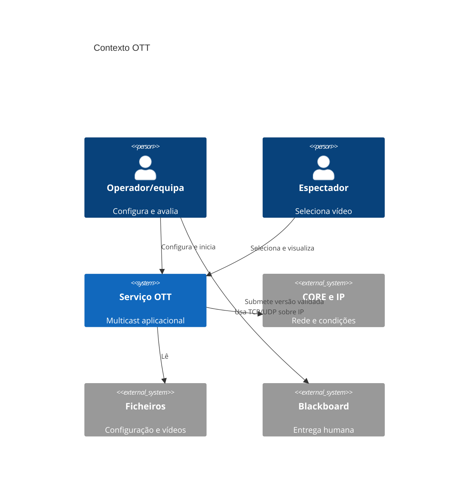
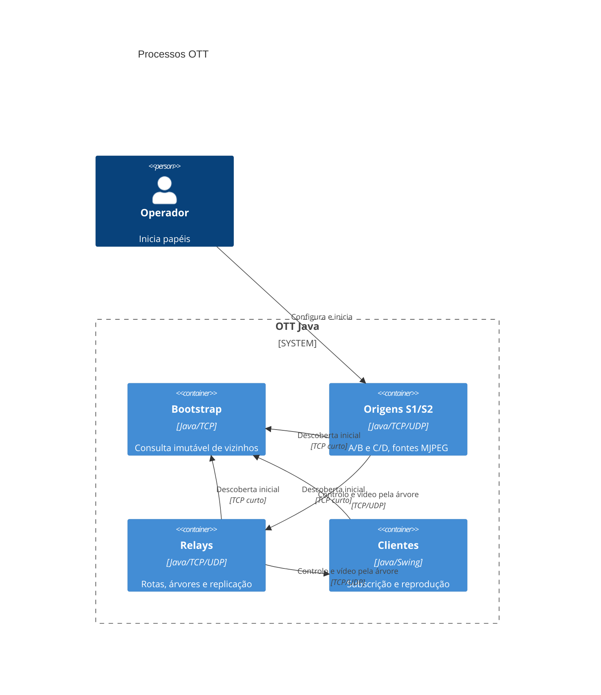
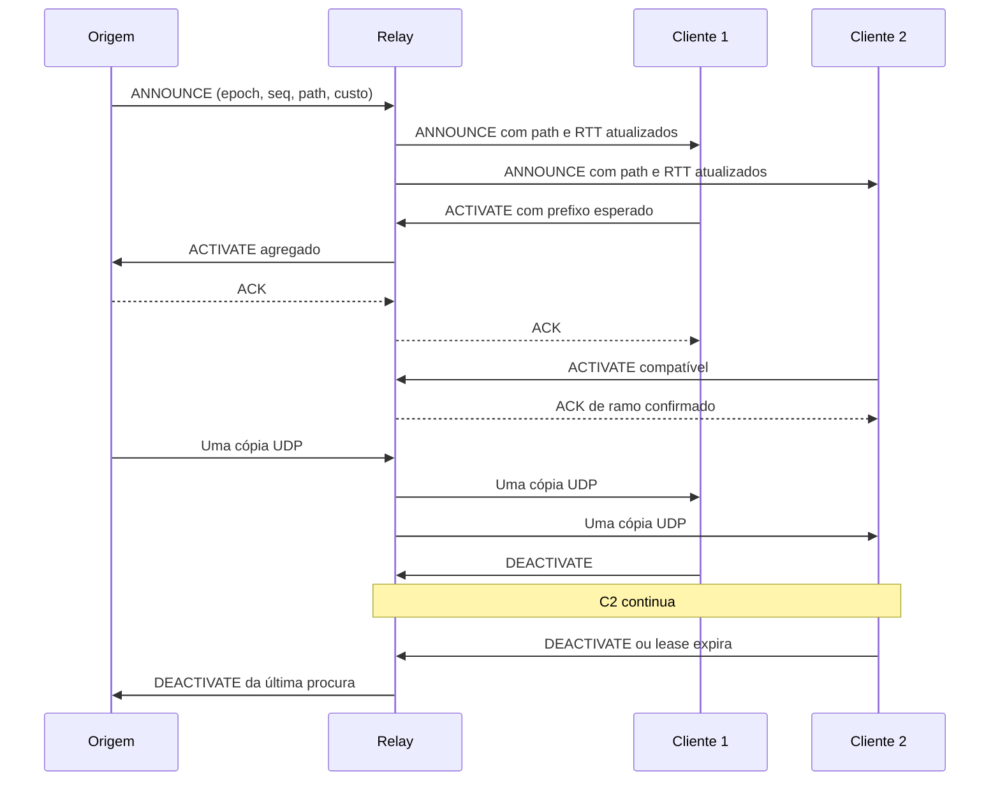

# Architecture Decision Document — serviço OTT

Versão 1.0.2. Atualização: 2026-11-03T20:54:11Z. Base de código observada: `85e1b33ff0a1de69116dfdf3e7ee2d2352cbf936`.
Respostas incorporadas: **1A, 2A, 3B, 4A**; clarificações aprovadas **CP-01, CP-02, CP-03**. Documento mestre para **Construction**.
Aceite é o estado da decisão de desenho; não afirma implementação ou resultado.
Nenhum bolt foi iniciado por gerar ou validar este documento.

## 1. Contexto e âmbito

O projeto distribui vídeo OTT através de multicast aplicacional sobre IP.
Deve servir duas origens com dois conteúdos distintos cada, clientes simultâneos,
segmentos comuns sem cópias redundantes e adaptação baseada em métricas de rede.

Dentro: processos Java BOOTSTRAP/SERVER/RELAY/CLIENT, CLI e Swing, configuração,
TCP de controlo/UDP próprio de vídeo, path vector/RTT, ACK/leases e recuperação
quando uma falha TCP deixa um caminho alternativo válido até à mesma origem.
Inclui testes incrementais, CORE, artigo e pacote reproduzível.

Fora: DB, HTTP, contas, RTP/RTSP, multicast IP, pause/seek, failover do mesmo vídeo
noutra fonte, entrada arbitrária de IDs não configurados e recuperação automática
de falha exclusiva UDP. Novas vizinhanças fora do grafo configurado ficam
adiadas como extra (CP-03). Não se acrescenta CI, linter ou limiar percentual global.

Inception desta base foi concluído por instrução explícita do utilizador.
Os extras que venham a ser pedidos serão definidos numa retoma posterior de
Inception, com requisitos, decisões e bolts próprios. O âmbito atual não os
inclui implicitamente; este fecho não constitui dispensa definitiva de extras
da entrega. O seu planeamento futuro deve considerar integração e avaliação
antes do artigo/pacote final que os inclua.

Atores: operador/equipa configura, inicia e avalia; espectador escolhe/termina
uma stream; docente avalia; Construction implementa e testa; revisores humanos
aceitam as versões atribuídas. Operations só opera uma versão integrada se pedido.

Estado observado: TASK-001–005 DONE, configuração/codec/TCP implementados;
bootstrap tem apenas comentário e os serviços distribuídos/vídeo ainda faltam.
Os 149 testes são evidência histórica de 27-10-2026, não reexecutada neste trabalho.

## 2. Fontes e precedência

**Enunciado → specs.md → intents → documentação existente → código.**
O ADD governa as decisões derivadas dessas fontes e não pode dispensar uma
obrigação superior. Construction lê o ADD primeiro e depois os detalhes técnicos
nele incorporados. Um índice ou bolt não constitui outra arquitetura.

| Fonte | Utilização |
|---|---|
| [Enunciado](ESR-TP2-26-27.pdf), pp. 1–5 | Objetivos, mínimos, avaliação e entrega |
| [specs.md](specs.md) | 40 entradas, aliases, natureza, origem e critérios completos |
| [Intent](memory-bank/intents/001-ott-streaming/requirements.md) | Objetivo e organização prévia |
| [Arquitetura anterior](docs/04-ARCHITECTURE.md), [modelo](docs/06-DATA-MODEL.md), [ADR anteriores](docs/12-RISKS-AND-DECISIONS.md) | Proveniência; decisões consolidadas neste ADD |
| [Contrato técnico](docs/07-API-AND-INTERFACES.md), secções 3–7 | Formatos/enums/offsets/limites v1 e perfil MJPEG incorporados por ADR-009/012 |
| [Testes](docs/09-TESTING-STRATEGY.md), [DoD](docs/14-DEFINITION-OF-DONE.md), [coordenação](docs/team/00-COORDINATION.md) | Oráculos, revisão e integração dos pais |
| [TASK](docs/tasks/), [fases](docs/phases/), [progresso](docs/15-PROJECT-PROGRESS.md) | Critérios de origem e estado vivo, sem substituir decisões por comportamento acidental |
| [Evidência TCP](experiments/task-005-transport-validation.md) | Última validação local registada |
| [Inventário completo de entrada](memory-bank/add-input-inventory.json) | Caminhos, tamanhos e hashes; vazios são placeholders |

Reconciliações: criar specs preservando critérios/aliases; acrescentar TASK-032;
explicitar falha UDP como limitação; conservar as ferramentas existentes;
dividir trabalho agregado; remeter índices antigos para o ADD. ADR-001–015
mantêm IDs e ADR-003 fica Substituída por ADR-013. Os bytes v1 não mudam.
Histórico não é apagado. Novo conflito deve ser registado e resolvido explicitamente.

## 3. Drivers arquiteturais

| Driver | Entradas | Efeito e critério verificável |
|---|---|---|
| DRV-001 — Partilha por stream | REQ-005/007/010/011, NFR-002 | Árvore e uma cópia por chave no tronco estável |
| DRV-002 — Entrada/falha/adaptação | REQ-002/003/006/008/009/014, NFR-003, CON-008 | Métricas/alternativas; recuperação TCP válida ou UNAVAILABLE |
| DRV-003 — Atualidade do vídeo | REQ-015/018, NFR-001 | Pacing, filas, reassemblagem com prazo e descarte |
| DRV-004 — Duas origens/quatro conteúdos | REQ-012/013/016 | Quatro UUID e conteúdos identificáveis; isolamento de origens |
| DRV-005 — Consistência e limites | REQ-021/024, NFR-004 | Validação antes de rede, defaults e recursos limitados |
| DRV-006 — Evidência/entrega | NFR-005, CON-001–007/009, REQ-020/022/023 | CORE, medições, PDF ≤12 páginas e extração limpa |
| DRV-007 — Construção rastreável | INT-001/002 | ADD mestre, tarefas atómicas e matriz sem órfãos |

Metas iniciais de engenharia: ativação ≤5 s; recuperação TCP com alternativa ≤10 s;
FPS apresentado ≥90% do configurado no baseline com capacidade suficiente; zero
trocas por custo nos 60 s após convergência; última poda ≤7 s. Não são SLA do PDF.
Medir e explicar desvios, corrigindo causas; tuning não dispensa requisito obrigatório.
Comparar 1/2/5 clientes, sem promessa de N ilimitado. Medição: warm-up 10 s, janela
60 s, três repetições ou desvio justificado. RTT não mede banda/perda UDP/atraso
unidirecional. Respeitar limites de filas/caches/montagens da secção 6.

## 4. Visão arquitetural

### 4.1. Contexto C4 — nível 1



### 4.2. Processos C4 — nível 2

Um único projeto/JAR, instanciado em processos separados; não criar microserviços.



| Componente | Responsabilidade/fronteira |
|---|---|
| app | CLI, composição e encerramento; validar antes de abrir sockets |
| config | Properties/deployment/RuntimeConfiguration imutáveis, sem rede ou bytes de media |
| bootstrap | Localizar vizinhos configurados; sem membros vivos, métricas ou rotas |
| transport | TCP/framing/filas/escrita confirmada; não escolhe destinos |
| overlay | Handshake, unicidade, reconexão e eventos |
| monitoring | Sondas TCP e RTT EWMA; sem estimar perda UDP/capacidade |
| routing | Candidatos/path vector, procura, ACK/leases e troca confirmada |
| streaming | Codec UDP, replicação por snapshot e counters; relay não reagrupa JPEG |
| server | Validar/ler media e emitir com pacing só com procura confirmada |
| client | Selecionar, reconstituir/descodificar e apresentar no EDT |
| tests/experiments/CORE/delivery | Provas e artefactos, sem resultados presumidos |

### 4.3. Sequências críticas

```mermaid
sequenceDiagram
  participant N as Nó
  participant B as Bootstrap
  participant P as Vizinho
  N->>B: REGISTER
  B->>B: Validar e consultar grafo imutável
  B-->>N: REGISTER_OK (inclui offline; instanceId zero)
  B->>B: sendAndFlush concluído
  B-->>N: EOF da consulta
  N->>P: HELLO (menor nodeId inicia)
  P-->>N: HELLO_OK
  Note over N,P: Comunicam/reconectam sem bootstrap
```



```mermaid
sequenceDiagram
  participant N as Nó
  participant O as Parent antigo
  participant P as Alternativa
  Note over N,P: Melhoria sustentada ou falha TCP; falha ignora histerese
  N->>P: ACTIVATE com caminho/epoch válidos
  P-->>N: ACK correlacionado
  N->>N: Trocar snapshot confirmado
  N->>O: DEACTIVATE se acessível
  Note over N,P: UDP-only com TCP saudável não dispara este fluxo
```

## 5. Registo de decisões

Todas as ADR têm driver, alternativa real e prova. Aceite consolida o plano ou
as respostas recebidas; não dispensa revisão de artefactos nem afirma código pronto.

<a id="adr-001"></a>
### ADR-001 — Java 21 e Maven

- **Estado:** Aceite.
- **Contexto e drivers:** A base já usa Java release 21 e Maven; a linguagem é livre no PDF. Drivers: NFR-004, REQ-021.
- **Decisão:** Manter Java 21 e o POM existente, sem dependências runtime novas; JUnit apenas em testes.
- **Alternativas rejeitadas:** Python: obriga a descartar base/testes sem necessidade do enunciado.
- **Consequências, riscos e trade-offs:** Reutiliza trabalho e biblioteca padrão; exige JDK 21 e java.desktop no ambiente CORE.
- **Impacto:** componentes config, protocol, transport, app; ficheiros `Projeto/pom.xml`; origem TASK-001, TASK-025.
- **Como validar:** V-001, V-025. Cumprir os critérios IMP e os oráculos das secções 8–9 com resultado e limites registados.

<a id="adr-002"></a>
### ADR-002 — TCP de controlo e UDP de vídeo

- **Estado:** Aceite.
- **Contexto e drivers:** Sinalização precisa de ordem; vídeo privilegia atualidade em vez de entrega tardia. Drivers: REQ-003, REQ-015, NFR-001.
- **Decisão:** Usar TCP full-duplex persistente entre vizinhos e datagramas UDP próprios para vídeo; bootstrap usa consulta TCP curta.
- **Alternativas rejeitadas:** Tudo TCP: retransmissões/filas propagam atraso de vídeo. Tudo UDP: exige fiabilidade própria para controlo.
- **Consequências, riscos e trade-offs:** Dois endpoints e tratamento explícito de perda/reordenação; UDP não garante qualidade ou entrega.
- **Impacto:** componentes transport, streaming, client; ficheiros `transport/Transport.java`, `streaming/StreamPacket.java`; origem TASK-005, TASK-019, TASK-021, TASK-022.
- **Como validar:** V-005, V-019, V-021, V-022. Cumprir os critérios IMP e os oráculos das secções 8–9 com resultado e limites registados.

<a id="adr-003"></a>
### ADR-003 — Bootstrap por grafo permitido — registo histórico

- **Estado:** Substituída — substituída por [ADR-013](#adr-013).
- **Contexto e drivers:** A opção original foi refinada pela instrução explícita que limita o bootstrap. Drivers: REQ-004.
- **Decisão:** Esta entrada deixa de orientar implementação; aplicar ADR-013, que mantém grafo configurado e exclui membership vivo.
- **Alternativas rejeitadas:** Registo central com leases: contraria a correção explícita do utilizador.
- **Consequências, riscos e trade-offs:** Preserva histórico sem dois contratos concorrentes de descoberta.
- **Impacto:** componentes bootstrap; ficheiros `bootstrap/BootstrapServer.java`; origem TASK-006.
- **Como validar:** V-006. Cumprir os critérios IMP e os oráculos das secções 8–9 com resultado e limites registados.

<a id="adr-004"></a>
### ADR-004 — Anúncios path vector e custo RTT

- **Estado:** Aceite.
- **Contexto e drivers:** Existem caminhos alternativos e um anúncio melhor pode chegar depois do primeiro. Drivers: REQ-005, REQ-006, REQ-014, NFR-003, REQ-016, REQ-019.
- **Decisão:** Guardar candidato por vizinho/stream; somar RTT EWMA, desempatar por saltos e ID; reenviar primeira chegada e melhorias estritas da geração.
- **Alternativas rejeitadas:** Saltos apenas: ignora variação de atraso. Link-state global/Dijkstra: requer disseminação e estado globais adicionais.
- **Consequências, riscos e trade-offs:** Paths/cache aumentam estado; prefixos têm de ser validados na ativação. RTT não mede capacidade ou perda UDP.
- **Impacto:** componentes monitoring, routing, streaming; ficheiros `monitoring/NetworkMonitor.java`, `routing/RoutingService.java`, `routing/RoutingTable.java`; origem TASK-010, TASK-011, TASK-012, TASK-013.
- **Como validar:** V-010, V-011, V-012, V-013. Cumprir os critérios IMP e os oráculos das secções 8–9 com resultado e limites registados.

<a id="adr-005"></a>
### ADR-005 — Árvores sob procura, ACK, revisões e leases

- **Estado:** Aceite.
- **Contexto e drivers:** Clientes partilham troncos; crashes e mensagens atrasadas não podem deixar ramos fantasma. Drivers: REQ-007, REQ-011, REQ-017, NFR-003, REQ-010, NFR-002.
- **Decisão:** Manter um upstream confirmado e conjuntos de downstream/consumidores por stream; ativar só após ACK compatível, renovar e podar procura agregada.
- **Alternativas rejeitadas:** Subscrição por cliente final a montante duplica tráfego; só DEACTIVATE sem lease não limpa crashes.
- **Consequências, riscos e trade-offs:** Mais estados e correlação; tráfego transitório nos dois ramos é permitido numa troca confirmada, cópia única em estado estável.
- **Impacto:** componentes routing; ficheiros `routing/Route.java`, `routing/Subscription.java`, `routing/RoutingService.java`; origem TASK-014, TASK-015, TASK-016, TASK-017.
- **Como validar:** V-014, V-015, V-016, V-017. Cumprir os critérios IMP e os oráculos das secções 8–9 com resultado e limites registados.

<a id="adr-006"></a>
### ADR-006 — MJPEG independente, UDP próprio e Swing

- **Estado:** Aceite.
- **Contexto e drivers:** Perfil docente confirmado usa cinco dígitos ASCII seguidos de JPEG; o PDF não impõe RTP. Drivers: REQ-015, REQ-018.
- **Decisão:** Ler esse perfil com limites, usar frames independentes e player Swing; relays reenviam bytes sem descodificar JPEG.
- **Alternativas rejeitadas:** RTP completo/RTSP: compatibilidade não exigida e trabalho extra. Codecs interframe: dependências e recuperação mais complexas.
- **Consequências, riscos e trade-offs:** Mais banda; um fragmento perdido pode descartar o frame. GUI real e quatro conteúdos continuam obrigatórios na demonstração adotada.
- **Impacto:** componentes server, streaming, client; ficheiros `server/VideoSource.java`, `client/VideoPlayer.java`; origem TASK-019, TASK-020, TASK-021, TASK-022, TASK-023, TASK-024.
- **Como validar:** V-019, V-020, V-021, V-022, V-023, V-024. Cumprir os critérios IMP e os oráculos das secções 8–9 com resultado e limites registados.

<a id="adr-007"></a>
### ADR-007 — Propriedades UTF-8 e binário sem dependências runtime

- **Estado:** Aceite.
- **Contexto e drivers:** Não existe obrigação JSON; as propriedades e o codec já estão implementados. Drivers: REQ-021, NFR-004.
- **Decisão:** Manter .properties para configuração e tipos binários explícitos para controlo/dados; nunca ObjectInputStream da rede.
- **Alternativas rejeitadas:** JSON com biblioteca externa é viável, mas acrescenta dependência sem satisfazer necessidade adicional.
- **Consequências, riscos e trade-offs:** Contratos e validações próprios têm de ser testados; propriedades operacionais são estendidas por ADR-016.
- **Impacto:** componentes config, protocol; ficheiros `config/ConfigurationLoader.java`, `protocol/MessageCodec.java`; origem TASK-003, TASK-004, TASK-019, TASK-032.
- **Como validar:** V-003, V-004, V-019, V-032. Cumprir os critérios IMP e os oráculos das secções 8–9 com resultado e limites registados.

<a id="adr-008"></a>
### ADR-008 — Testes incrementais e aceitação no CORE

- **Estado:** Aceite.
- **Contexto e drivers:** Documentação ou build sem testes não demonstram interações distribuídas. Drivers: NFR-005, CON-001, REQ-020, REQ-021.
- **Decisão:** Validar cada incremento com oráculo próprio, integração progressiva, GUI e os três cenários CORE antes de alegar conclusão integrada.
- **Alternativas rejeitadas:** Testar só no fim aumenta custo de diagnóstico; usar só loopback não comprova a bancada requerida.
- **Consequências, riscos e trade-offs:** Mais recolha de evidência; permite separar erro local, controlo, vídeo e underlay.
- **Impacto:** componentes tests, experiments; ficheiros `Projeto/src/test/java`, `CORE/topologies`, `experiments/`; origem TASK-001, TASK-004, TASK-005, TASK-009, TASK-018, TASK-024, TASK-025, TASK-026, TASK-027, TASK-028.
- **Como validar:** V-001, V-004, V-005, V-009, V-018, V-024, V-025, V-026, V-027, V-028. Cumprir os critérios IMP e os oráculos das secções 8–9 com resultado e limites registados.

<a id="adr-009"></a>
### ADR-009 — Fixtures independentes e perfil confirmado

- **Estado:** Aceite.
- **Contexto e drivers:** O encoder não pode ser o oráculo dos próprios bytes; extensão Mjpeg não define container por si. Drivers: REQ-018, REQ-021, NFR-005.
- **Decisão:** Preservar as 45 fixtures e manifesto como referências independentes e o perfil de cinco dígitos; interpretar os tipos atuais com ADR-013.
- **Alternativas rejeitadas:** Gerar expected bytes com o encoder esconde erros simétricos; presumir JPEG sem prefixos contradiz os bytes observados.
- **Consequências, riscos e trade-offs:** Alterações legítimas de contrato requerem revisão de fixtures/proveniência; dados sintéticos UDP não provam JPEG ou reprodução.
- **Impacto:** componentes protocol, server, tests; ficheiros `Projeto/src/test/resources/protocol`, `server/VideoSource.java`; origem TASK-002, TASK-004, TASK-019, TASK-020.
- **Como validar:** V-002, V-004, V-019, V-020. Cumprir os critérios IMP e os oráculos das secções 8–9 com resultado e limites registados.

<a id="adr-010"></a>
### ADR-010 — Carga estrita e configuração imutável

- **Estado:** Aceite.
- **Contexto e drivers:** Erros de grafo, UUID e endpoints devem falhar antes de abrir sockets. Drivers: REQ-001, REQ-004, REQ-012, REQ-013, REQ-021.
- **Decisão:** Rejeitar chaves desconhecidas/duplicadas/inaplicáveis, validar deployment e devolver records/cópias imutáveis com erros agregados; estender apenas as chaves de ADR-016.
- **Alternativas rejeitadas:** Defaults implícitos para identidades/portas ou aceitação permissiva ocultam erro e colisões.
- **Consequências, riscos e trade-offs:** Carga offline não comprova DNS, IP local, symlinks reais ou conteúdo de vídeos.
- **Impacto:** componentes config; ficheiros `config/ConfigurationLoader.java`, `config/NodeConfiguration.java`; origem TASK-003, TASK-032.
- **Como validar:** V-003, V-032. Cumprir os critérios IMP e os oráculos das secções 8–9 com resultado e limites registados.

<a id="adr-011"></a>
### ADR-011 — Reutilizar os XML CORE existentes

- **Estado:** Aceite.
- **Contexto e drivers:** O utilizador já escolheu os cenários existentes; overlay não é cópia de links IP. Drivers: CON-001, REQ-020, NFR-004.
- **Decisão:** Reutilizar cenario1/2/3.xml, mapear processos/IP/portas e só adaptar o mínimo se uma limitação concreta o exigir, preservando o original.
- **Alternativas rejeitadas:** Gerar outras topologias por defeito descarta preparação e pode confundir underlay/overlay.
- **Consequências, riscos e trade-offs:** Relays podem correr em routers Linux do CORE; IPs e diversidade de caminhos têm de ser verificados em execução.
- **Impacto:** componentes CORE, experiments; ficheiros `CORE/topologies/cenario1.xml`, `CORE/topologies/cenario2.xml`, `CORE/topologies/cenario3.xml`; origem TASK-025, TASK-026, TASK-027.
- **Como validar:** V-025, V-026, V-027. Cumprir os critérios IMP e os oráculos das secções 8–9 com resultado e limites registados.

<a id="adr-012"></a>
### ADR-012 — Codec separado de transporte e contexto

- **Estado:** Aceite.
- **Contexto e drivers:** O stream TCP pode fragmentar/juntar mensagens; formato válido não autoriza uma operação. Drivers: REQ-021, NFR-005.
- **Decisão:** Preservar framing 37..65536, UTF-8 estrito, IDs explícitos e distinção EOF limpo/truncatura/formato; handlers verificam identidade, caminhos e estado.
- **Alternativas rejeitadas:** Misturar codec e sockets dificulta testar bytes; usar writeUTF ou ordinal altera o contrato.
- **Consequências, riscos e trade-offs:** Codec e runtime têm testes e responsabilidades distintos; 16 tipos ativos e código 3 rejeitado.
- **Impacto:** componentes protocol, transport, overlay; ficheiros `protocol/MessageCodec.java`, `protocol/ControlMessage.java`; origem TASK-004, TASK-005, TASK-007.
- **Como validar:** V-004, V-005, V-007. Cumprir os critérios IMP e os oráculos das secções 8–9 com resultado e limites registados.

<a id="adr-013"></a>
### ADR-013 — Bootstrap só para localização inicial

- **Estado:** Aceite.
- **Contexto e drivers:** Instrução explícita anterior do utilizador retirou renovação e estado vivo do bootstrap. Drivers: REQ-004, REQ-002, INT-001.
- **Decisão:** REGISTER/REGISTER_OK consultam grafo imutável, incluindo offline com instanceId zero; responder e fechar. Não guardar membros, leases, sondas, saída ou rotas.
- **Alternativas rejeitadas:** Membership central com heartbeat/lease volta a criar a dependência operacional que foi excluída.
- **Consequências, riscos e trade-offs:** Nós com lista conservada reconectam sem bootstrap; novos processos sem lista precisam da descoberta inicial.
- **Impacto:** componentes bootstrap, overlay; ficheiros `bootstrap/BootstrapServer.java`, `overlay/NeighborManager.java`; origem TASK-006, TASK-007, TASK-008, TASK-009.
- **Como validar:** V-006, V-007, V-008, V-009. Cumprir os critérios IMP e os oráculos das secções 8–9 com resultado e limites registados.

Clarificação aprovada CP-01: a consulta inicial usa nodeId, com validação de
senderId/Endpoint.nodeId e dos endpoints configurados. Mantêm-se REGISTER,
REGISTER_OK e o envelope v1. O IP remoto está disponível no socket, mas não é
a chave de identidade: vários processos podem partilhar IP e um nó pode usar
interfaces diferentes. Usar só o IP para desencadear uma resposta sem pedido
exigiria outro protocolo; mudar apenas a pesquisa não evita a descodificação
já feita pelo transporte. Aceita-se o custo da leitura da consulta inicial,
sem alegar benefício de desempenho medido para a alternativa rejeitada.

<a id="adr-014"></a>
### ADR-014 — TCP assíncrono com recursos limitados

- **Estado:** Aceite.
- **Contexto e drivers:** O transporte existente usa leitor/escritor exclusivos e queues limitadas. Drivers: REQ-003, REQ-021, NFR-003.
- **Decisão:** Manter dials assíncronos, ordem de callbacks por ligação, reservas limitadas e shutdown com deadline; send=ACCEPTED continua a significar enfileiramento.
- **Alternativas rejeitadas:** Escritas bloqueantes no handler ou filas ilimitadas comprometem progresso e memória.
- **Consequências, riscos e trade-offs:** Overflow fecha só a ligação afetada; threads virtuais não dispensam limites; timeout/callback preso devem ser explícitos.
- **Impacto:** componentes transport; ficheiros `transport/Connection.java`, `transport/Transport.java`; origem TASK-005, TASK-006, TASK-008.
- **Como validar:** V-005, V-006, V-008. Cumprir os critérios IMP e os oráculos das secções 8–9 com resultado e limites registados.

<a id="adr-015"></a>
### ADR-015 — Confirmação assíncrona de escrita da resposta

- **Estado:** Aceite.
- **Contexto e drivers:** Fechar depois de send=ACCEPTED pode descartar a resposta do bootstrap. Drivers: REQ-004, REQ-021, NFR-003.
- **Decisão:** Adicionar Connection.sendAndFlush(ControlMessage): CompletableFuture<Void>; concluir no escritor após write/flush completos e só então fechar a consulta, com prazo finito.
- **Alternativas rejeitadas:** Esperar por queuedMessages=0 não prova escrita; bloquear callback pode impedir progresso. Um novo ACK remoto não é necessário para esta garantia local.
- **Consequências, riscos e trade-offs:** Falha/overflow/close/shutdown terminam futures; cancelamento não promete desfazer bytes já enviados. Escrita concluída não é entrega/ACK remoto.
- **Impacto:** componentes transport, bootstrap; ficheiros `transport/Connection.java`, `bootstrap/BootstrapServer.java`; origem TASK-006.
- **Como validar:** V-005, V-006. Cumprir os critérios IMP e os oráculos das secções 8–9 com resultado e limites registados.

<a id="adr-016"></a>
### ADR-016 — Parâmetros centrais e overrides validados

- **Estado:** Aceite.
- **Contexto e drivers:** A resposta 2A aprovou corrigir a ausência de parametrização no loader. Drivers: REQ-024, REQ-021, NFR-001, INT-002.
- **Decisão:** Adicionar RuntimeConfiguration imutável, defaults e chaves do secção 6.3; aplicar validação de tipos/papéis/relações antes de sockets e injetar valores nos consumidores.
- **Alternativas rejeitadas:** Constantes dispersas exigem recompilar experiências; propriedades permissivas ou wire limits configuráveis permitem estados incompatíveis.
- **Consequências, riscos e trade-offs:** Nova tarefa TASK-032 e regressão dos perfis antigos; afinação não altera formatos v1, identidade ou hard caps.
- **Impacto:** componentes config, app, monitoring, routing, streaming; ficheiros `config/RuntimeConfiguration.java`, `config/ConfigurationLoader.java`, `config/NodeConfiguration.java`, `app/OttApplication.java`; origem TASK-032, TASK-008, TASK-010, TASK-017, TASK-021, TASK-022.
- **Como validar:** V-032, V-008, V-010, V-017, V-021, V-022. Cumprir os critérios IMP e os oráculos das secções 8–9 com resultado e limites registados.

<a id="adr-017"></a>
### ADR-017 — Um projeto com componentes e proprietário serial do estado

- **Estado:** Aceite.
- **Contexto e drivers:** Vizinhos, rotas e subscrições são alterados por eventos concorrentes. Drivers: REQ-001, REQ-005, NFR-004, REQ-021.
- **Decisão:** Manter um JAR/processos por papel e os pacotes atuais; um executor serial por nó possui o estado e publica snapshots imutáveis para UDP.
- **Alternativas rejeitadas:** Microserviços ou locks em todos os handlers acrescentam coordenação sem necessidade; mutação direta por I/O cria corridas.
- **Consequências, riscos e trade-offs:** Fila de eventos é limitada e callbacks não bloqueiam; saturação é erro operacional observado.
- **Impacto:** componentes app, overlay, routing, streaming; ficheiros `app/OttApplication.java`, `overlay/OverlayNode.java`, `routing/RoutingTable.java`; origem TASK-008, TASK-011, TASK-021.
- **Como validar:** V-008, V-011, V-021. Cumprir os critérios IMP e os oráculos das secções 8–9 com resultado e limites registados.

<a id="adr-018"></a>
### ADR-018 — Estado volátil e identidades por stream/execução

- **Estado:** Aceite.
- **Contexto e drivers:** Um reinício não pode reativar dados, rotas ou subscrições de uma execução anterior. Drivers: REQ-005, REQ-012, REQ-013, NFR-003.
- **Decisão:** Guardar estado operacional só em memória; nodeId é estável, instanceId/connectionId e serverEpoch distinguem execuções; streamId separa sequências, árvores e buffers.
- **Alternativas rejeitadas:** Persistir rotas/leases exige recuperação transacional e pode restaurar estado obsoleto; usar título como chave causa colisões.
- **Consequências, riscos e trade-offs:** Reinício reconstrói estado e interrompe a stream dessa origem; a época é comum às streams da mesma origem, mas nunca chave única de dedup.
- **Impacto:** componentes config, overlay, routing, streaming; ficheiros `overlay/Neighbor.java`, `routing/Route.java`, `streaming/StreamPacket.java`; origem TASK-007, TASK-011, TASK-012, TASK-014, TASK-022.
- **Como validar:** V-007, V-011, V-012, V-014, V-022. Cumprir os critérios IMP e os oráculos das secções 8–9 com resultado e limites registados.

<a id="adr-019"></a>
### ADR-019 — Handshake, iniciador determinístico e reconexão direta

- **Estado:** Aceite.
- **Contexto e drivers:** Arranques simultâneos e callbacks de ligações antigas podem duplicar ou apagar vizinhos. Drivers: REQ-002, REQ-003, REQ-004, NFR-003.
- **Decisão:** Só o menor nodeId inicia o canal; HELLO valida grafo/endpoint/instância; uma conexão confirmada por par, retries com backoff/jitter e comparação de connectionId/instanceId.
- **Alternativas rejeitadas:** Primeiro socket que chega é não determinístico; nova consulta bootstrap a cada falha contraria ADR-013.
- **Consequências, riscos e trade-offs:** Nova instância exige renegociar subscrições. Um ID já vivo não é resolvido por registo central ou autenticação criptográfica.
- **Impacto:** componentes overlay, transport; ficheiros `overlay/NeighborManager.java`, `overlay/Neighbor.java`; origem TASK-007, TASK-008.
- **Como validar:** V-007, V-008. Cumprir os critérios IMP e os oráculos das secções 8–9 com resultado e limites registados.

Clarificações aprovadas CP-02/03: regresso e entrada tardia abrangem IDs já
configurados. Um reinício mantém nodeId, cria nova instanceId e requer consulta
inicial ao bootstrap; só o processo que conservou a lista em memória pode
reconectar diretamente sem bootstrap. TASK-007/016 já cobrem esse âmbito.
Recuperar ligações permitidas e escolher caminhos alternativos não cria novas
vizinhanças. Arestas fora do grafo, mesmo entre IDs conhecidos, ficam adiadas;
sem caminho válido até à mesma origem mantém-se UNAVAILABLE até surgir um
caminho confirmável. O regresso de um relay não força troca de parent: aplicam-se
validação, ACK e histerese quando o upstream atual continua válido.

<a id="adr-020"></a>
### ADR-020 — Erros tipados, falhas locais e shutdown limitado

- **Estado:** Aceite.
- **Contexto e drivers:** Entrada inválida ou peer lento não deve matar o nó nem bloquear outras streams. Drivers: REQ-021, NFR-003, REQ-001.
- **Decisão:** Usar os códigos de erro existentes, correlação requestId e razões locais; configurar antes de sockets, isolar falhas de ligação/stream e encerrar recursos com prazo.
- **Alternativas rejeitadas:** Exceções/stack traces na rede expõem detalhes e não são contrato; retries ou joins ilimitados impedem terminação.
- **Consequências, riscos e trade-offs:** Sem resposta ERROR se o envelope for inseguro; intenção de consumo sobrevive a indisponibilidade, não a subscrição de uma conexão morta.
- **Impacto:** componentes protocol, transport, app, routing, client; ficheiros `protocol/ErrorCode.java`, `transport/Connection.java`, `app/OttApplication.java`; origem TASK-004, TASK-005, TASK-008, TASK-016, TASK-024.
- **Como validar:** V-004, V-005, V-008, V-016, V-024. Cumprir os critérios IMP e os oráculos das secções 8–9 com resultado e limites registados.

<a id="adr-021"></a>
### ADR-021 — Segurança de laboratório e validação de fronteiras

- **Estado:** Aceite.
- **Contexto e drivers:** O âmbito é laboratório controlado; não há exigência de contas/TLS. Drivers: REQ-021, CON-001, NFR-003.
- **Decisão:** Validar allowlist/contexto HELLO, endpoints UDP, paths de media e comprimentos antes de alocar; não alegar autenticação criptográfica ou confidencialidade.
- **Alternativas rejeitadas:** TLS/contas/chaves próprias acrescentam âmbito; confiar cegamente em mensagens compromete consistência e recursos.
- **Consequências, riscos e trade-offs:** Spoofing em rede hostil fica por resolver; exposição pública exige nova ADR. Bootstrap sem membresia e dados UDP não criam autorização.
- **Impacto:** componentes config, overlay, streaming, server; ficheiros `config/ConfigurationLoader.java`, `overlay/NeighborManager.java`, `streaming/StreamForwarder.java`, `server/VideoSource.java`; origem TASK-003, TASK-007, TASK-019, TASK-020, TASK-021.
- **Como validar:** V-003, V-007, V-019, V-020, V-021. Cumprir os critérios IMP e os oráculos das secções 8–9 com resultado e limites registados.

<a id="adr-022"></a>
### ADR-022 — Observabilidade local e experiências reproduzíveis

- **Estado:** Aceite.
- **Contexto e drivers:** É necessário distinguir RTT, perda de datagramas, frame incompleto e frame não mostrado. Drivers: NFR-005, REQ-008, REQ-023.
- **Decisão:** Registar eventos com nó/instância/stream/request, custos e motivo de troca; expor snapshots de métricas/counters e recolher manifestos RUN-ID, CSV e capturas nas experiências.
- **Alternativas rejeitadas:** Usar apenas FPS visual não atribui causas; uma stack externa de métricas acrescenta dependências sem requisito.
- **Consequências, riscos e trade-offs:** Contadores acumulados precisam de deltas; capturas underlay não contam como transmissões overlay distintas. Sem relógio comum não medir atraso unidirecional.
- **Impacto:** componentes monitoring, app, streaming, experiments; ficheiros `monitoring/LinkMetrics.java`, `app/OttApplication.java`, `streaming/StreamForwarder.java`, `experiments/`; origem TASK-008, TASK-010, TASK-013, TASK-021, TASK-028.
- **Como validar:** V-008, V-010, V-013, V-021, V-028. Cumprir os critérios IMP e os oráculos das secções 8–9 com resultado e limites registados.

<a id="adr-023"></a>
### ADR-023 — Entrega reproduzível, artigo e integração Git

- **Estado:** Aceite.
- **Contexto e drivers:** A entrega tem formato/nome/reprodução próprios e revisão da equipa. Drivers: CON-002, CON-003, CON-004, CON-005, CON-006, CON-007, REQ-022, REQ-023.
- **Decisão:** Produzir artigo até 12 páginas com LNCS adotado, ZIP validado por extração limpa e nomes reais; preservar revisão por TASK e base comum; upload é humano.
- **Alternativas rejeitadas:** Só entregar JAR omite fontes/configuração; upload automatizado exige credenciais e não substitui confirmação. Trabalhar todos no mesmo checkout mistura alterações.
- **Consequências, riscos e trade-offs:** Gates de PL/grupo/prazo/créditos e submissão permanecem. Branches sugeridas por TASK; commits só quando autorizados.
- **Impacto:** componentes delivery, report, team; ficheiros `README.md`, `docs/team/00-COORDINATION.md`, `experiments/`; origem TASK-009, TASK-018, TASK-029, TASK-030, TASK-031.
- **Como validar:** V-009, V-018, V-029, V-030, V-031. Cumprir os critérios IMP e os oráculos das secções 8–9 com resultado e limites registados.

<a id="adr-024"></a>
### ADR-024 — ADD mestre e incrementos atómicos rastreáveis

- **Estado:** Aceite.
- **Contexto e drivers:** As decisões estavam distribuídas e alguns bolts agregavam tarefas extensas. Drivers: INT-001, INT-002, NFR-005.
- **Decisão:** Construction consulta add.md primeiro; executar uma tarefa IMP S/M por bolt, com dependências, decisões e critérios explícitos; manter aliases TASK/REQ e atualizar índices/validador.
- **Alternativas rejeitadas:** Manter documentos e bolts como autoridades paralelas permite divergência; renumerar os IDs existentes quebra referências.
- **Consequências, riscos e trade-offs:** Mais incrementos e índices derivados; decisões inviáveis exigem parar a parte afetada, propor substituição e aguardar aprovação, sem alterar silenciosamente o âmbito.
- **Impacto:** componentes planning; ficheiros `add.md`, `specs.md`, `memory-bank/bolts`, `scripts/validate-planning.py`; origem TASK-001, TASK-032.
- **Como validar:** V-ADD, V-032. Cumprir os critérios IMP e os oráculos das secções 8–9 com resultado e limites registados.

<a id="adr-025"></a>
### ADR-025 — Sem recuperação automática de falha exclusiva UDP

- **Estado:** Aceite.
- **Contexto e drivers:** Resposta 3B: o controlo TCP pode estar saudável enquanto dados UDP se perdem. Drivers: CON-008, REQ-008, REQ-009.
- **Decisão:** Manter deteção por TCP/sondas; testar bloqueio apenas UDP como limitação assumida. Não adicionar watchdog, feedback de vídeo ou novas mensagens para rerouting.
- **Alternativas rejeitadas:** Deteção de silêncio UDP poderia recuperar mais falhas, mas exigiria política de falsos positivos e novo mecanismo fora da opção aprovada.
- **Consequências, riscos e trade-offs:** Pode ocorrer interrupção indefinida de vídeo com parent TCP ativo. Descarte/counters não significam recuperação; resultado deve constar da avaliação.
- **Impacto:** componentes monitoring, routing, experiments; ficheiros `monitoring/NetworkMonitor.java`, `docs/tasks/PHASE-06/TASK-026.md`; origem TASK-010, TASK-016, TASK-026, TASK-028.
- **Como validar:** V-010, V-016, V-026, V-028. Cumprir os critérios IMP e os oráculos das secções 8–9 com resultado e limites registados.

<a id="adr-026"></a>
### ADR-026 — Qualidade sem ferramentas ou limiar percentual novos

- **Estado:** Aceite.
- **Contexto e drivers:** Resposta 4A mantém a estratégia existente; o enunciado não fixa percentagem de cobertura. Drivers: CON-009, REQ-021, NFR-005.
- **Decisão:** Usar Maven/JUnit e validação de artefactos/casos críticos. Não introduzir CI, linter dedicado ou limiar global de cobertura nesta versão.
- **Alternativas rejeitadas:** JaCoCo/linters/CI podem ajudar, mas criam configuração/manutenção e não foram escolhidos para este âmbito.
- **Consequências, riscos e trade-offs:** Execuções e evidência têm de ser feitas/registadas; ausência de pipeline não dispensa regressão, revisão, GUI ou CORE.
- **Impacto:** componentes tests, planning; ficheiros `Projeto/pom.xml`, `scripts/validate-planning.py`; origem TASK-001, TASK-004, TASK-005, TASK-032.
- **Como validar:** V-001, V-004, V-005, V-032, V-ADD. Cumprir os critérios IMP e os oráculos das secções 8–9 com resultado e limites registados.


## 6. Modelo de dados e contratos

### 6.1. Entidades e invariantes

| Entidade | Identidade/relação | Invariante |
|---|---|---|
| NodeConfiguration/RuntimeConfiguration | nodeId, role, endpoints e opções | Imutáveis; loader sem sockets/instanceId gerado |
| TopologyConfiguration | nodeId → endpoint/papel/vizinhos | Grafo permitido simétrico, sem disponibilidade/membership |
| Neighbor | nodeId/instanceId/connectionId | Uma conexão confirmada; eventos antigos não apagam a nova |
| StreamInfo/StreamKey | streamId, serverId e epoch | Origem fixa por UUID; título não é chave; epoch pertence ao arranque da fonte |
| RouteCandidate | streamId/vizinho | Path simples origem→nó, seq/custo/validade; custo fonte=0 |
| Route | streamId | Selecionado, confirmado e pendente separados; fonte sem parent |
| Subscription | stream/epoch/child/subscriptionId/revision | PENDING até ACK; idempotência, lease e procura agregada |
| StreamPacket | stream/session/frame/fragmentIndex | session=epoch; relay preserva bytes |
| FrameAssembly | stream/session/frame | Metadados coerentes; montagens limitadas; duplicados não estendem deadline |
| Metrics/Counters | nó/stream/direção/vizinho | Monotónicos na execução; analisar deltas por intervalo |

Rotas: UNAVAILABLE/INACTIVE/ACTIVATING/ACTIVE/SWITCHING. Um anúncio cria candidato,
não autorização de dados. Falta de candidato mantém intenção de consumo mas fica
UNAVAILABLE; stop remove intenção e ACK antigo não a reativa. Vizinhos:
DISCONNECTED/CONNECTING/HANDSHAKING/ACTIVE/CLOSED.

O path de um candidato inclui o próprio nó. P, ao receber ACTIVATE de C, remove
o último ID e valida o prefixo contra o seu caminho/época; incompatibilidade gera
PATH_CHANGED e retry limitado. Fonte ou ramo já confirmado compatível responde ACK.
Guardar um candidato por vizinho/stream; rejeitar o próprio ID/repetições/custos
inválidos. Uma cache booleana seen não pode suprimir uma melhoria tardia.
Troca planeada mantém parent antigo até ACK novo, troca snapshot e poda antigo.
Falha TCP ignora histerese; UDP-only não gera rerouting.

A overlay pode ser uma malha; cada stream ativa uma árvore enraizada na sua origem pelos caminhos selecionados e prefixos compatíveis. Não se calcula uma árvore geradora mínima global nem se garante banda disponível. Um candidato sem amostra RTT fica pendente; após medição, o custo local mínimo é 1 µs. A origem mantém custo zero. A nova época de uma origem invalida candidatos/frames anteriores e conserva épocas retiradas num histórico limitado até ao horizonte dos anúncios; UUID de época não é um contador ordenável.

[PRESSUPOSTO] Para configurações de lease diferentes, conceder no máximo
min(pedido, máximo local); renovar a cada min(período configurado, grantedLease/3),
com precisão monotónica sem arredondar para zero. Lease nulo é inválido. V-015
testa esta regra de negociação para não ignorar um lease concedido menor.

### 6.2. Interfaces e formato de erros

Não há HTTP. CLI: --role/--config, papel coerente e opções estritas; comandos finais
neighbors/catalog/routes/metrics/play UUID/stop/trace UUID/quit. Um cliente consome
uma stream de cada vez; headless valida receção, não demonstra a janela.
Saídas: 0 normal/help, 2 configuração/CLI inválida, 3 bind/recurso local fatal.

| Interface | Contrato |
|---|---|
| ConfigurationLoader.load/loadDeployment | Records/cópias imutáveis ou ConfigurationException agregada antes de rede |
| NodeConfiguration.runtime() | Novo RuntimeConfiguration com grupos Control/Overlay/Monitoring/Routing/Subscription/Video/Source |
| MessageCodec.read/write/encode/decode | Sem sockets; EOF limpo vazio, truncatura EOFException, formato ProtocolException |
| Transport.connect | CompletableFuture; DNS fora do executor serial |
| Connection.send | ACCEPTED/CLOSED/OVERFLOW/INVALID_MESSAGE; ACCEPTED só enfileira |
| Connection.sendAndFlush | Novo CompletableFuture<Void>, sucesso só após write/flush completos no escritor |
| NeighborManager.snapshot / RoutingTable.forwardingSnapshot | Snapshots imutáveis de estado confirmado |
| RoutingService | Eventos serializados, ACK e ativação assíncronos |
| StreamForwarder.accept | Só upstream confirmado/epoch ativa; fonte injeta localmente |
| VideoSource.nextFrame / FrameAssembler.accept | JPEG limitado ou EOF/erro; montagem só entrega frame completo |
| VideoPlayer.showFrame | Imagem pronta no EDT; rede/decode fora dele e só último frame pronto se GUI lenta |

sendAndFlush mantém send. Validação inválida termina o future com erro de formato;
fecho/overflow/I/O com IOException/razão explícita; cancelamento não promete desfazer
bytes escritos. O prazo do bootstrap fecha a ligação sem bloquear callback. Todos os
futures pendentes terminam em fecho/shutdown; só o escritor resolve sucesso/ordem.
Escrita/flush não é entrega remota/ACK e fila vazia não comprova escrita completa.

Os formatos completos do [contrato v1, secções 3–7](docs/07-API-AND-INTERFACES.md)
são incorporados por ADR-009/012: u32 big-endian length exclui o prefixo, corpo
37..65536; envelope version/type/requestId/senderId/senderInstance; UTF-8 estrito.
16 tipos ativos: 1 REGISTER, 2 REGISTER_OK, 4 NODE_LEAVE, 5 HELLO, 6 HELLO_OK,
7/8 PING/PONG, 9 ANNOUNCE, 10 WITHDRAW, 11 ACTIVATE, 12 ACK, 13 DEACTIVATE,
14 RENEW, 15 TRACE, 16 TRACE_RESULT e 17 ERROR. Código 3 retirado, sem fallback.

UDP: OTT1, versão 1/flags 0, cabeçalho 64, stream/session UUID, frameSeq,
mediaTimeUs, frameLength e fragmentIndex/count. Aplicação ≤1200/payload ≤1136,
fragmentCount=ceil(frameLength/1136), último com resto não nulo; máximo de
protocolo 2 MiB/1847 fragmentos. O ficheiro de cinco dígitos + L JPEG limita
o frame a 99999; FPS vem da configuração. Relay não reagrupa nem descodifica.

Bytes/tamanhos v1 não são overrides. Se o MTU for incompatível, registar o gate
e propor revisão compatível de contrato/fixtures; não mudar fragmentos por nó
silenciosamente. mediaTimeUs é timeline, não horário UTC para latência unilateral.

ERROR: code u16, relatedType bruto e detail curto, correlacionado por requestId.
1 INVALID_MESSAGE; 2 UNSUPPORTED_VERSION; 3 UNAUTHORIZED_NEIGHBOR; 4 DUPLICATE_ID;
5 UNKNOWN_STREAM; 6 NO_ROUTE; 7 PATH_CHANGED; 8 LOOP_DETECTED; 9 STALE_REVISION;
10 TIMEOUT; 11 RESOURCE_LIMIT; 12 SOURCE_UNAVAILABLE. Sem stack traces/paths;
envelope inseguro provoca fecho/razão local sem ERROR.

### 6.3. Parâmetros operacionais opcionais

TASK-032 implementa RuntimeConfiguration imutável e defaults centrais. Identidades,
papéis, hosts/portas e paths continuam nas propriedades obrigatórias existentes.
Ausência das novas chaves preserva os perfis antigos. A composição mapeia Control
para Transport.Options e injeta os outros grupos nos componentes respetivos.
[PRESSUPOSTO] Os nomes/grupos abaixo detalham a opção 2A; são contrato de execução
deste ADD, não requisitos impostos pelo PDF.

| Chave | Default | Papel | Validação | Utilização |
|---|---:|---|---|---|

| `control.connect.timeout.ms` | 2000 | todos | 1..2147483647 ms | timeout do dial |
| `control.shutdown.timeout.ms` | 3000 | todos | 1..2147483647 ms | prazo global do shutdown |
| `control.max.connections` | 64 | todos | 1..64 | reservas incluindo dials |
| `control.queue.capacity` | 256 | todos | 1..256 | frames por saída TCP |
| `bootstrap.query.timeout.ms` | 3000 | todos | 1..2147483647 ms | consulta inicial completa; deadline total após ligação |
| `overlay.hello.timeout.ms` | 3000 | overlay | 1..2147483647 ms | handshake |
| `overlay.retry.initial.ms` | 500 | overlay | 1..2147483647 ms | backoff inicial |
| `overlay.retry.max.ms` | 5000 | overlay | 1..2147483647 ms | teto final incluindo jitter |
| `overlay.retry.jitter.percent` | 10 | overlay | 0..100 inteiro | variação limitada pelo teto |
| `monitor.probe.interval.ms` | 1000 | overlay | 1..2147483647 ms | uma sonda pendente por vizinho |
| `monitor.probe.timeout.ms` | 1000 | overlay | 1..2147483647 ms | timeout por sonda |
| `monitor.probe.failures` | 3 | overlay | 1..2147483647 inteiro | timeouts consecutivos |
| `monitor.ewma.alpha` | 0,2 | overlay | finito; 0 < alpha ≤ 1 | suavização de RTT |
| `routing.announce.interval.ms` | 2000 | overlay | 1..2147483647 ms | geração periódica |
| `routing.candidate.ttl.ms` | 8000 | overlay | 1..2147483647 ms | validade do candidato |
| `routing.cache.capacity` | 4096 | overlay | 1..4096 | chaves de flooding |
| `routing.cache.ttl.ms` | 16000 | overlay | 1..2147483647 ms | expiração da cache |
| `routing.flood.max.per.sec` | 10 | overlay | 1..10 | reenvios por stream/vizinho |
| `routing.activate.timeout.ms` | 3000 | overlay | 1..2147483647 ms | tentativa de ativação |
| `routing.activate.attempts` | 3 | overlay | 1..2147483647 inteiro | tentativas por ronda, sem loop ilimitado |
| `subscription.lease.ms` | 6000 | overlay | 1..2147483647 ms | lease máximo concedido |
| `subscription.renew.ms` | 2000 | overlay | 1..2147483647 ms | período máximo de renovação |
| `routing.switch.improvement.percent` | 20 | overlay | 0..100 inteiro | redução relativa mínima; exigir custo estritamente menor |
| `routing.switch.observations` | 3 | overlay | 1..2147483647 inteiro | observações consecutivas válidas |
| `routing.switch.min.dwell.ms` | 5000 | overlay | 1..2147483647 ms | permanência após última troca |
| `node.events.capacity` | 4096 | overlay | 1..4096 | fila de eventos de controlo |
| `video.egress.capacity` | 256 | overlay | 1..256 | datagramas por saída |
| `video.reassembly.max.frames` | 8 | overlay | 1..8 | montagens por stream |
| `video.reassembly.deadline.ms` | 250 | overlay | 1..2147483647 ms | prazo desde primeiro fragmento |
| `source.max.frame.bytes` | 99999 | SERVER | 1..99999 | limite local do perfil de cinco dígitos |

Nos ficheiros, números usam dígitos decimais e alpha usa ponto: monitor.ewma.alpha=0.2 (a vírgula da tabela é notação portuguesa). Não aceitar separadores de milhares ou unidades dentro do valor.

overlay=SERVER/RELAY/CLIENT; todos inclui BOOTSTRAP. Bootstrap rejeita overrides
overlay/source; os defaults de grupos não aplicáveis podem existir no record
mas não são consumidos. Validar tipos, NaN/infinito, overflow e papel antes de rede.

Relações: retry.initial≤retry.max; candidate.ttl>announce.interval;
cache.ttl≥candidate.ttl; renew<lease. Durações têm unidade explícita e conversão
verificada. Uma sonda pendente impede nova sonda; a seguinte só ocorre após
resposta/timeout e intervalo elegível. Falhas são contadas por sondas concluídas,
não ticks. Backoff final com jitter fica entre 1 ms e o máximo configurado, evitando retry imediato em ciclo.
Melhoria de 0% ainda exige redução estrita, sem dividir por zero na fonte.
Observações são amostras novas e consecutivas de candidato válido, não releituras.

Hard caps preservados: 64 nós/deployment, 256 streams/origem, 32 IDs/path,
65536 bytes/corpo TCP, 1200/64/1136 UDP, 2 MiB/frame de protocolo e janela
dedup de 512 frames. Filas/caches/montagens da tabela podem ser reduzidas;
aumentar hard caps ou alterar bytes exige ADR e compatibilidade explícita.

## 7. Estrutura do repositório e convenções

```text
add.md / specs.md                       # decisões / requisitos normativos
Projeto/pom.xml
Projeto/src/main/java/pt/uminho/esr/ott/
  app/ config/ bootstrap/ transport/ overlay/
  monitoring/ routing/ streaming/ server/ client/
Projeto/src/main/resources/config/
Projeto/src/test/java/pt/uminho/esr/ott/
Projeto/src/test/resources/protocol/
CORE/topologies/cenario{1,2,3}.xml
docs/                                  # TASK pai, proveniência e estado
memory-bank/intents/001-ott-streaming/units/
memory-bank/bolts/{id}/bolt.md           # um IMP por bolt
memory-bank/architecture-traceability.json # índice derivado do ADD
scripts/validate-planning.py
experiments/construction/{bolt}/
report/ / dist/                         # alvos futuros
```

Caminhos curtos Java abaixo usam esse pacote; *Test.java vai em src/test/java,
não na produção. Novos diretórios/ficheiros são alvos, não provas já existentes.
Preservar nomes Java/records, enums com códigos explícitos e cópias defensivas.

Git: conservar base/alterações locais; branches sugeridas por TASK conforme
docs/team, por exemplo task-NNN-autor. Revisão por diff local ou PR, com versão
exata e integração antes de usar como dependência. Não criar branches/commits,
publicar ou contactar pessoas por inferência deste plano. Sem forçar histórico.
[PRESSUPOSTO] Commit identifica TASK/IMP e ação; não se impõe Conventional Commits.

## 8. Guia de implementação por dependências

A sequência é topológica, não numérica de bolt. Conservam-se os 18 IDs e
acrescentam-se 15: **33 IMP, 33 bolts, 33 histórias, sete unidades**.
TASK-032 precede TASK-006. TASK-020/025/026/031 são compostas; o pai só fecha
quando todas as partes, critérios originais, revisão e integração estiverem feitos.

S=prova/alteração pequena delimitada; M=um componente/interação e seus testes
com fronteira clara para uma sessão; L tem de ser dividida antes de executar.
Não se prometem horas fixas nem se esconde um gate dentro de uma tarefa dada como
concluída. Os testes são incrementais. Atribuições legadas mantêm-se; TASK-032
é transversal Construction e exige revisor humano distinto a designar antes de DONE.

<a id="imp-001"></a>
### IMP-001 — Verificar a base herdada

- **Descrição/entrega:** Verificar a base herdada. Verificar a base DONE sem a reimplementar.
- **Fase/unidade/tamanho:** BASELINE / 001-base-validada / S.
- **Bolt/origem:** [001-base-validada](memory-bank/bolts/001-base-validada/bolt.md); TASK-001, TASK-002, TASK-003, TASK-004, TASK-005.
- **Ficheiros:** `Projeto/pom.xml`, `Projeto/src/main/java/pt/uminho/esr/ott/config/`, `Projeto/src/main/java/pt/uminho/esr/ott/protocol/`, `Projeto/src/main/java/pt/uminho/esr/ott/transport/`, `Projeto/src/test/`.
- **Dependências:** nenhuma; verificar a base real.
- **ADR:** ADR-001, ADR-002, ADR-007, ADR-008, ADR-009, ADR-010, ADR-012, ADR-014, ADR-020, ADR-021, ADR-024, ADR-026.
- **REQ/NFR/CON/INT:** CON-009, INT-001, INT-002, NFR-004, NFR-005, REQ-001, REQ-003, REQ-004, REQ-012, REQ-013, REQ-016, REQ-021.
- **Testes exigidos:** V-001, V-002, V-003, V-004, V-005, V-ADD. V-001: inspeção do POM efetivo e build limpo com release 21; verificar engine escolhido. Zero testes nesta base não valida funcionalidades; repetir descoberta real em V-003. | V-002: revisão independente dos comprimentos, offsets, exemplos de identidade e tabela de requisitos; evidência de acesso ou falha de recurso, sem execução de streaming. | V-003: fixtures válidas/invalidas com diretório temporário, paths fora do cwd, ID de um carácter e quatro streams; Maven reporta testes executados e falha perante um requisito de configuração violado. | V-004: golden bytes para HELLO/ANNOUNCE/ACTIVATE/ERROR e descoberta, round-trip dos 16 tipos ativos, leituras parciais, concatenação e rejeições sem alocação não limitada. Rejeitar código 3, layout antigo de resposta com lease e vizinhos com instância viva na resposta bootstrap. | V-005: dois endpoints loopback com portas efémeras trocam mensagens simultâneas intactas; parar um gera evento único; reconexão e saturação não deixam threads/sockets abertos.
- **Gates:** nenhum externo adicional.
- **Critérios de aceitação:**

  - [ ] Confirmar componentes reais e manter TASK-001–005 DONE, sem os reimplementar.
  - [ ] Conferir 45 fixtures, 16 tipos ativos e o ADD/specs/DAG antes de libertar nova construção.
  - [ ] Executar a regressão existente no ambiente de Construction, guardando um novo log; 149 é total histórico, não resultado atual.

<a id="imp-002"></a>
### IMP-002 — Implementar parametrização operacional

- **Descrição/entrega:** Implementar parametrização operacional. Produzir este incremento e a sua prova, preservando os restantes componentes.
- **Fase/unidade/tamanho:** PHASE-02 / 002-overlay / M.
- **Bolt/origem:** [019-overlay](memory-bank/bolts/019-overlay/bolt.md); TASK-032.
- **Ficheiros:** `config/RuntimeConfiguration.java`, `config/NodeConfiguration.java`, `config/ConfigurationLoader.java`, `config/ConfigurationLoaderTest.java`.
- **Dependências:** IMP-001 (001-base-validada).
- **ADR:** ADR-007, ADR-010, ADR-016, ADR-024, ADR-026.
- **REQ/NFR/CON/INT:** CON-009, INT-001, INT-002, REQ-021, REQ-024.
- **Testes exigidos:** V-032. V-032: perfis atuais mantêm os defaults; overrides válidos são preservados;
valores/papéis/relações inválidos produzem ConfigurationException agregada,
sem sockets/estado parcial; regressão de configuração/codec/transporte preservada.
- **Gates:** G-REVIEW-032.
- **Critérios de aceitação:**

  - [ ] Chaves, defaults, papéis e relações correspondem ao ADD secção 6.3.
  - [ ] Carregamento inválido falha antes de rede e sem configuração parcial.
  - [ ] Perfis existentes continuam válidos sem propriedades novas.
  - [ ] V-032 e revisão/integração exigidas têm evidência real.

<a id="imp-003"></a>
### IMP-003 — Descoberta inicial e escrita confirmada

- **Descrição/entrega:** Descoberta inicial e escrita confirmada. Produzir este incremento e a sua prova, preservando os restantes componentes.
- **Fase/unidade/tamanho:** PHASE-02 / 002-overlay / M.
- **Bolt/origem:** [002-overlay](memory-bank/bolts/002-overlay/bolt.md); TASK-006.
- **Ficheiros:** `bootstrap/BootstrapServer.java`, `transport/Connection.java`, `transport/Transport.java`, `bootstrap/BootstrapServerTest.java`, `transport/TransportTest.java`.
- **Dependências:** IMP-001 (001-base-validada), IMP-002 (019-overlay).
- **ADR:** ADR-003, ADR-013, ADR-014, ADR-015, ADR-024.
- **REQ/NFR/CON/INT:** INT-001, INT-002, REQ-002, REQ-003, REQ-004.
- **Testes exigidos:** V-006. V-006: consultas repetidas/concorrentes recebem só os vizinhos configurados, incluindo offline, com instanceId zero e sem lease; duas instâncias do mesmo ID recebem a mesma lista; operações não permitidas são rejeitadas sem alterar a configuração; a conexão fecha após a resposta completa e não existe renovação ou estado vivo no bootstrap.
- **Gates:** nenhum externo adicional.
- **Critérios de aceitação:**

  - [ ] Resposta corresponde ao grafo e respeita X por nó.
  - [ ] Resposta independe da disponibilidade e de consultas anteriores; não existem registo vivo, lease, renovação ou monitorização.
  - [ ] IDs e endpoints inválidos são rejeitados sem alterar a configuração ou bloquear outras consultas.
  - [ ] Conexão inicial é fechada após resposta; não há mensagens de saída/renovação para bootstrap.
  - [ ] Confirmação de escrita/flush tem prazo e termina em sucesso ou erro; testes observam resposta completa antes de EOF e não deixam futures pendentes após falha/shutdown.
  - [ ] Validação V-006 executada e evidência ligada no progresso.

<a id="imp-004"></a>
### IMP-004 — Estabelecer e reconectar vizinhos

- **Descrição/entrega:** Estabelecer e reconectar vizinhos. Produzir este incremento e a sua prova, preservando os restantes componentes.
- **Fase/unidade/tamanho:** PHASE-02 / 002-overlay / M.
- **Bolt/origem:** [003-overlay](memory-bank/bolts/003-overlay/bolt.md); TASK-007.
- **Ficheiros:** `overlay/Neighbor.java`, `overlay/NeighborManager.java`, `overlay/NeighborManagerTest.java`.
- **Dependências:** IMP-001 (001-base-validada), IMP-003 (002-overlay).
- **ADR:** ADR-012, ADR-013, ADR-018, ADR-019, ADR-021, ADR-024.
- **REQ/NFR/CON/INT:** INT-001, INT-002, NFR-004, REQ-002, REQ-003, REQ-004, REQ-021.
- **Testes exigidos:** V-007. V-007: três nós iniciados em ordens diferentes convergem para o grafo esperado sem duplicados; novo instanceId após reinício não é apagado por callback antigo; vizinho desconhecido é rejeitado; após descoberta, desligar bootstrap e comprovar reconexão direta sem novas consultas.
- **Gates:** nenhum externo adicional.
- **Critérios de aceitação:**

  - [ ] Uma conexão confirmada por vizinho.
  - [ ] Entrada tardia e reconexão funcionam.
  - [ ] Endereço UDP só é aceite após handshake.
  - [ ] Validação V-007 executada e evidência ligada no progresso.

<a id="imp-005"></a>
### IMP-005 — Compor CLI e ciclo de processo

- **Descrição/entrega:** Compor CLI e ciclo de processo. Produzir este incremento e a sua prova, preservando os restantes componentes.
- **Fase/unidade/tamanho:** PHASE-02 / 002-overlay / M.
- **Bolt/origem:** [020-overlay](memory-bank/bolts/020-overlay/bolt.md); TASK-008.
- **Ficheiros:** `app/OttApplication.java`, `overlay/OverlayNode.java`, `app/OttApplicationTest.java`.
- **Exceção de âmbito autorizada — Q-C-09:** acrescentar extensão mínima aditiva
  de lifecycle em `overlay/NeighborManager.java` e testes próprios em
  `overlay/NeighborManagerLifecycleTest.java`. `send()` de aplicação mantém-se
  inalterado. Novo pedido público de shutdown fecha admissões/retries, notifica
  NODE_LEAVE v1 só a sessões diretas confirmadas, observa escrita local best effort
  no budget global restante e fecha perante falha/timeout. Sem novo transporte,
  ACK, tipo wire, cap ou dependência. Não reabre IMP-004 nem muda o seu fecho/testes.
  Contrato em [07](docs/07-API-AND-INTERFACES.md) e
  [Plan aprovado](memory-bank/bolts/020-overlay/implementation-plan.md);
  [Implement aprovado](memory-bank/bolts/020-overlay/implementation-walkthrough.md);
  [Test aprovado](memory-bank/bolts/020-overlay/test-walkthrough.md), com V-008,
  regressão e V-ADD consolidados. Revisão final e integração pendentes.
- **Dependências:** IMP-001 (001-base-validada), IMP-004 (003-overlay), IMP-002 (019-overlay).
- **ADR:** ADR-013, ADR-014, ADR-016, ADR-017, ADR-019, ADR-020, ADR-022, ADR-024.
- **REQ/NFR/CON/INT:** INT-001, INT-002, NFR-003, REQ-001, REQ-002, REQ-023.
- **Testes exigidos:** V-008. V-008: subprocessos locais iniciam por CLI, mostram vizinhos e terminam; configuração inválida não abre porto; interrupção e erro de um peer não deixam processo preso.
- **Gates:** nenhum externo adicional.
- **Critérios de aceitação:**

  - [ ] BOOTSTRAP, SERVER, RELAY e CLIENT arrancam no papel pedido.
  - [ ] Códigos de erro e logs são coerentes.
  - [ ] O fim de um processo não exige reiniciar os restantes.
  - [ ] Validação V-008 executada e evidência ligada no progresso.

<a id="imp-006"></a>
### IMP-006 — Demonstrar o primeiro marco

- **Descrição/entrega:** Demonstrar o primeiro marco. Produzir este incremento e a sua prova, preservando os restantes componentes.
- **Fase/unidade/tamanho:** PHASE-02 / 002-overlay / S.
- **Bolt/origem:** [004-overlay](memory-bank/bolts/004-overlay/bolt.md); TASK-009.
- **Ficheiros:** `experiments/milestone-1/`.
- **Dependências:** IMP-001 (001-base-validada), IMP-005 (020-overlay).
- **ADR:** ADR-008, ADR-013, ADR-023, ADR-024.
- **REQ/NFR/CON/INT:** CON-007, INT-001, INT-002, NFR-005.
- **Testes exigidos:** V-009. V-009: outro elemento consegue repetir a demonstração e identificar consulta inicial, handshake, saída e reconexão nos logs; os nós já descobertos reconectam com bootstrap parado, sem tráfego periódico para ele.
- **Gates:** G-ASSESSMENTS.
- **Critérios de aceitação:**

  - [ ] Roteiro repetível e logs datados disponíveis.
  - [ ] Limitações da versão intermédia explicitadas.
  - [ ] Situação da avaliação registada sem datas inventadas.
  - [ ] Validação V-009 executada e evidência ligada no progresso.

<a id="imp-007"></a>
### IMP-007 — Medir RTT e detetar falhas TCP

- **Descrição/entrega:** Medir RTT e detetar falhas TCP. Produzir este incremento e a sua prova, preservando os restantes componentes.
- **Fase/unidade/tamanho:** PHASE-03 / 003-rotas / M.
- **Bolt/origem:** [005-rotas](memory-bank/bolts/005-rotas/bolt.md); TASK-010.
- **Ficheiros:** `monitoring/NetworkMonitor.java`, `monitoring/LinkMetrics.java`, `monitoring/NetworkMonitorTest.java`.
- **Dependências:** IMP-006 (004-overlay).
- **ADR:** ADR-004, ADR-016, ADR-022, ADR-024, ADR-025.
- **REQ/NFR/CON/INT:** CON-008, INT-001, INT-002, REQ-003, REQ-008, REQ-014, REQ-021.
- **Testes exigidos:** V-010. V-010: relógio falso confirma EWMA, reset após nova instância, perda de três sondas e ausência de falso positivo por um timeout; EOF invalida imediatamente.
- **Gates:** nenhum externo adicional.
- **Critérios de aceitação:**

  - [ ] RTT é calculado sem comparar relógios de máquinas diferentes.
  - [ ] Falhas são correlacionadas à conexão correta.
  - [ ] Métrica sem amostra não é publicada como zero confiável.
  - [ ] Validação V-010 executada e evidência ligada no progresso.

<a id="imp-008"></a>
### IMP-008 — Modelar candidatos e snapshots

- **Descrição/entrega:** Modelar candidatos e snapshots. Produzir este incremento e a sua prova, preservando os restantes componentes.
- **Fase/unidade/tamanho:** PHASE-03 / 003-rotas / M.
- **Bolt/origem:** [021-rotas](memory-bank/bolts/021-rotas/bolt.md); TASK-011.
- **Ficheiros:** `routing/Route.java`, `routing/RouteCandidate.java`, `routing/RouteState.java`, `routing/RouteMetric.java`, `routing/RoutingTable.java`, `routing/RoutingTableTest.java`.
- **Dependências:** IMP-006 (004-overlay), IMP-007 (005-rotas).
- **ADR:** ADR-004, ADR-017, ADR-018, ADR-024.
- **REQ/NFR/CON/INT:** INT-001, INT-002, REQ-005, REQ-006, REQ-014, REQ-021.
- **Testes exigidos:** V-011. V-011: custos e desempate calculados com fixtures de resultados conhecidos; quatro streams não interferem; alternativa é preservada e snapshot não pode ser alterado por consumidor.
- **Gates:** nenhum externo adicional.
- **Critérios de aceitação:**

  - [ ] Cada fluxo tem custo, origem, destinos e estado.
  - [ ] Empates são reproduzíveis e caminhos inválidos rejeitados.
  - [ ] Expirar um candidato não apaga alternativas válidas.
  - [ ] Validação V-011 executada e evidência ligada no progresso.

<a id="imp-009"></a>
### IMP-009 — Difundir anúncios e catálogo

- **Descrição/entrega:** Difundir anúncios e catálogo. Produzir este incremento e a sua prova, preservando os restantes componentes.
- **Fase/unidade/tamanho:** PHASE-03 / 003-rotas / M.
- **Bolt/origem:** [006-rotas](memory-bank/bolts/006-rotas/bolt.md); TASK-012.
- **Ficheiros:** `routing/RoutingService.java`, `streaming/StreamInfo.java`, `streaming/StreamCatalog.java`, `routing/RoutingServiceTest.java`.
- **Dependências:** IMP-006 (004-overlay), IMP-008 (021-rotas).
- **ADR:** ADR-004, ADR-018, ADR-024.
- **REQ/NFR/CON/INT:** INT-001, INT-002, REQ-005, REQ-006, REQ-009, REQ-012, REQ-014, REQ-016.
- **Testes exigidos:** V-012. V-012: grafo em losango e grafo cíclico convergem para custo esperado; segunda chegada melhor é aceite; quatro streams aparecem; retirar uma origem não remove streams da outra; flooding estabiliza.
- **Gates:** nenhum externo adicional.
- **Critérios de aceitação:**

  - [ ] Catálogo inclui origem e validade dos quatro fluxos.
  - [ ] Melhores caminhos e alternativas ficam disponíveis.
  - [ ] Cache, seq, epoch e path impedem tempestade e regressão a época retirada.
  - [ ] Validação V-012 executada e evidência ligada no progresso.

<a id="imp-010"></a>
### IMP-010 — Diagnosticar percursos pela CLI

- **Descrição/entrega:** Diagnosticar percursos pela CLI. Produzir este incremento e a sua prova, preservando os restantes componentes.
- **Fase/unidade/tamanho:** PHASE-03 / 003-rotas / S.
- **Bolt/origem:** [022-rotas](memory-bank/bolts/022-rotas/bolt.md); TASK-013.
- **Ficheiros:** `routing/RoutingService.java`, `app/OttApplication.java`, `routing/RouteTraceTest.java`.
- **Dependências:** IMP-006 (004-overlay), IMP-009 (006-rotas), IMP-005 (020-overlay).
- **ADR:** ADR-004, ADR-022, ADR-024.
- **REQ/NFR/CON/INT:** INT-001, INT-002, REQ-010, REQ-019, REQ-023.
- **Testes exigidos:** V-013. V-013: duas rotas alternativas produzem visited correto; NO_ROUTE e TTL são explícitos; não há ativação nem saída de vídeo após trace.
- **Gates:** nenhum externo adicional.
- **Critérios de aceitação:**

  - [ ] Trace reflete a tabela de cada nó.
  - [ ] Falhas terminam por erro/timeout em prazo.
  - [ ] Diagnóstico não altera subscrições.
  - [ ] Validação V-013 executada e evidência ligada no progresso.

<a id="imp-011"></a>
### IMP-011 — Ativar procura com confirmação

- **Descrição/entrega:** Ativar procura com confirmação. Produzir este incremento e a sua prova, preservando os restantes componentes.
- **Fase/unidade/tamanho:** PHASE-04 / 004-arvores / M.
- **Bolt/origem:** [007-arvores](memory-bank/bolts/007-arvores/bolt.md); TASK-014.
- **Ficheiros:** `routing/Route.java`, `routing/Subscription.java`, `routing/RoutingService.java`, `routing/ActivationTest.java`.
- **Dependências:** IMP-010 (022-rotas).
- **ADR:** ADR-005, ADR-018, ADR-024.
- **REQ/NFR/CON/INT:** INT-001, INT-002, REQ-005, REQ-007, REQ-011, REQ-017, REQ-021.
- **Testes exigidos:** V-014. V-014: dois clientes em tronco comum geram uma subscrição no tronco; ACK atrasado/cancelado não ativa; prefixo incorreto gera PATH_CHANGED; streams independentes mantêm estados separados.
- **Gates:** nenhum externo adicional.
- **Critérios de aceitação:**

  - [ ] Árvore ativa apenas após confirmação válida.
  - [ ] Uma referência agregada a montante por stream.
  - [ ] Repetições são idempotentes e erros não deixam PENDING eterno.
  - [ ] Validação V-014 executada e evidência ligada no progresso.

<a id="imp-012"></a>
### IMP-012 — Renovar e podar subscrições

- **Descrição/entrega:** Renovar e podar subscrições. Produzir este incremento e a sua prova, preservando os restantes componentes.
- **Fase/unidade/tamanho:** PHASE-04 / 004-arvores / M.
- **Bolt/origem:** [023-arvores](memory-bank/bolts/023-arvores/bolt.md); TASK-015.
- **Ficheiros:** `routing/Subscription.java`, `routing/RoutingService.java`, `routing/SubscriptionLeaseTest.java`.
- **Dependências:** IMP-011 (007-arvores), IMP-010 (022-rotas).
- **ADR:** ADR-005, ADR-024.
- **REQ/NFR/CON/INT:** INT-001, INT-002, NFR-003, REQ-002, REQ-005, REQ-007, REQ-009, REQ-011, REQ-017.
- **Testes exigidos:** V-015. V-015: sair um de dois consumidores mantém tronco ativo; sair o último remove; relógio falso elimina lease órfão; cancelamento velho não remove ramo novo.
- **Gates:** nenhum externo adicional.
- **Critérios de aceitação:**

  - [ ] Vídeo só permanece autorizado enquanto há procura efetiva.
  - [ ] Ramos órfãos desaparecem por timeout.
  - [ ] Outros consumidores e fluxos mantêm-se ativos.
  - [ ] Validação V-015 executada e evidência ligada no progresso.

<a id="imp-013"></a>
### IMP-013 — Recuperar falhas do upstream TCP

- **Descrição/entrega:** Recuperar falhas do upstream TCP. Produzir este incremento e a sua prova, preservando os restantes componentes.
- **Fase/unidade/tamanho:** PHASE-04 / 004-arvores / M.
- **Bolt/origem:** [008-arvores](memory-bank/bolts/008-arvores/bolt.md); TASK-016.
- **Ficheiros:** `routing/RoutingService.java`, `routing/Route.java`, `routing/RecoveryTest.java`.
- **Dependências:** IMP-010 (022-rotas), IMP-012 (023-arvores).
- **ADR:** ADR-005, ADR-020, ADR-024, ADR-025.
- **REQ/NFR/CON/INT:** CON-008, INT-001, INT-002, NFR-003, REQ-002, REQ-006, REQ-009.
- **Testes exigidos:** V-016. V-016: cortar upstream num losango leva a caminho alternativo sem ciclo; sem alternativa termina UNAVAILABLE; regresso permite recuperar; streams da outra origem continuam.
- **Gates:** nenhum externo adicional.
- **Critérios de aceitação:**

  - [ ] Há recuperação quando existe caminho até à mesma fonte.
  - [ ] Ausência de caminho é visível e não produz laço.
  - [ ] Estado antigo não é reativado por mensagens atrasadas.
  - [ ] Validação V-016 executada e evidência ligada no progresso.

<a id="imp-014"></a>
### IMP-014 — Trocar parent com histerese

- **Descrição/entrega:** Trocar parent com histerese. Produzir este incremento e a sua prova, preservando os restantes componentes.
- **Fase/unidade/tamanho:** PHASE-04 / 004-arvores / M.
- **Bolt/origem:** [024-arvores](memory-bank/bolts/024-arvores/bolt.md); TASK-017.
- **Ficheiros:** `routing/RoutingService.java`, `routing/RouteMetric.java`, `routing/RouteSwitchTest.java`.
- **Dependências:** IMP-013 (008-arvores), IMP-010 (022-rotas).
- **ADR:** ADR-005, ADR-016, ADR-024.
- **REQ/NFR/CON/INT:** INT-001, INT-002, NFR-001, NFR-003, REQ-009, REQ-014.
- **Testes exigidos:** V-017. V-017: séries temporais predeterminadas não oscilam junto do limiar; melhoria sustentada troca; falha troca sem esperar permanência; troca falhada mantém parent antigo válido.
- **Gates:** nenhum externo adicional.
- **Critérios de aceitação:**

  - [ ] Política corresponde aos parâmetros documentados.
  - [ ] Um upstream é confirmado no snapshot.
  - [ ] Tráfego transitório e limites da troca são explicitados.
  - [ ] Validação V-017 executada e evidência ligada no progresso.

<a id="imp-015"></a>
### IMP-015 — Demonstrar o segundo marco

- **Descrição/entrega:** Demonstrar o segundo marco. Produzir este incremento e a sua prova, preservando os restantes componentes.
- **Fase/unidade/tamanho:** PHASE-04 / 004-arvores / S.
- **Bolt/origem:** [009-arvores](memory-bank/bolts/009-arvores/bolt.md); TASK-018.
- **Ficheiros:** `experiments/milestone-2/`.
- **Dependências:** IMP-010 (022-rotas), IMP-014 (024-arvores).
- **ADR:** ADR-008, ADR-023, ADR-024.
- **REQ/NFR/CON/INT:** CON-007, INT-001, INT-002, NFR-005.
- **Testes exigidos:** V-018. V-018: reprodução independente da ativação/poda/failover usando logs e snapshots; revisão do material contra os critérios de gestão de fluxos e controlo do PDF.
- **Gates:** G-ASSESSMENTS.
- **Critérios de aceitação:**

  - [ ] Demonstração mostra isolamento entre fluxos e procura agregada.
  - [ ] Falha e alteração de RTT têm evidência verificável.
  - [ ] Conteúdo e estado do marco estão registados.
  - [ ] Validação V-018 executada e evidência ligada no progresso.

<a id="imp-016"></a>
### IMP-016 — Codificar datagramas e fragmentos

- **Descrição/entrega:** Codificar datagramas e fragmentos. Produzir este incremento e a sua prova, preservando os restantes componentes.
- **Fase/unidade/tamanho:** PHASE-05 / 005-video / M.
- **Bolt/origem:** [010-video](memory-bank/bolts/010-video/bolt.md); TASK-019.
- **Ficheiros:** `streaming/StreamPacket.java`, `streaming/StreamPacketTest.java`.
- **Dependências:** IMP-015 (009-arvores).
- **ADR:** ADR-002, ADR-006, ADR-007, ADR-009, ADR-021, ADR-024.
- **REQ/NFR/CON/INT:** INT-001, INT-002, NFR-001, REQ-010, REQ-015, REQ-018, REQ-021.
- **Testes exigidos:** V-019. V-019: fixtures de bytes confirmam offsets 0–64; recombinação manual dos payloads recupera exatamente o frame; nenhum datagrama excede 1200 bytes; inputs inválidos são rejeitados.
- **Gates:** nenhum externo adicional.
- **Critérios de aceitação:**

  - [ ] Formato coincide com contrato v1.
  - [ ] Limites são impostos antes de alocar.
  - [ ] Fragmentação cobre todas as fronteiras sem bytes perdidos.
  - [ ] Validação V-019 executada e evidência ligada no progresso.

<a id="imp-017"></a>
### IMP-017 — Preparar quatro conteúdos distintos

- **Descrição/entrega:** Preparar quatro conteúdos distintos. Produzir este incremento e a sua prova, preservando os restantes componentes.
- **Fase/unidade/tamanho:** PHASE-05 / 005-video / M.
- **Bolt/origem:** [011-video](memory-bank/bolts/011-video/bolt.md); TASK-020 parte A.
- **Ficheiros:** `Projeto/src/main/resources/media/`, `experiments/media/manifest.json`.
- **Dependências:** IMP-015 (009-arvores), IMP-016 (010-video).
- **ADR:** ADR-006, ADR-009, ADR-021, ADR-024.
- **REQ/NFR/CON/INT:** INT-001, INT-002, NFR-001, REQ-012, REQ-013, REQ-015, REQ-018.
- **Testes exigidos:** V-020-A. V-020-A: inspeção de todos os registos/JPEG e comparação de conteúdos/hashes; recurso indisponível mantém gate G-MEDIA.
- **Gates:** G-MEDIA.
- **Critérios de aceitação:**

  - [ ] Quatro conteúdos identificáveis, dois por origem, preparados no perfil de cinco dígitos/JPEG.
  - [ ] Proveniência, parâmetros de preparação, hashes e FPS registados; cópias idênticas não contam como vídeos distintos.
  - [ ] Cada JPEG respeita o limite e é descodificável; condições de redistribuição ainda pendentes ficam explícitas para TASK-030.

<a id="imp-018"></a>
### IMP-018 — Ler o perfil MJPEG confirmado

- **Descrição/entrega:** Ler o perfil MJPEG confirmado. Produzir este incremento e a sua prova, preservando os restantes componentes.
- **Fase/unidade/tamanho:** PHASE-05 / 005-video / M.
- **Bolt/origem:** [025-video](memory-bank/bolts/025-video/bolt.md); TASK-020 parte B.
- **Ficheiros:** `server/VideoSource.java`, `server/VideoSourceTest.java`.
- **Dependências:** IMP-015 (009-arvores), IMP-017 (011-video).
- **ADR:** ADR-006, ADR-009, ADR-021, ADR-024.
- **REQ/NFR/CON/INT:** INT-001, INT-002, NFR-001, REQ-012, REQ-013, REQ-015, REQ-018.
- **Testes exigidos:** V-020-B. V-020-B: ficheiros de dois frames, leituras parciais, cada truncatura e limite; teste de ImageIO sem GUI.
- **Gates:** nenhum externo adicional.
- **Critérios de aceitação:**

  - [ ] Ler L bytes após cinco dígitos ASCII; EOF só é limpo entre registos.
  - [ ] Prefixo inválido/parcial, zero, excesso de tamanho, truncatura e JPEG inválido têm erro localizado antes de publicação.
  - [ ] Fixtures independentes produzem os bytes esperados e o leitor fecha recursos.

<a id="imp-019"></a>
### IMP-019 — Emitir fontes com pacing e procura

- **Descrição/entrega:** Emitir fontes com pacing e procura. Produzir este incremento e a sua prova, preservando os restantes componentes.
- **Fase/unidade/tamanho:** PHASE-05 / 005-video / M.
- **Bolt/origem:** [026-video](memory-bank/bolts/026-video/bolt.md); TASK-020 parte C.
- **Ficheiros:** `server/StreamingServer.java`, `server/StreamingServerTest.java`, `app/OttApplication.java`.
- **Dependências:** IMP-015 (009-arvores), IMP-018 (025-video).
- **ADR:** ADR-006, ADR-009, ADR-021, ADR-024.
- **REQ/NFR/CON/INT:** INT-001, INT-002, NFR-001, REQ-012, REQ-013, REQ-015, REQ-018.
- **Testes exigidos:** V-020-C. V-020-C: relógio/scheduler falso demonstra pacing, suspensão/retoma, loop, EOF e isolamento.
- **Gates:** nenhum externo adicional.
- **Critérios de aceitação:**

  - [ ] Emitir só com procura confirmada, ao FPS configurado, sem catch-up ilimitado.
  - [ ] Streams mantêm posição/seq/timeline independentes; loop preserva monotonia e EOF sem loop retira só essa stream.
  - [ ] Stop e shutdown cancelam emissão e fecham fontes sem afetar a outra origem.

<a id="imp-020"></a>
### IMP-020 — Encaminhar datagramas pela árvore

- **Descrição/entrega:** Encaminhar datagramas pela árvore. Produzir este incremento e a sua prova, preservando os restantes componentes.
- **Fase/unidade/tamanho:** PHASE-05 / 005-video / M.
- **Bolt/origem:** [012-video](memory-bank/bolts/012-video/bolt.md); TASK-021.
- **Ficheiros:** `streaming/StreamForwarder.java`, `streaming/StreamForwarderTest.java`.
- **Dependências:** IMP-015 (009-arvores), IMP-016 (010-video).
- **ADR:** ADR-002, ADR-006, ADR-016, ADR-017, ADR-021, ADR-022, ADR-024.
- **REQ/NFR/CON/INT:** INT-001, INT-002, NFR-001, NFR-002, REQ-007, REQ-010, REQ-011, REQ-015, REQ-021.
- **Testes exigidos:** V-021. V-021: fonte→relay→dois sinks recebe uma cópia por fragmento no tronco e duas nas saídas; origem não autorizada/epoch velha não segue; saturar uma saída não bloqueia controlo nem outras streams.
- **Gates:** nenhum externo adicional.
- **Critérios de aceitação:**

  - [ ] Envios correspondem apenas ao snapshot ativo.
  - [ ] Replicação é única por destino em estado estável.
  - [ ] Counters distinguem descarte, envio e entrega local.
  - [ ] Validação V-021 executada e evidência ligada no progresso.

<a id="imp-021"></a>
### IMP-021 — Reconstituir frames com prazo

- **Descrição/entrega:** Reconstituir frames com prazo. Produzir este incremento e a sua prova, preservando os restantes componentes.
- **Fase/unidade/tamanho:** PHASE-05 / 005-video / M.
- **Bolt/origem:** [027-video](memory-bank/bolts/027-video/bolt.md); TASK-022.
- **Ficheiros:** `client/FrameAssembler.java`, `client/FrameAssemblerTest.java`.
- **Dependências:** IMP-015 (009-arvores), IMP-020 (012-video).
- **ADR:** ADR-002, ADR-006, ADR-016, ADR-018, ADR-024.
- **REQ/NFR/CON/INT:** INT-001, INT-002, NFR-001, NFR-003, REQ-015, REQ-018, REQ-021.
- **Testes exigidos:** V-022. V-022: permutações determinísticas recuperam frame; perda expira; duplicado não aumenta memória nem deadline; flood não supera oito montagens; epoch novo limpa buffers. O teste de JPEG corrompido pertence ao decoder/player em V-023.
- **Gates:** nenhum externo adicional.
- **Critérios de aceitação:**

  - [ ] Reordenação não corrompe frames completos.
  - [ ] Perda e overflow têm fim e razão observáveis.
  - [ ] Não existe espera ilimitada por um fragmento.
  - [ ] Validação V-022 executada e evidência ligada no progresso.

<a id="imp-022"></a>
### IMP-022 — Apresentar catálogo e vídeo Swing

- **Descrição/entrega:** Apresentar catálogo e vídeo Swing. Produzir este incremento e a sua prova, preservando os restantes componentes.
- **Fase/unidade/tamanho:** PHASE-05 / 005-video / M.
- **Bolt/origem:** [013-video](memory-bank/bolts/013-video/bolt.md); TASK-023.
- **Ficheiros:** `client/StreamingClient.java`, `client/VideoPlayer.java`, `client/VideoPlayerTest.java`.
- **Dependências:** IMP-015 (009-arvores), IMP-021 (027-video).
- **ADR:** ADR-006, ADR-024.
- **REQ/NFR/CON/INT:** INT-001, INT-002, REQ-015, REQ-016, REQ-018.
- **Testes exigidos:** V-023. V-023: testar presenter e frame sink sem GUI; na bancada gráfica verificar vídeo, seleção e fecho manualmente, registando imagem/roteiro. Ausência de display é erro explicativo, não sucesso GUI.
- **Gates:** G-GUI.
- **Critérios de aceitação:**

  - [ ] Janela reproduz frames de conteúdo identificável.
  - [ ] Seleção e stop respeitam uma subscrição local.
  - [ ] Rede e descodificação não bloqueiam EDT.
  - [ ] Validação V-023 executada e evidência ligada no progresso.

<a id="imp-023"></a>
### IMP-023 — Integrar duas origens e quatro streams

- **Descrição/entrega:** Integrar duas origens e quatro streams. Produzir este incremento e a sua prova, preservando os restantes componentes.
- **Fase/unidade/tamanho:** PHASE-05 / 005-video / M.
- **Bolt/origem:** [028-video](memory-bank/bolts/028-video/bolt.md); TASK-024.
- **Ficheiros:** `app/OttApplication.java`, `Projeto/src/test/java/pt/uminho/esr/ott/integration/`, `Projeto/src/test/resources/`.
- **Dependências:** IMP-015 (009-arvores), IMP-022 (013-video), IMP-019 (026-video).
- **ADR:** ADR-006, ADR-008, ADR-020, ADR-024.
- **REQ/NFR/CON/INT:** INT-001, INT-002, REQ-007, REQ-012, REQ-013, REQ-015, REQ-016, REQ-023.
- **Testes exigidos:** V-024. V-024: duas origens anunciam e fornecem quatro vídeos; sinks confirmam stream/session/conteúdo; partilha e isolamento são medidos; GUI reproduz pelo menos uma amostra de cada UUID com evidência.
- **Gates:** G-GUI.
- **Critérios de aceitação:**

  - [ ] Quatro fluxos distintos são utilizáveis.
  - [ ] Partilha e isolamento passam a validação local.
  - [ ] Versão integrada encerra sem threads/sockets pendentes.
  - [ ] Validação V-024 executada e evidência ligada no progresso.

<a id="imp-024"></a>
### IMP-024 — Preparar ambiente e mapa CORE

- **Descrição/entrega:** Preparar ambiente e mapa CORE. Produzir este incremento e a sua prova, preservando os restantes componentes.
- **Fase/unidade/tamanho:** PHASE-06 / 006-core / M.
- **Bolt/origem:** [014-core](memory-bank/bolts/014-core/bolt.md); TASK-025 parte A.
- **Ficheiros:** `CORE/topologies/cenario1.xml`, `experiments/scenario-1/config/`, `experiments/scenario-1/environment.md`.
- **Dependências:** IMP-023 (028-video).
- **ADR:** ADR-001, ADR-008, ADR-011, ADR-024.
- **REQ/NFR/CON/INT:** CON-001, INT-001, INT-002, NFR-004, REQ-011, REQ-020, REQ-023.
- **Testes exigidos:** V-025-A. V-025-A: preflight e arranque/terminação dos processos; não alegar cópia única nesta preparação.
- **Gates:** G-CORE, G-GUI.
- **Critérios de aceitação:**

  - [ ] JDK/JAR/volumes/display verificados em sessão CORE real.
  - [ ] Mapa S/R/C1/C2 e bootstrap, IPs/interfaces/portas e rotas IP documentados; advertised UDP pertence ao nó.
  - [ ] Perfis válidos e reachability confirmada sem substituir o XML por defeito.

<a id="imp-025"></a>
### IMP-025 — Medir partilha no cenário de quatro nós

- **Descrição/entrega:** Medir partilha no cenário de quatro nós. Produzir este incremento e a sua prova, preservando os restantes componentes.
- **Fase/unidade/tamanho:** PHASE-06 / 006-core / M.
- **Bolt/origem:** [029-core](memory-bank/bolts/029-core/bolt.md); TASK-025 parte B.
- **Ficheiros:** `experiments/scenario-1/`, `experiments/scenario-1/metrics.csv`.
- **Dependências:** IMP-024 (014-core), IMP-023 (028-video).
- **ADR:** ADR-001, ADR-008, ADR-011, ADR-024.
- **REQ/NFR/CON/INT:** CON-001, INT-001, INT-002, NFR-004, REQ-011, REQ-020, REQ-023.
- **Testes exigidos:** V-025-B. V-025-B: cruzar (stream,session,frame,index) no tronco e nas saídas; distinguir warm-up e transição.
- **Gates:** G-CORE.
- **Critérios de aceitação:**

  - [ ] Duas saídas recebem a mesma stream com uma cópia por chave no tronco estável sem perda configurada.
  - [ ] Parar um consumidor preserva o outro; depois do último stop a poda remove vídeo no prazo medido.
  - [ ] Capturas e contadores correspondem a ligações lógicas e manifestos identificam a versão/condições.

<a id="imp-026"></a>
### IMP-026 — Validar falhas TCP e limitação UDP

- **Descrição/entrega:** Validar falhas TCP e limitação UDP. Produzir este incremento e a sua prova, preservando os restantes componentes.
- **Fase/unidade/tamanho:** PHASE-06 / 006-core / M.
- **Bolt/origem:** [015-core](memory-bank/bolts/015-core/bolt.md); TASK-026 parte A.
- **Ficheiros:** `experiments/scenario-2/failures/`, `experiments/scenario-2/config/`.
- **Dependências:** IMP-023 (028-video), IMP-025 (029-core).
- **ADR:** ADR-008, ADR-011, ADR-024, ADR-025.
- **REQ/NFR/CON/INT:** CON-001, CON-008, INT-001, INT-002, NFR-003, REQ-006, REQ-009, REQ-014, REQ-020.
- **Testes exigidos:** V-026-A. V-026-A: três repetições, caminho antes/depois e interrupção; ensaio UDP-only em janela finita com perda/frames e parent observado.
- **Gates:** G-CORE.
- **Critérios de aceitação:**

  - [ ] Morte de processo e quebra TCP recuperam por alternativa até à mesma origem, quando existe; partição fica UNAVAILABLE.
  - [ ] Bloqueio apenas UDP com sondas TCP saudáveis é registado como limitação, sem exigir recuperação ou troca de parent.
  - [ ] Ensaios têm deadline e cronologia; recuperação IP é distinguida da recuperação aplicacional.

<a id="imp-027"></a>
### IMP-027 — Medir adaptação por RTT e estabilidade

- **Descrição/entrega:** Medir adaptação por RTT e estabilidade. Produzir este incremento e a sua prova, preservando os restantes componentes.
- **Fase/unidade/tamanho:** PHASE-06 / 006-core / M.
- **Bolt/origem:** [030-core](memory-bank/bolts/030-core/bolt.md); TASK-026 parte B.
- **Ficheiros:** `experiments/scenario-2/adaptation/`, `experiments/scenario-2/metrics.csv`.
- **Dependências:** IMP-026 (015-core), IMP-023 (028-video).
- **ADR:** ADR-008, ADR-011, ADR-024, ADR-025.
- **REQ/NFR/CON/INT:** CON-001, CON-008, INT-001, INT-002, NFR-003, REQ-006, REQ-009, REQ-014, REQ-020.
- **Testes exigidos:** V-026-B. V-026-B: condições fixas/invertidas e ruído; cruzar logs/snapshots, clocks locais e frames.
- **Gates:** G-CORE.
- **Critérios de aceitação:**

  - [ ] Inverter atraso sustentado altera parent só após melhoria/observações/permanência válidas.
  - [ ] Ruído junto do limiar não provoca oscilação; falha TCP ignora histerese.
  - [ ] Três repetições mostram custos, motivo e interrupção, com limites/metas avaliados sem resultados inventados.

<a id="imp-028"></a>
### IMP-028 — Validar quatro streams e cinco clientes

- **Descrição/entrega:** Validar quatro streams e cinco clientes. Produzir este incremento e a sua prova, preservando os restantes componentes.
- **Fase/unidade/tamanho:** PHASE-06 / 006-core / M.
- **Bolt/origem:** [016-core](memory-bank/bolts/016-core/bolt.md); TASK-027.
- **Ficheiros:** `experiments/scenario-3/`, `CORE/topologies/cenario3.xml`.
- **Dependências:** IMP-023 (028-video), IMP-027 (030-core).
- **ADR:** ADR-008, ADR-011, ADR-024.
- **REQ/NFR/CON/INT:** CON-001, INT-001, INT-002, NFR-002, REQ-007, REQ-012, REQ-013, REQ-020.
- **Testes exigidos:** V-027. V-027: quatro conteúdos identificáveis são recebidos de duas origens; cinco clientes funcionam dentro da capacidade configurada; falhas de uma origem não corrompem a outra; partilha no tronco tem evidência.
- **Gates:** G-CORE.
- **Critérios de aceitação:**

  - [ ] Mínimo de dois servidores com dois vídeos cada demonstrado no CORE.
  - [ ] Cinco clientes e rotas alternativas têm evidência.
  - [ ] Falhas e isolamento são descritos com limites.
  - [ ] Validação V-027 executada e evidência ligada no progresso.

<a id="imp-029"></a>
### IMP-029 — Consolidar métricas e limites

- **Descrição/entrega:** Consolidar métricas e limites. Produzir este incremento e a sua prova, preservando os restantes componentes.
- **Fase/unidade/tamanho:** PHASE-06 / 006-core / M.
- **Bolt/origem:** [031-core](memory-bank/bolts/031-core/bolt.md); TASK-028.
- **Ficheiros:** `experiments/metrics/`, `experiments/results/`.
- **Dependências:** IMP-028 (016-core), IMP-023 (028-video).
- **ADR:** ADR-008, ADR-022, ADR-024, ADR-025.
- **REQ/NFR/CON/INT:** CON-001, CON-008, INT-001, INT-002, NFR-001, NFR-002, NFR-005, REQ-008, REQ-011, REQ-023.
- **Testes exigidos:** V-028. V-028: auditoria cruzada entre capturas, contadores e eventos de rota; tabela reproduzível de condições/resultados; análise distingue perda de datagrama, frame incompleto e frame não mostrado.
- **Gates:** G-CORE.
- **Critérios de aceitação:**

  - [ ] Resultados são reais, datados e repetíveis.
  - [ ] Critérios de eficiência e adaptação têm evidência.
  - [ ] Limitações e desvios de metas estão documentados.
  - [ ] Validação V-028 executada e evidência ligada no progresso.

<a id="imp-030"></a>
### IMP-030 — Produzir e rever o artigo

- **Descrição/entrega:** Produzir e rever o artigo. Produzir este incremento e a sua prova, preservando os restantes componentes.
- **Fase/unidade/tamanho:** PHASE-07 / 007-entrega / M.
- **Bolt/origem:** [017-entrega](memory-bank/bolts/017-entrega/bolt.md); TASK-029.
- **Ficheiros:** `report/artigo.tex`, `report/artigo.pdf`.
- **Dependências:** IMP-029 (031-core).
- **ADR:** ADR-023, ADR-024.
- **REQ/NFR/CON/INT:** CON-002, CON-003, INT-001, INT-002, NFR-005, REQ-022.
- **Testes exigidos:** V-029. V-029: revisão por checklist do enunciado; correspondência de figuras/tabelas com dados; contagem de páginas do PDF até 12; protocolo no artigo corresponde aos bytes e comportamento implementados.
- **Gates:** nenhum externo adicional.
- **Critérios de aceitação:**

  - [ ] Artigo cobre arquitetura, protocolos, implementação e avaliação.
  - [ ] Até 12 páginas no ficheiro final.
  - [ ] Todas as afirmações experimentais têm evidência e limites.
  - [ ] Validação V-029 executada e evidência ligada no progresso.

<a id="imp-031"></a>
### IMP-031 — Validar o pacote de entrega

- **Descrição/entrega:** Validar o pacote de entrega. Produzir este incremento e a sua prova, preservando os restantes componentes.
- **Fase/unidade/tamanho:** PHASE-07 / 007-entrega / M.
- **Bolt/origem:** [018-entrega](memory-bank/bolts/018-entrega/bolt.md); TASK-030.
- **Ficheiros:** `dist/`, `README.md`, `experiments/delivery-manifest.json`.
- **Dependências:** IMP-030 (017-entrega), IMP-029 (031-core).
- **ADR:** ADR-023, ADR-024.
- **REQ/NFR/CON/INT:** CON-003, CON-004, CON-005, INT-001, INT-002, REQ-023.
- **Testes exigidos:** V-030. V-030: arquivo abre sem paths absolutos/escape; extração limpa passa instruções e testes; PDF abre e continua até 12 páginas; nomes e hashes correspondem ao manifesto.
- **Gates:** G-MEDIA-DISTRIBUTION, G-DELIVERY.
- **Critérios de aceitação:**

  - [ ] PDF e ZIP usam turno/grupo reais.
  - [ ] Entrega é reproduzível a partir da extração.
  - [ ] Não há segredos, caches ou dependências locais não documentadas.
  - [ ] Validação V-030 executada e evidência ligada no progresso.

<a id="imp-032"></a>
### IMP-032 — Preparar e ensaiar a defesa

- **Descrição/entrega:** Preparar e ensaiar a defesa. Produzir este incremento e a sua prova, preservando os restantes componentes.
- **Fase/unidade/tamanho:** PHASE-07 / 007-entrega / S.
- **Bolt/origem:** [032-entrega](memory-bank/bolts/032-entrega/bolt.md); TASK-031 parte A.
- **Ficheiros:** `experiments/defense/`, `docs/defesa-final.md`.
- **Dependências:** IMP-031 (018-entrega), IMP-029 (031-core).
- **ADR:** ADR-023, ADR-024.
- **REQ/NFR/CON/INT:** CON-005, CON-006, CON-007, INT-001, INT-002, NFR-005.
- **Testes exigidos:** V-031-A. V-031-A: ensaio cronometrado e revisão da correspondência versão defendida/pacote.
- **Gates:** G-ASSESSMENTS, G-DELIVERY.
- **Critérios de aceitação:**

  - [ ] Ensaio cobre critérios de avaliação, decisões, demonstrações intermédias e limites conhecidos.
  - [ ] Roteiro identifica exatamente PDF/ZIP e versão validados e possui fallback de evidência real.
  - [ ] Prazo/grupo/artefactos conhecidos ou pendências explícitas; preparação não equivale a upload.

<a id="imp-033"></a>
### IMP-033 — Registar a submissão humana

- **Descrição/entrega:** Registar a submissão humana. Produzir este incremento e a sua prova, preservando os restantes componentes.
- **Fase/unidade/tamanho:** PHASE-07 / 007-entrega / S.
- **Bolt/origem:** [033-entrega](memory-bank/bolts/033-entrega/bolt.md); TASK-031 parte B.
- **Ficheiros:** `experiments/submission-confirmation.md`.
- **Dependências:** IMP-029 (031-core), IMP-032 (032-entrega).
- **ADR:** ADR-023, ADR-024.
- **REQ/NFR/CON/INT:** CON-005, CON-006, CON-007, INT-001, INT-002, NFR-005.
- **Testes exigidos:** V-031-B. V-031-B: inspeção humana da submissão e do manifesto; enquanto faltar confirmação, estado permanece pendente.
- **Gates:** G-SUBMISSION, G-DELIVERY.
- **Critérios de aceitação:**

  - [ ] A equipa confirma upload no grupo correto com nomes reais antes do prazo conhecido.
  - [ ] Registar data, versão/hashes e confirmação sem credenciais; IA não automatiza login nem presume upload.
  - [ ] TASK-031 e este bolt só ficam DONE/complete após essa confirmação humana.


## 9. Estratégia de qualidade

Cobertura mínima é **todos os critérios aplicáveis e casos críticos**, não uma
percentagem de linhas/ramos. Maven/JUnit e verificação documental mantêm-se;
sem JaCoCo, linter dedicado ou CI novos (4A). failIfNoTests=true permanece no POM.
Documento/relatório usa inspeção de artefactos em vez de unitário artificial.

| Camada | Casos exigidos |
|---|---|
| Configuração | Defaults/overrides, tipos/papéis/relações, duplicadas, erros agregados e nenhum socket |
| Codec | Fixtures, leituras parciais/concatenadas, truncatura, limites/overflow e bytes inválidos |
| Transporte | Full-duplex, concorrência, peer lento, overflow localizado, flush/cancelamento/shutdown |
| Métricas/rotas | Relógio falso, EWMA, três timeouts, melhoria tardia, loop, alternativa, epoch/expiração |
| Árvores | Procura agregada, ACK tardio/prefixo/revisão, lease/cancelamento, recuperação TCP/histerese |
| Vídeo | Perfil real, pacing, perda/reordenação/duplicação, montagem limitada, decode e EDT |
| GUI/CORE | Processos/janela reais e três XML; headless/loopback não os substituem |
| Entrega | Matriz/links/DAG, PDF ≤12 páginas, ZIP limpo, nomes/hashes e confirmação de upload |

V-001–032 são oráculos dos pais. V-020-A/B/C, V-025-A/B, V-026-A/B e V-031-A/B
são provas parciais descritas nos IMP; todas são necessárias para fechar o V pai.
V-ADD verifica as 13 secções, IDs/aliases, drivers/alternativas, cobertura,
ligações, etapas e DAG. Os relatórios distinguem planeado, executado e aprovado.

```sh
# Raiz: validação de artefactos, sem testes Java
python3 scripts/validate-planning.py
# Dentro de Projeto/, durante Construction
mvn -B -ntp clean verify
```

O build Java não foi executado para escrever este ADD. Registar RUN-ID,
commit/JAR, versões, config/media/hashes, operador/seed, condições e dados brutos.
Medir FPS completos/apresentados, descartes por razão, RTT/idade, filas máximas,
bytes/datagramas, custos/motivo de troca e interrupção com relógio local.
Capturas usam (streamId,sessionId,frameSeq,fragmentIndex) por ligação lógica;
excluir warm-up/transição da prova de cópia única. Sem relógio comum, não alegar
atraso unidirecional a partir de mediaTimeUs.

UDP-only: apresentar perda/frames e parent observado. Reproduzir/documentar a
limitação pode passar o teste da limitação; a perda de serviço continua a ser um
resultado negativo da solução, não prova de recuperação automática.

DoD de IMP/bolt: output/critérios/testes, revisão e integração exigidos, estados
e evidência coerentes. Pai composto só fecha com todas as partes; fase só após
todos os pais e integração. GUI/CORE/revisão em falta continuam pendentes mesmo
com unitários verdes. TASK-031 e último bolt exigem confirmação humana do upload.

## 10. Riscos, pressupostos e dívida técnica

| ID | Risco/pressuposto | Mitigação/limite |
|---|---|---|
| R-01 | Vídeo pode parar indefinidamente com UDP falhado/TCP saudável | Aceite em 3B/ADR-025; ensaio separado e crítica explícita |
| R-02 | RTT não mede capacidade/perda UDP/atraso unidirecional | Medir frames/filas/banda/capturas e distinguir métricas |
| R-03 | Oscilação/ciclo/prefixo obsoleto | EWMA/histerese, paths, ACK/revisão/epoch e testes tardios |
| R-04 | Fonte única por conteúdo | UNAVAILABLE nessa origem, isolamento das outras; sem réplica presumida |
| R-05 | Media final/créditos por preparar/verificar | G-MEDIA em TASK-020 e G-MEDIA-DISTRIBUTION em TASK-030 |
| R-06 | Runtime CORE/GUI/IP/MTU não validados aqui | Preflight/mapa/capturas reais; não mascarar incompatibilidades |
| R-07 | Sem CI/linter/cobertura percentual novos | 4A; regressão/DoD e revisão por incremento |
| R-08 | Datas, PL/grupo/prazo desconhecidos | Gates corretos; não inventar nem bloquear trabalho independente |
| R-09 | Revisor humano da TASK-032 por designar | Designar pessoa distinta antes de DONE |
| A-01 | [PRESSUPOSTO] Laboratório controlado | Fonte docs/10; rede pública/hostil requer nova ADR de segurança |
| A-02 | [PRESSUPOSTO] Nomes novos de classes/chaves/interfaces/commits | Detalhamento mínimo do ADD para não adivinhar; não imposição do PDF |
| A-03 | [PRESSUPOSTO] Metas e tuning iniciais adequados | Medir/calibrar; alterações não mudam bytes ou hard caps |
| A-04 | [PRESSUPOSTO] Negociação de lease de 6.1 | Testar configurações diferentes; concedido positivo e renovado a tempo |

### Gates e momento de resolução

| Gate | Critério e momento |
|---|---|
| G-MEDIA | Conteúdos reais preparados/validados na parte A de TASK-020; leitor/emissão não fingem media disponível |
| G-MEDIA-DISTRIBUTION | Proveniência/condições da versão incluída, antes de fechar TASK-030 |
| G-GUI | Reprodução identificável numa janela real para os critérios visuais de TASK-023/024 |
| G-CORE | Runtime/IP/mapeamento e medições reais nas TASK-025–028 |
| G-ASSESSMENTS | Datas/conteúdo reais ou situação pendente explicitamente registada; não inventar informação docente |
| G-DELIVERY | PL/grupo/prazo reais antes de nomes/entrega finais |
| G-SUBMISSION | Confirmação humana de upload para concluir TASK-031/último bolt |
| G-REVIEW-032 | Pessoa distinta designada e revisão/integração registadas antes do DONE de TASK-032 |

Um gate de evidência/fecho não impede por si só preparar trabalho independente
já autorizado. Não marcar a prova afetada como concluída enquanto faltar.

## 11. Regras para os agentes de implementação

1. Ler ADD/specs/IMP selecionado e estado real. Aplicar precedência da secção 2;
   bolts/standards são índices derivados, não decisões concorrentes.
2. Não contrariar ADR Aceite nem introduzir dependência/âmbito sem nova ADR.
   Uma propriedade não altera wire, política ou hard cap.
3. Decisão inviável: parar a parte afetada, recolher evidência/impacto, propor ADR
   de substituição e **aguardar aprovação**. Trabalho independente autorizado só
   avança se não contornar o gate.
4. Ambiguidade material: perguntar. Questões menores são [PRESSUPOSTO] justificado,
   nunca requisito ou sucesso inventado.
5. Um IMP S/M por vez, respeitando partes e revisão. Uma parte não fecha o pai.
   Não forçar ordem numérica de TASK/bolt nem reabrir fundações DONE.
6. Validar durante a construção, com limites/recursos libertados e evidência.
   Não apagar testes ou relaxar obrigações para obter verde.
7. Manter ADD/specs, índice, histórias/bolts, TASK e progresso coerentes. Timestamps
   e relatórios de execução só após execução; atualizar changelog.
8. Não contactar pessoas, criar/publicar commits, fazer deploy ou upload só por
   este plano. A submissão final é humana; não pedir credenciais.

## 12. Matriz de rastreabilidade

Critérios completos e aliases em specs.md. O JSON de rastreabilidade é um índice
derivado do ADD para verificação, não uma segunda arquitetura. Teste na matriz
é oráculo, não execução presumida.

| REQ/NFR/CON/INT | Alias | ADR | Componente | Tarefa IMP | Teste |
|---|---|---|---|---|---|

| REQ-001 | RF-001 | ADR-010, ADR-017, ADR-020 | app, client, config, overlay, protocol, routing, streaming, transport | IMP-001, IMP-005 | V-001, V-002, V-003, V-004, V-005, V-008, V-ADD |
| REQ-002 | RF-002 | ADR-013, ADR-019 | bootstrap, overlay, transport | IMP-003, IMP-004, IMP-005, IMP-012, IMP-013 | V-006, V-007, V-008, V-015, V-016 |
| REQ-003 | RF-003 | ADR-002, ADR-014, ADR-019 | client, overlay, streaming, transport | IMP-001, IMP-003, IMP-004, IMP-007 | V-001, V-002, V-003, V-004, V-005, V-006, V-007, V-010, V-ADD |
| REQ-004 | RF-004 | ADR-003, ADR-010, ADR-013, ADR-015, ADR-019 | bootstrap, config, overlay, transport | IMP-001, IMP-003, IMP-004 | V-001, V-002, V-003, V-004, V-005, V-006, V-007, V-ADD |
| REQ-005 | RF-005 | ADR-004, ADR-017, ADR-018 | app, config, monitoring, overlay, routing, streaming | IMP-008, IMP-009, IMP-011, IMP-012 | V-011, V-012, V-014, V-015 |
| REQ-006 | RF-006 | ADR-004 | monitoring, routing, streaming | IMP-008, IMP-009, IMP-013, IMP-026, IMP-027 | V-011, V-012, V-016, V-026, V-026-A, V-026-B |
| REQ-007 | RF-007 | ADR-005 | routing | IMP-011, IMP-012, IMP-020, IMP-023, IMP-028 | V-014, V-015, V-021, V-024, V-027 |
| REQ-008 | RF-008 | ADR-022, ADR-025 | app, experiments, monitoring, routing, streaming | IMP-007, IMP-029 | V-010, V-028 |
| REQ-009 | RF-009 | ADR-025 | experiments, monitoring, routing | IMP-009, IMP-012, IMP-013, IMP-014, IMP-026, IMP-027 | V-012, V-015, V-016, V-017, V-026, V-026-A, V-026-B |
| REQ-010 | RF-010 | ADR-005 | routing | IMP-010, IMP-016, IMP-020 | V-013, V-019, V-021 |
| REQ-011 | RF-011 | ADR-005 | routing | IMP-011, IMP-012, IMP-020, IMP-024, IMP-025, IMP-029 | V-014, V-015, V-021, V-025, V-025-A, V-025-B, V-028 |
| REQ-012 | RF-012 | ADR-010, ADR-018 | config, overlay, routing, streaming | IMP-001, IMP-009, IMP-017, IMP-018, IMP-019, IMP-023, IMP-028 | V-001, V-002, V-003, V-004, V-005, V-012, V-020, V-020-A, V-020-B, V-020-C, V-024, V-027, V-ADD |
| REQ-013 | RF-013 | ADR-010, ADR-018 | config, overlay, routing, streaming | IMP-001, IMP-017, IMP-018, IMP-019, IMP-023, IMP-028 | V-001, V-002, V-003, V-004, V-005, V-020, V-020-A, V-020-B, V-020-C, V-024, V-027, V-ADD |
| REQ-014 | RF-014 | ADR-004 | monitoring, routing, streaming | IMP-007, IMP-008, IMP-009, IMP-014, IMP-026, IMP-027 | V-010, V-011, V-012, V-017, V-026, V-026-A, V-026-B |
| REQ-015 | RF-015 | ADR-002, ADR-006 | client, server, streaming, transport | IMP-016, IMP-017, IMP-018, IMP-019, IMP-020, IMP-021, IMP-022, IMP-023 | V-019, V-020, V-020-A, V-020-B, V-020-C, V-021, V-022, V-023, V-024 |
| NFR-001 | RNF-001 | ADR-002, ADR-016 | app, client, config, monitoring, routing, streaming, transport | IMP-014, IMP-016, IMP-017, IMP-018, IMP-019, IMP-020, IMP-021, IMP-029 | V-017, V-019, V-020, V-020-A, V-020-B, V-020-C, V-021, V-022, V-028 |
| NFR-002 | RNF-002 | ADR-005 | routing | IMP-020, IMP-028, IMP-029 | V-021, V-027, V-028 |
| NFR-003 | RNF-003 | ADR-004, ADR-005, ADR-014, ADR-015, ADR-018, ADR-019, ADR-020, ADR-021 | app, bootstrap, client, config, monitoring, overlay, protocol, routing, server, streaming, transport | IMP-005, IMP-012, IMP-013, IMP-014, IMP-021, IMP-026, IMP-027 | V-008, V-015, V-016, V-017, V-022, V-026, V-026-A, V-026-B |
| NFR-004 | RNF-004 | ADR-001, ADR-007, ADR-011, ADR-017 | CORE, app, config, experiments, overlay, protocol, routing, streaming, transport | IMP-001, IMP-004, IMP-024, IMP-025 | V-001, V-002, V-003, V-004, V-005, V-007, V-025, V-025-A, V-025-B, V-ADD |
| NFR-005 | RNF-005 | ADR-008, ADR-009, ADR-012, ADR-022, ADR-024, ADR-026 | app, experiments, monitoring, overlay, planning, protocol, server, streaming, tests, transport | IMP-001, IMP-006, IMP-015, IMP-029, IMP-030, IMP-032, IMP-033 | V-001, V-002, V-003, V-004, V-005, V-009, V-018, V-028, V-029, V-031, V-031-A, V-031-B, V-ADD |
| CON-001 | RC-001 | ADR-008, ADR-011, ADR-021 | CORE, config, experiments, overlay, server, streaming, tests | IMP-024, IMP-025, IMP-026, IMP-027, IMP-028, IMP-029 | V-025, V-025-A, V-025-B, V-026, V-026-A, V-026-B, V-027, V-028 |
| CON-002 | RC-002 | ADR-023 | delivery, report, team | IMP-030 | V-029 |
| CON-003 | RC-003 | ADR-023 | delivery, report, team | IMP-030, IMP-031 | V-029, V-030 |
| CON-004 | RC-004 | ADR-023 | delivery, report, team | IMP-031 | V-030 |
| CON-005 | RC-005 | ADR-023 | delivery, report, team | IMP-031, IMP-032, IMP-033 | V-030, V-031, V-031-A, V-031-B |
| CON-006 | RC-006 | ADR-023 | delivery, report, team | IMP-032, IMP-033 | V-031, V-031-A, V-031-B |
| CON-007 | RC-007 | ADR-023 | delivery, report, team | IMP-006, IMP-015, IMP-032, IMP-033 | V-009, V-018, V-031, V-031-A, V-031-B |
| REQ-016 | RP-001 | ADR-004 | monitoring, routing, streaming | IMP-001, IMP-009, IMP-022, IMP-023 | V-001, V-002, V-003, V-004, V-005, V-012, V-023, V-024, V-ADD |
| REQ-017 | RP-002 | ADR-005 | routing | IMP-011, IMP-012 | V-014, V-015 |
| REQ-018 | RP-003 | ADR-006, ADR-009 | client, protocol, server, streaming, tests | IMP-016, IMP-017, IMP-018, IMP-019, IMP-021, IMP-022 | V-019, V-020, V-020-A, V-020-B, V-020-C, V-022, V-023 |
| REQ-019 | RP-004 | ADR-004 | monitoring, routing, streaming | IMP-010 | V-013 |
| REQ-020 | RP-005 | ADR-008, ADR-011 | CORE, experiments, tests | IMP-024, IMP-025, IMP-026, IMP-027, IMP-028 | V-025, V-025-A, V-025-B, V-026, V-026-A, V-026-B, V-027 |
| REQ-021 | RP-006 | ADR-001, ADR-007, ADR-008, ADR-009, ADR-010, ADR-012, ADR-014, ADR-015, ADR-016, ADR-017, ADR-020, ADR-021, ADR-026 | app, bootstrap, client, config, experiments, monitoring, overlay, planning, protocol, routing, server, streaming, tests, transport | IMP-001, IMP-004, IMP-007, IMP-008, IMP-011, IMP-016, IMP-020, IMP-021 | V-001, V-002, V-003, V-004, V-005, V-007, V-010, V-011, V-014, V-019, V-021, V-022, V-ADD |
| REQ-022 | RP-007 | ADR-023 | delivery, report, team | IMP-030 | V-029 |
| REQ-023 | RP-008 | ADR-022, ADR-023 | app, delivery, experiments, monitoring, report, streaming, team | IMP-005, IMP-010, IMP-023, IMP-024, IMP-025, IMP-029, IMP-031 | V-008, V-013, V-024, V-025, V-025-A, V-025-B, V-028, V-030 |
| REQ-024 | — | ADR-016 | app, config, monitoring, routing, streaming | IMP-002 | V-032 |
| CON-008 | — | ADR-025 | experiments, monitoring, routing | IMP-007, IMP-013, IMP-026, IMP-027, IMP-029 | V-010, V-016, V-026, V-026-A, V-026-B, V-028 |
| CON-009 | — | ADR-026 | planning, tests | IMP-001, IMP-002 | V-001, V-002, V-003, V-004, V-005, V-032, V-ADD |
| INT-001 | — | ADR-013, ADR-024 | bootstrap, overlay, planning | IMP-001, IMP-023, IMP-028, IMP-032, IMP-033 | V-001, V-002, V-003, V-004, V-005, V-024, V-027, V-031, V-031-A, V-031-B, V-ADD |
| INT-002 | — | ADR-016, ADR-024 | app, config, monitoring, planning, routing, streaming | IMP-001, IMP-002 | V-001, V-002, V-003, V-004, V-005, V-032, V-ADD |


**Cobertura documental:** 40/40 entradas com ADR/componente/tarefa/teste;
26/26 ADR com driver/alternativa/validação; 33/33 IMP com bolt/história.
**Por cobrir documentalmente: nenhuma entrada.** Implementação/provas continuam
pendentes nos gates: cobertura de plano não significa conformidade técnica.

## 13. Questões em aberto e changelog

| Questão | Resolução ou gate |
|---|---|
| Q-01 specs.md ausente | Resolvida 1A: consolidado sem perder aliases/critérios |
| Q-02 parâmetros sem suporte no loader | Resolvida 2A: ADR-016, TASK-032 e contrato 6.3 |
| Q-03 falha exclusiva UDP | Resolvida 3B: limitação assumida, sem watchdog/rerouting novo |
| Q-04 ferramentas/cobertura extra | Resolvida 4A: sem CI/linter ou percentagem global novos |
| CP-01 identidade no bootstrap | Aprovada: manter nodeId e REGISTER/REGISTER_OK; IP não substitui identidade nem consulta |
| CP-02 falha e regresso de nó | Aprovada: nós já configurados, incluindo entrada tardia; TASK-007/016, sem admissão de IDs desconhecidos |
| CP-03 novas arestas e extras | Aprovada: recuperar alternativas configuradas; novas vizinhanças fora do grafo adiadas como extra |
| Fecho de Inception e extras posteriores | Aprovado pelo utilizador: fechar o âmbito atual e retomar Inception para criar bolts quando os extras forem pedidos |
| Media/licença da versão final | Gates de TASK-020/030 |
| GUI/CORE reais | Gates de execução, sem sucesso presumido |
| Revisor de TASK-032 | Pessoa distinta a designar antes do DONE |
| Datas docentes, PL/grupo/prazo e upload | Equipa nos gates de avaliação/entrega/submissão |

| Data | Alteração | Motivo |
|---|---|---|
| 2026-11-02T15:45:31Z | Criar specs/ADD 1.0.0, 40 entradas e 26 ADR | Pedido de documento mestre e respostas 1A/2A/3B/4A |
| 2026-11-02T15:45:31Z | ADR-003 Substituída por ADR-013; preservar IDs | Histórico sem dois contratos bootstrap |
| 2026-11-02T15:45:31Z | Acrescentar TASK-032 e parametrização validada | Lacuna aprovada em 2A |
| 2026-11-02T15:45:31Z | Limitação UDP/qualidade existente explícitas | Evitar promessas ou ferramentas não escolhidas |
| 2026-11-02T15:45:31Z | Reformular 18 bolts/acrescentar 15 | Um IMP S/M por bolt e gates por parte |
| 2026-11-03T14:50:15Z | ADD 1.0.1: esclarecer CP-01–03 em ADR-013/019 e âmbito | Utilizador aprovou manter nodeId, regresso configurado e adiar novas vizinhanças; sem novos requisitos/ADR/bolts |
| 2026-11-03T20:54:11Z | ADD 1.0.2: fecho aprovado de Inception e retoma futura para extras | Instrução explícita do utilizador; manter 33 bolts e planear os extras quando forem pedidos |

As escolhas 1A/2A/3B/4A e CP-01/02/03 estão aprovadas. O utilizador aprovou
também o fecho de Inception e dos artefactos revistos do âmbito atual em
2026-11-03T20:54:11Z. Os apontamentos e a justificação das CP estão no
[relatório do checkpoint](docs/checkpoint_REPORT.md); o
[registo de fecho](memory-bank/intents/001-ott-streaming/inception-log.md)
preserva a autorização e o resumo dos sete units/33 bolts. Não há escolha
pendente que impeça o fecho desta base. Os extras aguardam pedidos concretos
e planeamento posterior, sem apagar a base aprovada. Não se presume aprovação
de código, medição de metas, execução de bolt ou submissão; gates de execução
permanecem nas tarefas responsáveis. Alterar âmbito, hard caps ou contrato
aplica a secção 11, considerando a autorização futura que o utilizador fornecer.
