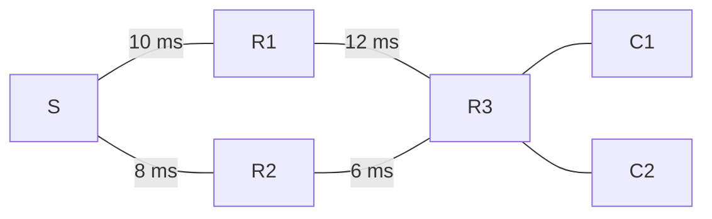
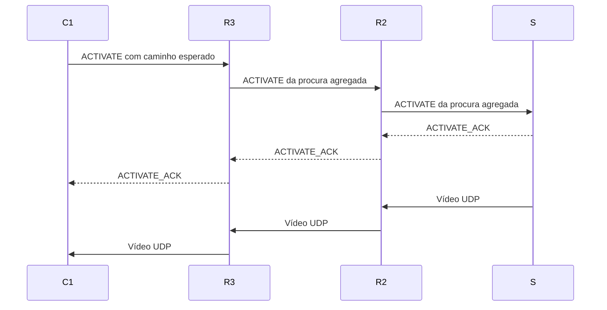

# Preparação para o checkpoint 1 — Serviço OTT

Análise do repositório em **01-11-2026**, revisão observada `6360a64`. Guia para explicar e defender as decisões do projeto, com especial atenção às árvores, monitorização, flooding e gestão dos fluxos.

**Como estudar:** começar pelo discurso da secção 1; compreender o exemplo das secções 5–9; responder às perguntas da secção 15 sem consultar o texto; usar a secção 17 para a revisão final.

**Âmbito da análise:** o repositório contém o enunciado, o plano, decisões e notas para o relatório das fases 1 e 2. Não foi encontrado um relatório final de resultados. Este guia cruza essa documentação com o código existente. Os exemplos numéricos são didáticos e não resultados experimentais.

## 1. Explicação do projeto em cerca de um minuto

> O projeto pretende distribuir vídeo em tempo real através de uma rede overlay, usando multicast ao nível da aplicação. Os servidores, relays e clientes são processos Java que comunicam sobre a rede IP criada no CORE. O bootstrap fornece inicialmente os vizinhos configurados; depois, os nós mantêm as ligações e tomam as decisões de encaminhamento de forma distribuída.
>
> A solução desenhada separa o controlo, sobre TCP, dos dados de vídeo, sobre UDP. Cada servidor anuncia periodicamente as suas streams. Os anúncios transportam o caminho e um custo acumulado baseado em RTT suavizado. Os clientes ativam os caminhos em sentido inverso, formando uma árvore por stream. Quando vários clientes partilham um segmento, o vídeo só atravessa esse segmento uma vez e é replicado nos pontos de ramificação.
>
> A monitorização deverá detetar falhas e alterações de qualidade. Uma falha desencadeia recuperação sem esperar pelos limiares de estabilidade; uma melhoria de custo tem de ser sustentada antes de provocar mudança. Atualmente estão implementados a configuração, o codec de controlo e o transporte TCP. A overlay completa, as árvores, a monitorização e o streaming estão especificados para as fases seguintes.

## 2. Estado real: o que podemos afirmar no checkpoint

Esta distinção deve acompanhar toda a apresentação. Nas secções seguintes, os mecanismos de routing, monitorização, árvores e vídeo descrevem **o desenho adotado**, ainda por implementar neste estado do repositório.

| Área | Estado confirmado | Evidência ou limite |
|---|---|---|
| Java 21, Maven e JUnit | Preparados | [POM](../Projeto/pom.xml) |
| Configuração `.properties` | Implementada | Validação estrita, modelos imutáveis e 65 testes documentados |
| Protocolo de controlo v1 | Codec implementado | 16 tipos ativos; 66 testes documentados de codec/integração |
| Transporte TCP | Implementado | Ligações full-duplex, estabelecimento assíncrono, filas limitadas e encerramento; 18 testes documentados |
| Bootstrap de rede | Por implementar | `BootstrapServer.java` contém apenas um comentário sobre o seu âmbito |
| Handshake e manutenção dos vizinhos | Por implementar | `NeighborManager.java` e `OverlayNode.java` estão vazios |
| Monitorização e métricas | Por implementar | `NetworkMonitor.java` e `LinkMetrics.java` estão vazios |
| Rotas, flooding e árvores | Por implementar | Classes de `routing/` vazias |
| UDP, fontes de vídeo e player | Por implementar | Classes correspondentes vazias |
| CLI de execução | Por implementar | `OttApplication.java` vazio; comandos de arranque dos READMEs são futuros |
| Integração CORE | Ainda sem demonstração funcional documentada | Existem três topologias XML; a inspeção estática não demonstra streaming |

O último build preservado regista **149 testes aprovados: 65 de configuração + 66 de codec + 18 de transporte**, sem falhas, erros ou testes ignorados. São resultados de 27-10-2026, consultados no [log da revisão](../experiments/task-005-review-build.log); não foram novamente executados para escrever este guia. Os testes TCP usam sockets reais em loopback, dentro da mesma JVM de testes.

**Formulação para a defesa:** “Já validámos a base de configuração, representação das mensagens e transporte. Para os mecanismos distribuídos temos contratos, invariantes e testes de aceitação planeados; falta a implementação e a avaliação em rede.”

Fontes: [progresso](15-PROJECT-PROGRESS.md), [notas da fase 1](PHASE-01-REPORT-NOTES.md), [notas da fase 2](PHASE-02-REPORT-NOTES.md) e [validação TCP](../experiments/task-005-transport-validation.md).

## 3. Requisitos e decisões: distinguir o que foi pedido do que escolhemos

O [enunciado](ENUNCIADO.md) exige nós que entrem e saiam durante a execução, vizinhanças de transporte, rotas por fluxo, caminhos alternativos, clientes simultâneos, monitorização, atualização dinâmica e encaminhamento pelas tabelas. Exige também **pelo menos dois servidores, cada um com dois vídeos distintos**. O exemplo simplificado com um servidor/fluxo não elimina esse mínimo.

| Decisão adotada | Justificação para apresentar | Compromisso ou alternativa |
|---|---|---|
| Java 21 e Maven | Aproveitar a base existente, biblioteca padrão e testes automatizados | Verificar Java e suporte gráfico no CORE; outras linguagens eram permitidas |
| TCP para controlo | Entrega ordenada e fiável de anúncios, pedidos e respostas durante a ligação | Retransmissões e filas podem atrasar o controlo; continuam a ser necessários timeouts e correlação aplicacional |
| UDP para vídeo | Permite privilegiar frames recentes e descartar dados atrasados | Perda, duplicação e reordenação têm de ser tratadas; não garante entrega |
| Bootstrap apenas inicial | Fornecer os vizinhos sem centralizar a operação e o encaminhamento | Um processo sem lista inicial depende do bootstrap; grafo permitido configurado previamente |
| Anúncios iniciados pelos servidores | Divulgar catálogo e caminhos antes de os clientes pedirem vídeo | Existe tráfego periódico de controlo mesmo sem audiência; alternativa seria descoberta iniciada pelos clientes |
| Path vector e soma de RTT EWMA | Conhecer o percurso, rejeitar ciclos e considerar condições observadas | Maior mensagem e estado; RTT não representa largura de banda nem qualidade completa do vídeo |
| Árvore por stream, ativada sob pedido | Partilhar os segmentos comuns e evitar vídeo sem procura | Exige gerir ACK, procura agregada, expiração e mudanças de parent |
| ACK e leases de subscrição | Confirmar o ramo e eliminar procura abandonada após crash | Mais estado e mensagens de renovação |
| MJPEG e Swing | Frames independentes e reprodução com a biblioteca Java | Banda superior à de codecs interframe; perda de fragmento pode inutilizar um frame |
| Binário próprio e `.properties` | Contratos explícitos e nenhuma dependência de execução adicional | Encoder/decoder e limites têm de estar rigorosamente especificados e testados |
| Testes incrementais e CORE no fim da integração | Isolar erros cedo e medir o comportamento na rede emulada | Unitários e loopback não substituem a validação em CORE |

Não são imposições do enunciado: Java, RTP, JSON, 25 FPS, três vizinhos por nó ou os valores de timeout. São escolhas possíveis ou exemplos. O plano atual usa um protocolo UDP próprio, configuração `.properties` e grau de vizinhança definido por nó.

Fontes: [decisões ADR-001–012 e hipóteses](12-RISKS-AND-DECISIONS.md), [contrato atual](07-API-AND-INTERFACES.md). A correção do bootstrap, referida nos documentos como **ADR-013**, está explicada na [evidência respetiva](../experiments/bootstrap-discovery-correction.md).

## 4. Arquitetura e construção da overlay

### 4.1. Underlay, overlay e árvore ativa

| Conceito | O que representa | Quem decide |
|---|---|---|
| Underlay | Equipamentos, interfaces, ligações e encaminhamento IP no CORE | Configuração e mecanismos da rede IP |
| Overlay | Vizinhanças lógicas entre processos Java | Grafo permitido e gestão distribuída das ligações |
| Árvore de uma stream | Subconjunto de ligações usado para entregar esse vídeo aos consumidores atuais | Routing e pedidos de ativação |

Uma ligação overlay pode atravessar várias ligações IP. Duas ligações overlay distintas podem partilhar recursos físicos. Logo, reduzir cópias numa ligação lógica não demonstra, por si só, utilização ótima de toda a rede física.

A overlay pode conter ciclos para disponibilizar alternativas. A árvore ativa de cada stream deve ser acíclica. Streams diferentes podem utilizar árvores e parents diferentes sobre a mesma overlay.

### 4.2. Papéis

- **BOOTSTRAP:** consulta da topologia e resposta com localizações; processo separado, mesmo se partilhar máquina com uma origem.
- **SERVER:** nó overlay que origina conteúdos; S1 disponibiliza A/B e S2 disponibiliza C/D.
- **RELAY:** recebe e replica datagramas conforme os ramos ativos.
- **CLIENT:** escolhe uma stream, pede a ativação, reconstitui frames e apresenta vídeo. O plano prevê uma stream de cada vez por processo cliente.

SERVER, RELAY e CLIENT partilham o núcleo previsto de overlay. O bootstrap não é um relay e não transporta o vídeo.

### 4.3. Arranque previsto de um nó

1. Carregar e validar a configuração antes de abrir sockets.
2. Gerar a identidade desta execução, `instanceId`.
3. Consultar o bootstrap por TCP com `REGISTER`.
4. Receber `REGISTER_OK` com os vizinhos configurados, incluindo os que estão offline.
5. Terminar a ligação de descoberta após a resposta completa.
6. Estabelecer os canais diretos e trocar `HELLO` / `HELLO_OK`.
7. Manter vizinhos, medir ligações e processar os restantes eventos localmente.

`REGISTER` é o nome de uma consulta inicial; **não cria um registo de membros vivos**. As instâncias dos vizinhos chegam a zero na resposta e são conhecidas no handshake direto. Não existem heartbeats, renovações, leases de registo nem avisos de saída enviados ao bootstrap.

Entre dois vizinhos, apenas o `nodeId` lexicograficamente menor inicia a ligação; ambos têm listener. Esta regra reduz ligações duplicadas e é complementada pela validação do handshake. O iniciador repete tentativas com backoff de 0,5 a 5 s e jitter até 10%. São valores propostos.

Uma nova `instanceId` distingue um processo reiniciado. A `connectionId` distingue cada ligação, permitindo ignorar eventos atrasados de uma ligação antiga sem apagar o estado da nova.

### 4.4. O que acontece se o bootstrap parar?

Os nós que já obtiveram a lista continuam a comunicar e podem reconectar diretamente aos mesmos vizinhos. Um processo que ainda precise de obter a lista inicial fica dependente da recuperação do bootstrap. Um processo reiniciado pode voltar a consultá-lo.

O grafo permitido é estático; a disponibilidade dos processos e das ligações é dinâmica. Entrar dinamicamente significa arrancar um nó já configurado, sem reiniciar toda a overlay. Introduzir IDs e vizinhanças arbitrárias durante a execução fica fora do fluxo básico.

Fontes: [arquitetura](04-ARCHITECTURE.md), [modelo](06-DATA-MODEL.md) e [TASK-007](tasks/PHASE-02/TASK-007.md).

## 5. Flooding: como os anúncios descobrem os caminhos

### 5.1. O que é inundado?

O flooding distribui **mensagens de controlo `STREAM_ANNOUNCE`**, emitidas periodicamente pelas origens para cada stream. Os dados de vídeo seguem apenas os ramos ativos.

Cada anúncio identifica a stream e a origem e inclui:

- `serverEpoch`: UUID do arranque da origem;
- `announceSeq`: sequência crescente por stream e época;
- `path`: percurso da origem até ao emissor imediato;
- `costMicros`: custo acumulado nesse percurso;
- metadados do conteúdo, como título, codec e FPS.

A origem começa com `path=[S]` e custo zero. Os anúncios continuam a existir mesmo quando ninguém vê o vídeo, permitindo conhecer streams e preparar rotas inativas.

### 5.2. O que faz um nó ao receber um anúncio?

Se N recebe o anúncio de P, o processamento previsto é:

1. Verificar a identidade do vizinho e a coerência da origem e época.
2. Verificar que o caminho começa na origem, termina em P, não contém N nem IDs repetidos e respeita o limite de 32 IDs.
3. Usar uma amostra válida da ligação N–P; sem amostra, o candidato aguarda medição.
4. Calcular `custo(N) = custo anunciado por P + RTT_EWMA(N,P)` e acrescentar N ao caminho.
5. Atualizar o candidato de P para essa stream e a sua validade.
6. Selecionar o melhor candidato: menor custo, depois menos saltos, depois desempate determinístico por ID.
7. Reenviar a primeira chegada válida e melhorias estritas da mesma geração, respeitando os limites de taxa. Não reenviar diretamente ao emissor nem por um caminho que produza ciclo.

Cada nó guarda **um candidato por vizinho e por stream**. O melhor candidato não elimina necessariamente as alternativas válidas.

### 5.3. Porque não basta guardar “já vi este anúncio”?

Considere esta overlay ilustrativa. Os números são custos RTT de ligações em ms, assumidos estáveis e simétricos apenas para facilitar o exemplo:



Para a mesma stream, época e sequência:

| Chegada a R3 | Caminho candidato | Custo até R3 | Decisão |
|---|---|---:|---|
| Primeiro via R1 | S → R1 → R3 | 10 + 12 = 22 ms | Guardar e divulgar |
| Depois via R2 | S → R2 → R3 | 8 + 6 = 14 ms | Guardar a alternativa e divulgar a melhoria |
| Repetição sem melhoria | Mesmo candidato | Sem redução | Suprimir o reenvio redundante |

Uma cache booleana que rejeitasse todas as chegadas posteriores esconderia o caminho de 14 ms. A chave `(streamId, serverEpoch, announceSeq)` identifica a geração, mas o controlo de reenvio também tem de permitir melhorias.

**Atualizar a melhor rota conhecida não significa trocar imediatamente uma árvore já ativa.** Uma mudança de dados por qualidade passa pela histerese e pela confirmação descritas na secção 9.

### 5.4. Como se evita uma tempestade ou um ciclo?

| Mecanismo | Problema que resolve |
|---|---|
| Caminho explícito e rejeição do próprio ID | Impede aceitar um percurso que já passou pelo recetor |
| Rejeição de IDs repetidos | Elimina percursos cíclicos declarados |
| Não devolver ao emissor | Evita o retorno imediato pela mesma ligação |
| Época e sequência | Distinguem arranques e gerações de anúncios |
| Primeira chegada + melhorias estritas | Reduz repetições sem esconder uma melhoria tardia |
| Cache limitada e com expiração | Limita memória e histórico |
| Limite de caminho e taxa | Contém o custo de propagação |

Valores propostos: anúncio a cada 2 s, candidato válido por 8 s, cache de 4096 chaves por 16 s e limite de 10 reenvios/s por stream/vizinho. A mesma geração não é reenviada indefinidamente por qualquer oscilação de custo: a divulgação segue as melhorias permitidas ou uma nova geração.

`STREAM_WITHDRAW` retira o candidato anunciado por aquele vizinho; não elimina automaticamente alternativas obtidas através de outros. Sem candidatos válidos, a stream fica `UNAVAILABLE`.

**Porque não Dijkstra?** O desenho usa aprendizagem distribuída com path vector, sem obrigar cada nó a manter uma base global de estado dos links. Dijkstra seria uma alternativa possível com outro mecanismo de distribuição de topologia. O protocolo próprio ainda precisa de testes de convergência; a escolha não demonstra, por si só, uma garantia formal equivalente à de um protocolo estabelecido.

Fontes: [ADR-004](12-RISKS-AND-DECISIONS.md), [contrato](07-API-AND-INTERFACES.md) e [TASK-012](tasks/PHASE-03/TASK-012.md).

## 6. Árvores: como se ativa e partilha uma stream

### 6.1. Qual é a árvore escolhida?

O projeto desenha uma **árvore de distribuição por stream, enraizada na respetiva origem e ativada pela procura**. Cada nó não fonte tem, em estado estável, um upstream confirmado e zero ou mais downstream ativos. Os caminhos selecionados têm de ser compatíveis entre si para serem ativados.

Não se calcula uma árvore geradora mínima de toda a overlay. A seleção favorece caminhos de menor custo segundo a métrica adotada; o subconjunto necessário para os consumidores forma a árvore ativa. Isto reduz redundância nos segmentos comuns, sem provar o mínimo global de consumo de banda.

| Termo | Significado |
|---|---|
| Upstream / parent | Vizinho a montante, na direção da origem |
| Downstream / child | Vizinho a jusante que pediu a stream |
| Consumidor local | Utilizador local que pretende receber essa stream |
| Rota conhecida | Existe um candidato válido, mesmo sem vídeo a circular |
| Ramo confirmado | A ativação foi aceite e confirmada por ACK |

Na entrada resumida do enunciado, o campo “Origem” corresponde ao upstream imediato. O projeto mantém também o `serverId`, que identifica o servidor original do conteúdo.

### 6.2. Primeiro cliente: ativação em sentido inverso

No exemplo, após a seleção compatível de S → R2 → R3 → C1:



Cada nó regista provisoriamente a procura como `PENDING`. Só confirma o ramo após o ACK a montante. A origem confirma diretamente; um nó com ramo já confirmado pode confirmar um novo filho se o prefixo e a época forem compatíveis.

Cada nó usa a sua própria subscrição a montante para agregar os pedidos dos filhos. O pedido transporta `subscriptionId`, `revision`, época e caminho esperado. Respostas são correlacionadas com o `requestId` do pedido correspondente.

**Porque validar o prefixo?** O cliente pode ter aprendido um caminho antes de o parent mudar de rota. O parent verifica se o prefixo esperado coincide com o seu caminho selecionado. Se não coincidir, responde `PATH_CHANGED`; o pedido tem de ser repetido com informação atualizada. Aceitar cegamente o pedido poderia juntar percursos incompatíveis e criar ciclos na transição.

**Porque esperar pelo ACK?** Conhecer uma rota não prova que a origem, ou um ramo já confirmado, aceitou servi-la. O ACK impede apresentar uma ativação apenas local como caminho funcional completo.

### 6.3. Segundo cliente: partilha do tronco

Quando C2 pede a mesma stream a R3, que já tem um ramo confirmado compatível, R3 acrescenta C2 aos downstream e confirma-o. Não cria uma segunda subscrição a montante para representar o mesmo fluxo.

```text
S ── uma cópia ──> R2 ── uma cópia ──> R3 ── uma cópia ──> C1
                                        └── uma cópia ──> C2
```

Estado conceptual de R3:

```text
streamId = A
serverId = S
upstream confirmado = R2
custo selecionado = 14 ms
downstream = {C1, C2}
estado = ACTIVE
```

O custo acima é até R3, sem incluir os links até aos clientes. A tabela é ilustrativa e não um output já disponível da aplicação.

Para uma stream de débito B, o tronco R2–R3 transporta aproximadamente B de vídeo, acrescido de overhead, mesmo com dois clientes. R3 transmite aproximadamente 2B nas duas saídas. A multiplicação ocorre apenas onde a árvore ramifica. Streams distintas continuam a consumir banda distinta.

### 6.4. Como se evita contar duas vezes o mesmo pedido?

A procura é representada por conjuntos de consumidores e subscrições identificadas, não por um contador incrementado cegamente. Repetir um pedido com a mesma identidade e revisão é idempotente: não cria outro child nem outra saída.

O nó precisa de subscrição a montante enquanto existir pelo menos um consumidor local ou downstream válido. Não precisa de saber quantos clientes finais existem atrás de cada child.

### 6.5. Estados que convém saber explicar

| Estado | Significado |
|---|---|
| `UNAVAILABLE` | Sem caminho válido; pode existir intenção de consumo pendente |
| `INACTIVE` | Caminho conhecido, sem árvore ativa para procura local/a jusante |
| `ACTIVATING` | Ativação em curso, a aguardar confirmação |
| `ACTIVE` | Ramo confirmado e procura efetiva |
| `SWITCHING` | Mudança coordenada de upstream em curso |

O melhor candidato, o upstream confirmado e o upstream pendente são conceitos distintos. Uma melhoria na tabela não autoriza, por si só, receber vídeo do novo vizinho.

Fontes: [modelo e invariantes](06-DATA-MODEL.md), [TASK-014](tasks/PHASE-04/TASK-014.md) e [contrato de ativação](07-API-AND-INTERFACES.md).

## 7. Poda, leases e saída dos clientes

### 7.1. Saída normal

Quando C1 para, envia `DEACTIVATE`. R3 remove apenas essa subscrição. Como C2 continua interessado, mantém o upstream e a entrega a C2.

Quando C2 também sai, se R3 não tiver consumidores locais nem outros filhos, desativa a sua subscrição a montante. A poda propaga-se até encontrar outro nó com procura ou chegar à origem. O servidor deixa de publicar vídeo quando perde a última procura dessa stream; continua a anunciar a sua disponibilidade.

### 7.2. Saída abrupta e ramos fantasma

Um crash pode impedir o envio de `DEACTIVATE` ou `NODE_LEAVE`. A limpeza não pode depender apenas de avisos de saída:

- o fecho da ligação invalida a procura associada;
- as sondas detetam vizinhos sem resposta;
- o lease elimina subscrições que deixaram de ser renovadas.

Valores propostos: lease de 6 s e renovação a cada 2 s, usando `SUBSCRIPTION_RENEW`, confirmada por `ACTIVATE_ACK`. Só uma renovação válida recebida prolonga o lease do filho. O nó renova a montante enquanto tiver procura efetiva.

**Os leases pertencem às subscrições de streams entre vizinhos. Não existem leases de registo no bootstrap.**

### 7.3. Mensagens atrasadas

Um `DEACTIVATE` antigo só remove a subscrição/revisão correspondente; não pode apagar uma nova. Um ACK recebido depois de o pedido expirar ou de o cliente cancelar é ignorado. Após reconexão, as subscrições são renegociadas e os eventos da ligação anterior não alteram a atual.

Fontes: [TASK-015](tasks/PHASE-04/TASK-015.md), [invariantes](06-DATA-MODEL.md) e [interações](07-API-AND-INTERFACES.md).

## 8. Monitorização: medir qualidade e detetar falhas

### 8.1. Medição de RTT

Cada nó deverá enviar `PROBE_PING` aos vizinhos ativos e receber `PROBE_PONG` com o mesmo `probeId`. O emissor guarda o instante de envio e calcula:

```text
RTT_amostra = instante_local_de_receção - instante_local_de_envio
```

Os dois instantes usam o mesmo relógio monotónico, por exemplo `System.nanoTime()`. Não é necessária sincronização entre máquinas. O relógio civil serve para os logs e pode sofrer ajustes.

Está prevista uma sonda pendente por vizinho. Respostas duplicadas, sem correlação ou de instâncias antigas são ignoradas. Uma ligação sem amostras não recebe um custo fictício zero; o candidato espera medição. O custo mínimo é positivo, de 1 µs.

### 8.2. Porque usar EWMA?

A média móvel exponencial reduz o efeito de picos isolados, mantendo capacidade de reagir a alterações:

```text
RTT_EWMA_novo = 0,8 × RTT_EWMA_anterior + 0,2 × RTT_amostra
```

Exemplo: estimativa anterior de 10 ms e amostra de 30 ms produzem `0,8×10 + 0,2×30 = 14 ms`. Uma medição isolada não faz a estimativa saltar diretamente para 30 ms.

O `alpha=0,2` é uma escolha inicial de afinação. A suavização reduz ruído, mas também atrasa a reação. Uma mudança de instância do vizinho reinicia as métricas dessa relação.

### 8.3. Como se calcula o custo do caminho?

```text
custo_origem = 0
custo_local = custo_anunciado_pelo_vizinho + RTT_EWMA_da_ligação
```

O contrato usa microssegundos inteiros e exige prevenção de overflow. Saltos e ID servem para desempatar; a proposta atual não usa a fórmula ponderada saltos×peso + RTT×peso mencionada como possibilidade no plano antigo.

### 8.4. Como se deteta uma falha?

Parâmetros iniciais: sonda a cada 1 s, timeout de 1 s e falha após três timeouts consecutivos. Um EOF/erro de transporte provoca reação imediata ao evento observado. Um único timeout não basta para declarar falha.

Depois de detetar a falha, o nó fecha a conexão afetada e publica o evento que invalida os candidatos e subscrições associados. A gestão de vizinhos tenta reconectar; o routing procura alternativas sem ter de esperar que essa reconexão tenha sucesso.

Três falhas consecutivas **não garantem recuperação exatamente em três segundos**. O tempo observado inclui fase das sondas, agendamento, deteção, seleção, ativação e receção dos primeiros frames.

### 8.5. O que a métrica não mede?

O RTT das sondas TCP inclui rede, filas, retransmissões e processamento aplicacional. Não é uma medição direta de largura de banda disponível, perda UDP ou atraso unidirecional do vídeo. Somar RTTs das ligações também não mede exatamente o atraso de reprodução; caminhos IP e condições podem ser assimétricos.

A escolha fornece um indicador simples de qualidade e congestionamento, mas pode não detetar uma limitação de capacidade com RTT ainda baixo. Para avaliar o serviço também se devem medir débito, filas, frames completos, frames apresentados e interrupções.

Fontes: [TASK-010](tasks/PHASE-03/TASK-010.md), [ADR-004](12-RISKS-AND-DECISIONS.md) e [estratégia experimental](09-TESTING-STRATEGY.md).

## 9. Mudança de rota: falha e melhoria sustentada

### 9.1. Falha do upstream

1. Invalidar os candidatos dependentes do vizinho que falhou.
2. Escolher uma alternativa válida, atual e sem ciclos.
3. Ativar o novo caminho e aguardar o ACK.
4. Publicar o novo estado de encaminhamento confirmado.
5. Se não houver caminho, ficar `UNAVAILABLE` e preservar a intenção do cliente para retomar quando chegar um anúncio válido.

Não se aplica a espera por uma melhoria de 20% ou pela permanência mínima: o caminho anterior deixou de funcionar. Mesmo assim, um candidato guardado não garante recuperação imediata; o prefixo tem de continuar compatível e a ativação pode falhar ou precisar de anúncios atualizados.

### 9.2. Mudança por qualidade

Para evitar oscilar entre caminhos por pequenas variações, o plano exige uma redução relativa de custo de pelo menos 20%, três observações de melhoria e permanência mínima de 5 s:

```text
melhoria_relativa = (custo_atual - custo_alternativo) / custo_atual
```

De 22 ms para 14 ms, a melhoria é cerca de 36,4%; passa o limiar de custo, mas ainda depende das observações e da permanência. De 22 ms para 20 ms, é cerca de 9,1%; não justifica a troca. Estes limiares ainda têm de ser validados experimentalmente.

### 9.3. Troca planeada com confirmação

O desenho segue a ideia de **ativar antes de desligar**: manter o upstream antigo válido, ativar o novo, esperar pelo ACK, trocar o snapshot de encaminhamento atomicamente e só depois podar o anterior. Se a nova ativação falhar e o antigo continuar válido, manter o antigo.

Pode haver tráfego temporário nos dois ramos durante a transição. A receção considera apenas o upstream confirmado no snapshot e usa deduplicação por stream/época/frame/fragmento. A propriedade de uma cópia por ligação é exigida em estado estável; uma transição não deve ser descrita como ausência absoluta de tráfego duplicado.

### 9.4. Falha de relay e falha de origem são diferentes

Uma falha de relay pode ser contornada se existir outro caminho até à mesma origem. Neste plano, cada UUID de stream pertence a uma única origem: se S1 falhar, A/B ficam indisponíveis; S2 continua a servir C/D. Não existe réplica de A/B em S2 nem failover automático de conteúdo.

Fontes: [TASK-016](tasks/PHASE-04/TASK-016.md), [TASK-017](tasks/PHASE-04/TASK-017.md) e [hipótese H-07](12-RISKS-AND-DECISIONS.md).

## 10. Protocolos e mecanismos utilizados

### 10.1. Mensagens de controlo a conhecer

Todos os formatos abaixo já são representáveis pelo codec. Os handlers que executam os efeitos distribuídos ainda faltam.

| Finalidade | Mensagens | Percurso previsto |
|---|---|---|
| Descoberta inicial | `REGISTER`, `REGISTER_OK` | Nó ↔ bootstrap, consulta curta |
| Estabelecer vizinhança | `HELLO`, `HELLO_OK` | Entre vizinhos diretos |
| Saída normal | `NODE_LEAVE` | Apenas aos vizinhos diretos |
| Medir e verificar resposta | `PROBE_PING`, `PROBE_PONG` | Uma ligação de vizinhança |
| Descobrir/retirar caminhos | `STREAM_ANNOUNCE`, `STREAM_WITHDRAW` | Anúncios e atualização distribuída de candidatos |
| Ativar | `ACTIVATE`, `ACTIVATE_ACK` | Pedido a montante e resposta a jusante |
| Podar | `DEACTIVATE` | Remoção de procura a montante |
| Renovar subscrição | `SUBSCRIPTION_RENEW`, `ACTIVATE_ACK` | Entre child e parent |
| Diagnosticar percurso | `ROUTE_TRACE`, `TRACE_RESULT` | Trace a montante e resposta pelo percurso inverso |
| Sinalizar falha de pedido | `ERROR` | Resposta correlacionada |

Existem **16 tipos ativos**, com IDs 1, 2 e 4–17. O código 3 foi retirado e é rejeitado. Referências antigas a 17 tipos são históricas. Um `PROBE_PING` mede um vizinho; o `ROUTE_TRACE` diagnostica um percurso multi-hop, com TTL e lista de visitados. Nenhum equivale a testar reprodução de vídeo.

### 10.2. Porque é necessário framing em TCP?

TCP entrega um fluxo de bytes: uma leitura pode conter parte de uma mensagem ou várias mensagens. Cada mensagem do projeto começa com um comprimento de 4 bytes em big-endian, seguido de um corpo entre 37 e 65536 bytes. O recetor lê o prefixo e o corpo completos e valida os limites antes de alocar.

O envelope identifica versão, tipo, `requestId`, `senderId` e `senderInstance`. Strings usam UTF-8 estrito e comprimentos explícitos. Campos inválidos, bytes adicionais e tipos/versões desconhecidos são rejeitados.

O transporte implementado usa um leitor e um escritor por ligação. Os envios passam por uma fila limitada, evitando intercalar bytes de mensagens produzidas por threads diferentes. Os defaults são 256 frames por saída e até 64 reservas de ligações, incluindo tentativas pendentes. Overflow fecha apenas a ligação saturada; a implementação usa threads virtuais Java 21.

**Ponto importante do código:** `Connection.send(...)=ACCEPTED` significa que a mensagem foi enfileirada. Não significa que foi escrita, entregue ou aceite pela aplicação remota. Fechar logo a seguir pode descartar a fila. A implementação futura do bootstrap terá de assegurar a escrita completa da resposta antes de fechar a consulta.

### 10.3. Para que servem os vários identificadores?

| Identificador | Função |
|---|---|
| `nodeId` | Identidade lógica estável do nó configurado |
| `instanceId` | Distinguir execuções desse nó |
| `connectionId` | Distinguir ligações e callbacks antigos |
| `streamId` | Identificar globalmente um conteúdo/fluxo; o título não é a chave |
| `serverEpoch` | Distinguir arranques da origem e invalidar estado anterior |
| `announceSeq` | Ordenar gerações de anúncios por stream/época |
| `requestId` | Correlacionar um pedido e a respetiva resposta |
| `subscriptionId` + `revision` | Identificar e versionar procura, renovações e cancelamentos |
| `frameSeq` + índice de fragmento | Reconstituir e deduplicar dados dentro de uma stream/época |

S1/A e S1/B partilham a época de arranque de S1, mas mantêm sequências, árvores e buffers independentes. Deduplicar apenas pela época confundiria streams diferentes.

### 10.4. Concorrência e proteção do estado

O desenho prevê um executor serial de eventos por nó para gerir vizinhos, candidatos e subscrições. Os workers de rede publicam eventos; não devem bloquear à espera de ACK. Um bloqueio no leitor que tivesse de receber o próprio ACK impediria o progresso.

O encaminhamento UDP deverá consultar snapshots imutáveis, trocados atomicamente. As filas e caches têm limites para impedir crescimento ilimitado. Saturação de dados deve provocar descarte contabilizado, sem bloquear indefinidamente a sinalização. A composição desse executor e do caminho UDP ainda não está implementada.

Fontes: [contrato completo](07-API-AND-INTERFACES.md), [MessageType](../Projeto/src/main/java/pt/uminho/esr/ott/protocol/MessageType.java), [Connection](../Projeto/src/main/java/pt/uminho/esr/ott/transport/Connection.java) e [Transport](../Projeto/src/main/java/pt/uminho/esr/ott/transport/Transport.java).

## 11. Streaming: percurso dos dados e controlo do atraso

### 11.1. Formato e escolha de MJPEG

O recurso docente inspecionado usa, para cada frame, cinco dígitos ASCII com o tamanho L, seguidos de L bytes JPEG. Exemplo: `06014` seguido de 6014 bytes. O ficheiro não contém o FPS; o ritmo vem da configuração. O exemplo docente observado usa 10 FPS, mas isso não é uma obrigação do projeto.

Frames independentes simplificam a leitura e permitem descartar um frame incompleto sem depender dele para descodificar o seguinte. O compromisso é maior consumo de banda do que em codecs com compressão entre frames.

### 11.2. Fragmentação UDP própria

O contrato define datagramas de até 1200 bytes de aplicação: cabeçalho de 64 bytes e até 1136 bytes de JPEG. O cabeçalho inclui `OTT1`, versão, stream, época/sessão, sequência, tempo de media, tamanho do frame e índice/contagem de fragmentos. **Não é RTP e não usa multicast IP.**

```text
número_de_fragmentos = ceil(tamanho_do_frame / 1136)
```

Um JPEG de 3000 bytes gera três fragmentos: 1136 + 1136 + 728 bytes de payload. Os 1200 bytes não incluem os cabeçalhos IP/UDP; é necessário verificar o MTU real da bancada. O objetivo é evitar fragmentação IP nas condições previstas, sem a assumir impossível em qualquer rede.

### 11.3. O que faz o relay?

Valida o datagrama e o endpoint do upstream confirmado, consulta a árvore ativa e reenvia os mesmos bytes uma vez por downstream confirmado e com lease válido. Não descodifica JPEG nem espera por um frame completo. Isso reduz trabalho e espera nos intermediários.

Um datagrama UDP não cria rotas nem renova subscrições. Dados de uma época antiga ou de um emissor incompatível com o upstream confirmado são descartados.

### 11.4. O que faz o cliente?

Agrupa fragmentos por `(streamId, sessionId, frameSeq)`, verifica consistência e ignora duplicados. O plano limita a montagem a oito frames simultâneos por stream, com deadline de 250 ms desde o primeiro fragmento. Duplicados não prolongam esse prazo.

Quando completa o JPEG, descodifica-o e entrega a imagem pronta ao EDT do Swing. Se faltar um fragmento no prazo, descarta o frame. Não há retransmissão aplicacional: o objetivo é limitar a acumulação de atraso. Isto aceita perdas visuais, pelo que a qualidade tem de ser medida.

A fonte usa pacing com relógio monotónico e não deve tentar recuperar um atraso enviando uma rajada ilimitada. O cliente que entra a meio acompanha a transmissão corrente; não recebe uma reprodução independente desde o início. Parar a última procura suspende a fonte e a retoma preserva sequência/posição, salvo nova época explícita.

O limite geral de frame no protocolo UDP é 2 MiB, mas o perfil de ficheiro com cinco dígitos só representa até 99999 bytes por frame. São limites de camadas diferentes. `mediaTimeUs` representa a timeline da fonte e não permite, sozinho, calcular latência entre relógios de máquinas diferentes.

Fonte: [contrato UDP e perfil MJPEG](07-API-AND-INTERFACES.md).

## 12. Exemplo completo para explicar no quadro

Utilizar a overlay de seis nós da secção 5 e uma stream A originada em S. Este é um exercício do desenho, ainda sem demonstração integrada no código atual.

1. **Arranque:** os nós obtêm vizinhos no bootstrap e fazem handshake direto. Um vizinho pode arrancar depois; o iniciador tenta novamente.
2. **Monitorização:** as sondas fornecem RTTs válidos e estimativas EWMA.
3. **Descoberta:** S anuncia A; R3 aprende S–R1–R3 com 22 ms e depois a melhoria S–R2–R3 com 14 ms. Ambos são candidatos enquanto válidos.
4. **Sem audiência:** existe informação de rota, mas não há vídeo a circular.
5. **C1 entra:** ativa C1–R3–R2–S; os ACK regressam e confirmam o ramo. O vídeo percorre S–R2–R3–C1.
6. **C2 entra:** R3 agrega a nova procura ao ramo confirmado. R2–R3 continua com uma cópia por datagrama.
7. **C1 sai:** apenas o seu ramo é removido; C2 continua a receber.
8. **R2 falha:** os nós afetados invalidam esse vizinho. R3 tenta S–R1–R3, se o candidato e os prefixos continuarem válidos. A falha ignora a histerese; pode haver interrupção até ao novo ACK.
9. **R2 regressa:** reconecta diretamente aos vizinhos conhecidos. Anúncios novos voltam a disponibilizar esse caminho. Se for melhor de forma sustentada e cumprir a permanência, pode ocorrer nova troca confirmada.
10. **C2 sai:** a última procura desaparece e a poda propaga-se até S. O vídeo para; os anúncios e as sondas continuam.

Se S morrer no passo 8, a alternativa por R1 não resolve: os dois percursos terminam na mesma origem que deixou de existir.

## 13. Análise crítica: pontos que o docente pode explorar

| Questão | Resposta fundamentada no projeto |
|---|---|
| A solução otimiza toda a rede? | Reduz duplicação nos segmentos comuns e seleciona caminhos por RTT. Não resolve explicitamente otimização global de capacidade, sobreposição underlay ou balanceamento de carga |
| O menor RTT garante banda para o vídeo? | Não. É necessário confrontar o débito real das streams com a capacidade dos links e medir perdas/filas |
| Ter caminhos alternativos garante tolerância a qualquer falha? | Não. Depende da conectividade restante, da origem e da validade/compatibilidade dos candidatos |
| O perfil local já tem redundância para todos os nós? | Não. No `topology.properties` atual, C1 só conhece R1; a falha de R1 isola-o. O triângulo S1–S2–R1 fornece alternativas no núcleo, mas não elimina esse ponto de corte |
| As tabelas de vizinhos são uma topologia global de routing? | O bootstrap conhece o grafo permitido; cada nó gere os vizinhos e candidatos que aprende. O routing não consulta um controlador para escolher cada percurso |
| Uma configuração válida prova conectividade? | Não. A validação offline não resolve DNS, testa reachability, abre vídeos ou prova que o IP pertence à máquina |
| Três sondas perdidas provam que o processo morreu? | Indicam ausência de resposta segundo a política; podem resultar de partição, atraso ou bloqueio. O mecanismo reage à indisponibilidade observada |
| O path vector basta durante mudanças concorrentes? | O desenho acrescenta validação de prefixo na ativação, ACK, revisões e épocas. A convergência sob mudanças concorrentes ainda precisa de implementação e testes |
| As identidades e a allowlist são autenticação forte? | Não. São validação de consistência no laboratório; não existe autenticação criptográfica/TLS implementada |
| Filas maiores resolvem congestionamento? | Podem apenas acumular atraso e memória. O plano limita filas, descarta dados e contabiliza o problema |

A observação do ponto de corte de C1 resulta da leitura do [perfil local](../Projeto/src/main/resources/config/topology.properties). Este perfil é de desenvolvimento em loopback, não o mapeamento final dos cenários CORE.

### Documentação histórica a não misturar com o desenho atual

O [plano antigo](../Projeto/docs/plano-implementacao.md) contém possibilidades como JSON, “MJPEG/RTP”, métrica ponderada de saltos/RTT e nomes `ROUTE_ACTIVATE`/`ROUTE_DEACTIVATE`. O contrato atual fixa binário próprio, soma de RTT EWMA, mensagens `ACTIVATE`/`DEACTIVATE`, confirmação e leases. O suporte multi-stream é modelado desde a base atual, não acrescentado apenas no final.

Há ainda trechos históricos com 17 tipos de controlo, 131 ou 146 testes e notas que antecedem o transporte. Para descrever a versão analisada, usar **16 tipos ativos e 149 testes documentados**. A conclusão de uma fase de fundações não significa conclusão de todas as etapas do enunciado.

## 14. Como validar e demonstrar as decisões

O marco previsto em [TASK-009](tasks/PHASE-02/TASK-009.md) concentra-se na descoberta, handshake, entrada/saída e reconexão, incluindo bootstrap desligado após a descoberta. Esse roteiro ainda está TODO. O conteúdo real indicado para o teu checkpoint inclui também decisões, árvores, monitorização e floods; por isso, a preparação conceptual deste guia é mais abrangente do que esse marco interno.

### Evidência já disponível

- Configuração: propriedades inválidas/duplicadas, endpoints, simetria do grafo, UUID e paths, com erros agregados e sem estado parcial.
- Codec: fixtures independentes, leituras parciais, concatenação de mensagens, limites, tipos inválidos e rejeição do código 3.
- TCP: comunicação simultânea, envios concorrentes, peer lento, overflow, admissão, cancelamento, erros de callbacks e encerramento durante I/O.

### Experiências planeadas e o que devem provar

| Experiência | Resultado que se deve observar |
|---|---|
| Arranque em ordens diferentes | Vizinhanças permitidas formadas sem duplicados |
| Desligar bootstrap após descoberta | Reconexão direta entre processos que conservam a lista |
| Flood em losango com melhoria tardia | Aceitação do segundo caminho mais barato e estabilização dos reenvios |
| Dois clientes da mesma stream | Uma cópia de cada datagrama no tronco comum |
| Parar um dos clientes | O outro continua sem poda do tronco |
| Matar o último consumidor | Limpeza por evento/lease e fim do vídeo no ramo abandonado |
| Matar um relay com alternativa | Nova ativação confirmada, tempo de interrupção medido e ausência de ciclo persistente |
| Introduzir atraso num caminho | Troca apenas após os critérios de melhoria sustentada |
| Variar custos perto do limiar | Ausência de oscilação contínua de parent |
| Perder/reordenar fragmentos UDP | Reassemblagem limitada, descarte no prazo e memória controlada |
| Duas origens e quatro streams | Estados independentes; falha de S1 não apaga C/D de S2 |

Para provar a cópia única, comparar a chave `(streamId, sessionId, frameSeq, fragmentIndex)` numa janela estável e sem perda configurada. O mesmo pacote observado em várias interfaces underlay não representa necessariamente duas transmissões overlay.

Métricas a recolher: bytes/datagramas por direção e ligação lógica, RTT e idade da amostra, alterações de parent e motivo, tempo até primeiro frame, interrupção após falha, frames completos/apresentados/descartados e profundidade das filas. Logs devem identificar nó, instância, stream, pedido e cronologia. Os resultados precisam de versões, configuração, topologia e dados brutos para serem repetíveis.

Fontes: [estratégia de testes](09-TESTING-STRATEGY.md) e [topologias CORE existentes](../CORE/topologies/). Reutilizam-se os XML existentes; o mapeamento dos processos e os endereços de cada cenário ainda têm de ser verificados em execução.

## 15. Perguntas prováveis e respostas para treinar

**1. Qual é o principal ganho face a uma ligação direta por cliente?**
Partilhar o tráfego da mesma stream nos segmentos comuns. Os relays replicam apenas nas ramificações, reduzindo cópias no tronco e saídas redundantes da origem.

**2. A overlay é uma árvore?**
A overlay é um grafo com alternativas. Cada stream utiliza uma árvore ativa própria, dependente dos consumidores e dos caminhos selecionados.

**3. Quem escolhe os vizinhos e quem escolhe as rotas?**
O operador define o grafo permitido e o bootstrap devolve os vizinhos. Os nós escolhem os caminhos com base em anúncios e métricas locais.

**4. Porque não usar o bootstrap continuamente?**
O âmbito adotado limita-o ao arranque. Depois, vizinhança, falhas e routing são tratados diretamente, permitindo que a rede já descoberta continue sem ele.

**5. Como cumpre a entrada dinâmica com grafo estático?**
Os processos dos IDs configurados podem entrar e sair durante a execução. Alterar arbitrariamente o conjunto de IDs não faz parte do mecanismo básico.

**6. O que significa X vizinhos? Todos têm três?**
X é o grau configurado de cada nó. Uma folha pode ter um vizinho; um relay pode ter vários. O número ativo depende de quantos estão disponíveis.

**7. Quem inicia o flooding?**
Cada origem, periodicamente e por stream. A mensagem anuncia conteúdo, percurso, época, sequência e custo.

**8. Porque não reenviar cada anúncio apenas uma vez?**
Porque a primeira chegada pode ser mais cara. O desenho permite a primeira divulgação e melhorias estritas da mesma geração, com limites de taxa.

**9. Como evitam loops?**
Validando o vetor de caminho nos anúncios e o prefixo esperado nas ativações, além da correlação de épocas/revisões e do controlo de repetições. Não devolver ao emissor só evita o retorno imediato.

**10. O caminho com menos saltos é sempre o escolhido?**
Não. O critério principal é soma de RTT EWMA. Saltos são um desempate.

**11. Como sabem o RTT sem sincronizar relógios?**
Guardam o instante de envio e calculam o tempo até ao PONG no mesmo relógio monotónico do emissor.

**12. Porque usam EWMA e histerese?**
EWMA suaviza as amostras da ligação. Histerese, observações repetidas e permanência limitam mudanças da árvore por diferenças pequenas ou passageiras.

**13. O vídeo começa assim que chega um anúncio?**
Não. O anúncio cria informação de rota. O vídeo depende de procura e ativação confirmada por ACK.

**14. Dois clientes geram dois ACTIVATE até à origem?**
A primeira procura ativa o tronco. Um nó já confirmado pode agregar o segundo cliente ao ramo compatível, sem criar outra subscrição a montante para a mesma stream.

**15. Quando é que a árvore é podada?**
Quando a remoção ou expiração de procura deixa um nó sem consumidores locais nem downstream válidos. A desativação propaga-se até encontrar procura restante.

**16. O que acontece se o cliente morrer sem avisar?**
O fecho da ligação, a deteção de falha e a expiração do lease permitem eliminar a procura abandonada.

**17. Qual é a diferença entre timeout de sonda, validade do anúncio e lease?**
A sonda verifica resposta do vizinho; a validade limita a idade de um candidato; o lease limita a duração da procura de um filho sem renovação. São estados e mensagens diferentes.

**18. Podem mudar para qualquer vizinho alternativo?**
Só se tiver um candidato atual, sem ciclos, com origem/época corretas e caminho que consiga ser confirmado. Um vizinho vivo pode ter um caminho inválido ou dependente do próprio nó.

**19. Se aparecer uma rota melhor, desligam logo a antiga?**
Numa troca planeada, mantêm a antiga enquanto ativam a nova. Só após o ACK trocam o snapshot e podam o ramo anterior.

**20. Porque separar TCP e UDP?**
O controlo beneficia de ordem e fiabilidade. Para vídeo em tempo real, a aplicação aceita descartar frames incompletos em vez de os reter à espera de retransmissão.

**21. Porque não usar RTP?**
O enunciado não o impõe. A decisão atual usa cabeçalho próprio para identificar streams, épocas e fragmentos. Isso exige especificação e testes próprios, sem prometer compatibilidade RTP.

**22. O relay descodifica o vídeo?**
Não. Encaminha datagramas conforme a árvore, evitando reassemblagem e descodificação nos intermediários.

**23. Como evitam que um stop antigo desligue uma nova sessão?**
Validam a identidade/ligação, a época, a `subscriptionId` e a `revision`. Mensagens antigas não podem alterar uma subscrição nova.

**24. Se S1 morrer, S2 continua o mesmo vídeo?**
Não. Os conteúdos pertencem a origens distintas. A/B ficam indisponíveis e C/D devem continuar; não foi desenhada replicação de conteúdo entre fontes.

**25. O que está efetivamente demonstrado hoje?**
Configuração, codec e transporte TCP com evidência de 149 testes locais. Ainda faltam overlay entre processos, monitorização, árvores, UDP, reprodução e avaliação CORE.

## 16. Números úteis e o motivo de existirem

Mais importante do que decorar os valores é explicar o problema que cada parâmetro resolve. Os valores de runtime ainda não implementado são propostas de afinação; os limites já aplicados no codec/transporte podem ser verificados no código.

| Parâmetro | Valor atual/proposto | Ideia a explicar |
|---|---:|---|
| Sonda / timeout / falhas | 1 s / 1 s / 3 | Detetar indisponibilidade sem reagir a uma única ausência |
| Alpha EWMA | 0,2 | Equilíbrio entre suavização e reação |
| Anúncio / validade | 2 s / 8 s | Atualização periódica e eliminação de informação envelhecida |
| Lease / renovação | 6 s / 2 s | Limpar procura abandonada com margem entre renovações |
| Timeout de ativação | 3 s | Não manter pedidos provisórios indefinidamente |
| Melhoria / observações / permanência | 20% / 3 / 5 s | Evitar oscilações por qualidade; não adiar reação a falhas |
| Caminho máximo | 32 IDs | Limitar mensagens e processamento |
| Corpo TCP | 37–65536 bytes | Framing verificável e alocações limitadas |
| Reservas TCP / fila por saída | 64 / 256 frames | Admissão e memória de saída limitadas |
| Datagrama / cabeçalho / payload | 1200 / 64 / 1136 bytes | Fragmentação aplicacional com tamanho controlado |
| Montagens por stream / prazo | 8 / 250 ms | Limitar memória e atraso de reassemblagem |

Fonte: [parâmetros e limites](07-API-AND-INTERFACES.md).

## 17. Revisão final antes do checkpoint

- [ ] Consigo explicar underlay, overlay e árvore de uma stream usando o mesmo desenho.
- [ ] Sei justificar TCP/UDP, path vector/RTT e anúncios iniciados pela origem.
- [ ] Consigo percorrer um flood e explicar a melhoria que chega depois do primeiro anúncio.
- [ ] Sei distinguir candidato, upstream pendente e upstream confirmado.
- [ ] Consigo mostrar ACTIVATE/ACK, entrada do segundo cliente e partilha do tronco.
- [ ] Sei explicar a poda normal e a limpeza após crash por leases/eventos.
- [ ] Consigo calcular uma atualização EWMA e uma melhoria percentual.
- [ ] Sei separar falha de ligação, mudança por qualidade e falha da origem.
- [ ] Sei explicar sequência, época, instância, pedido e revisão sem os confundir.
- [ ] Consigo descrever a fragmentação, o comportamento do relay e o descarte no cliente.
- [ ] Sei dizer o que os 149 testes demonstram e o que ainda falta validar.
- [ ] Não apresento o bootstrap como monitor ou controlador permanente de rotas.
- [ ] Distingo valores propostos de requisitos do enunciado e de resultados medidos.

Se houver apenas cinco minutos para rever: reler a secção 1, o exemplo completo da secção 12 e as perguntas 8, 9, 14, 17, 19 e 25.

## 18. Mapa de fontes para aprofundar

| Tema | Documento/código principal |
|---|---|
| Obrigações e avaliação | [Enunciado original](../ESR-TP2-26-27.pdf) e [transcrição](ENUNCIADO.md) |
| Justificações e alternativas | [Riscos, hipóteses e decisões](12-RISKS-AND-DECISIONS.md) |
| Componentes e interações | [Arquitetura](04-ARCHITECTURE.md) |
| Estados, identidades e invariantes | [Modelo de dados](06-DATA-MODEL.md) |
| Mensagens, formatos e parâmetros | [Interfaces e contratos](07-API-AND-INTERFACES.md) |
| Plano de validação | [Estratégia de testes](09-TESTING-STRATEGY.md) |
| Situação das tarefas | [Progresso](15-PROJECT-PROGRESS.md) |
| Material existente para o relatório | [Fase 1](PHASE-01-REPORT-NOTES.md) e [fase 2](PHASE-02-REPORT-NOTES.md) |
| Correção do bootstrap | [Evidência e contrato corrigido](../experiments/bootstrap-discovery-correction.md) |
| Resultados efetivamente registados | [Validação TCP](../experiments/task-005-transport-validation.md) e [log dos 149 testes](../experiments/task-005-review-build.log) |
| Configuração implementada | [ConfigurationLoader.java](../Projeto/src/main/java/pt/uminho/esr/ott/config/ConfigurationLoader.java) |
| Codec implementado | [MessageCodec.java](../Projeto/src/main/java/pt/uminho/esr/ott/protocol/MessageCodec.java) |
| Transporte implementado | [Transport.java](../Projeto/src/main/java/pt/uminho/esr/ott/transport/Transport.java) e [Connection.java](../Projeto/src/main/java/pt/uminho/esr/ott/transport/Connection.java) |

Este guia prepara a explicação do estado analisado. A implementação e os resultados obtidos depois desta revisão devem ser atualizados antes de usar as afirmações de estado numa defesa posterior.
