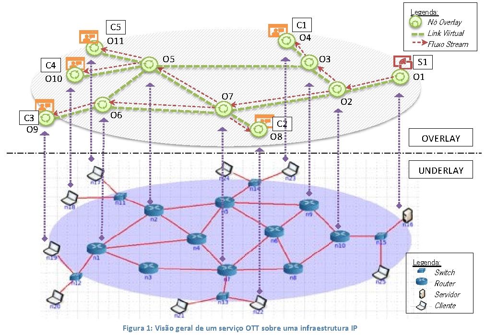
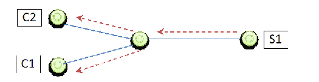
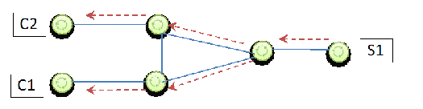

# Trabalho Prático Nº.2 – Serviço Over the Top para entrega de multimédia

Universidade do Minho — MEI, Engenharia de Serviços em Rede 2026/2027

**Duração:** 8 aulas (9 semanas)

> Transcrição do [enunciado original](../ESR-TP2-26-27.pdf), com formatação adaptada a Markdown. As figuras foram extraídas do PDF; foram omitidos os cabeçalhos e rodapés repetidos. Aviso do original: «GCOM.DI.UMINHO.PT — proibido o uso não autorizado».

## Motivação

Ao longo do último meio século de vida da Internet (a rede das redes), observou-se uma mudança irreversível de paradigma. A comunicação extremo-a-extremo, de sistema final para sistema final, dá lugar ao consumo voraz de conteúdos de qualquer tipo, a todo o instante, em contínuo e muitas vezes em tempo real. Este novo padrão de uso coloca grandes desafios à infraestrutura IP de base que a suporta. Apesar de não ter sido originalmente desenhada com esse requisito, tem sido possível resolver a entrega massiva de conteúdos com redes sofisticadas de entrega de conteúdos (CDNs) e com serviços específicos, desenhados sobre a camada aplicacional, e por isso ditos Over the Top (OTT). Um serviço de multimédia OTT, pode por exemplo usar uma rede overlay aplicacional (ex: multicast aplicacional), devidamente configurada e gerida para contornar os problemas de congestão e limitação de recursos da rede de suporte, entregando em tempo real e sem perda de qualidade os media diretamente ao cliente final. Serviços bem conhecidos como o Netflix ou o Hulu, fazem streaming sobre a rede IP pública. Daí a designação de “Over-the-top streaming services”. Para tal formam uma rede overlay própria, assente em cima dos protocolos de transporte (TCP ou UDP) e/ou aplicacionais (HTTP) da Internet. Neste trabalho pretende-se conceber e prototipar um desses serviços, que promova a eficiência e a otimização de recursos para melhor qualidade de experiência do utilizador.

## Objetivos

Usando primariamente o emulador CORE como bancada de teste, e uma ou mais topologias de teste, pretende-se conceber um protótipo de entrega de áudio/vídeo/texto com requisitos de tempo real, a partir de um servidor de conteúdos para um conjunto de N clientes. Para tal, um conjunto de nós pode ser usado no reenvio dos dados, como intermediários, formando entre si uma rede de overlay aplicacional, cuja criação e manutenção deve estar otimizada para a missão de entregar os conteúdos de forma mais eficiente, com o menor atraso e a largura de banda necessária. A forma como o overlay aplicacional se constitui e se organiza é determinante para a qualidade de serviço que é capaz de suportar. A figura 1 ilustra esta visão geral.

*Figura 1: Visão geral de um serviço OTT sobre uma infraestrutura IP.*

## Descrição detalhada

Na figura 1 estão 5 clientes (C1, C2, C3, C4 e C5) a tentar consumir uma stream multimédia a ser enviada pelo servidor S1. Não havendo overlay aplicacional, cada um dos 5 clientes tem de abrir uma conexão para o servidor, e o servidor tem de gerar 5 fluxos de dados idênticos, um por cada cliente. Esta solução naïve tem problemas óbvios de escalabilidade, pois a partir de um determinado número de clientes N, o servidor e/ou a rede deixam de conseguir suportar os N fluxos sem perda de qualidade. Uma abordagem mais eficiente pode ser conseguida adicionando nós de uma rede overlay (O1, O2, ... O11) construída sobre a rede underlay de suporte. Os nós da rede overlay estão instanciados diretamente em nós da rede underlay, pois são na verdade aplicações em execução em determinados sistemas físicos previamente selecionados. Para facilitar o cenário, vamos considerar que só há um servidor de streaming e que esse servidor é também um nó da rede overlay. Ou seja, o servidor S1 da Figura 1, é também o nó O1 da rede overlay, em execução no sistema servidor n16 da rede de suporte. Por seu lado os clientes de streaming (C1, C2, C3, C4 e C5), responsáveis por receber e reproduzir os conteúdos, são também nós overlay (respetivamente O4, O8, O9, O10 e O11), instanciados em equipamentos da rede underlay (n23, n22, n19, n18 e n17).

De salientar que a rede overlay tem muito menos nós e ligações que a rede de suporte, pois não é imaginável nem desejável que o mapeamento possa ser de um para um. Logo, as ligações na rede overlay são na realidade conexões de transporte (TCP ou UDP), que atravessam uma ou mais ligações na rede de suporte. Por exemplo, a ligação virtual entre O3 e O5, vai provavelmente ser suportada pelos links n9 ↔ n5 ↔ n2 da rede de suporte, se essa for a melhor rota IP de n9 para n2. A localização dos nós da rede overlay pode ser calculada ou escolhida manualmente. Na figura os nós da rede overlay estão instanciados em todo o tipo de equipamentos, incluindo switches e routers, o que sendo possível no emulador CORE não é realista. Numa rede real, os switches e routers são equipamentos dedicados, que não executam aplicações genéricas. No CORE é possível porque todos os sistemas são containers Linux. Será, no entanto, aconselhável colocar apenas sistemas terminais a executar a aplicação dos nós overlay.

Quando um nó da rede overlay começa a sua execução, precisa de conhecer pelo menos um outro nó qualquer da rede a quem se ligar. Ou, em alternativa, usar um nó bem conhecido e predeterminado (bootstrapper), cuja função é ajudar a construir a rede. Esse primeiro contacto serve simultaneamente para se dar a conhecer e para obter uma lista de outros nós com quem se ligar. Pode-se usar por exemplo o servidor de streaming como bootstrapper permanente, que vai conhecer todos os nós da rede overlay. Uma estratégia simples para se manter o overlay a funcionar é procurar garantir que cada nó tem pelo menos N vizinhos (ex: N=3). Estas ligações virtuais com os vizinhos devem ser mantidas ativas, e eventualmente monitorizadas, durante todo o tempo de execução.

Uma vez construído o overlay, torna-se necessário identificar os melhores caminhos para o fluxo de dados, desde o servidor aos clientes. Para isso os nós precisam de criar uma rota para o fluxo, ou uma tabela de rotas. Essa tabela pode ser preenchida por iniciativa do servidor de streaming, que envia uma mensagem a inundar a rede em todas as ligações para se dar a conhecer, ou por iniciativa dos clientes, que inundam a rede a pedir pelo conteúdo. Ou outra estratégia dinâmica que preencha as tabelas com caminhos e custos desses caminhos. Como métrica pode-se usar o nº de saltos, ou outras medidas de qualidade das ligações (atraso, largura de banda). Na figura vemos facilmente que o melhor caminho de S1 para o C1 é O4-O3-O2-O1. Por sua vez o melhor caminho de S1 para C2 é O8-O7-O2-O1. Mas não queremos que os dados passem duas vezes na ligação 02-01 que é comum a estes clientes, gerando tráfego redundante e ineficiência. Para tal a tabela com a rota em O2 deve dizer o seguinte: os pacotes do fluxo F, chegam vindos de O1, pela conexão de entrada O1-O2, com uma métrica de 1 salto, e devem ser replicados para O7 e O3, nas conexões de saída O2-O7 e O2-O3. Ou, de forma resumida: { Fluxo: F, Origem: O1, Métrica: 1, Destinos: O7, O3, Estado: ativa }.

A lista mínima de requisitos a considerar é a seguinte:

- Um nó da rede overlay é um programa (aplicação) que se executa manualmente numa máquina da rede IP de suporte;

- Os nós da rede overlay podem ser criados e destruídos dinamicamente (início e fim de execução do software);

- Quando se junta à rede overlay, um nó deve estabelecer e manter conexões de transporte (TCP ou UDP) com X nós da rede, que serão seus vizinhos;

- Ao iniciar a execução, o nó da rede tem de conhecer pelo menos um outro nó da rede, que pode ser o servidor de conteúdos, que o ajuda a obter a sua lista de X vizinhos;

- Os nós da rede overlay precisam de construir e manter uma tabela de rotas (uma por fluxo); como só há um fluxo, apenas uma rota (Fluxo, Custo, Origem, Destinos, Estado);

- A topologia deve suportar rotas alternativas, bem como cenários com múltiplos clientes em simultâneo;

- A rede deve ser monitorizada e as rotas devem ser mantidas e atualizadas dinamicamente, em função da entrada e saída de nós, bem como de alterações nas condições da rede;

- Os nós da rede overlay reenviam todos os dados de acordo com essa tabela;

- A presença de, pelo menos, dois servidores, cada um a disponibilizar, no mínimo, dois fluxos de vídeo (streams) distintos.

- Utilização de métricas da rede para a construção das rotas

## Etapas sugeridas

Nota: as etapas não precisam ser seguidas obrigatoriamente de forma sequencial!

### Etapa 0: Preparação das atividades

- Escolher a linguagem de programação mais conveniente para todos os elementos do grupo;

- Preparar uma topologia para testes e criar cenários de teste nessa topologia (ver cenários sugeridos);

- Definir qual o protocolo de transporte que vai ser usado no overlay: TCP ou UDP (também seria possível equacionar o uso de um protocolo de aplicação como o HTTP, mas talvez seja mais complexo);

- Implementar um cliente/servidor simples, baseado em exemplos, para o protocolo de suporte escolhido (TCP ou UDP), eventualmente que seja simultaneamente cliente e servidor;

### Etapa 1: Construção da topologia overlay

- Construir uma aplicação (ex: ott) que é simultaneamente cliente e servidor, que atende numa porta predefinida, e que é capaz de receber e enviar mensagens em modo full-duplex; testar com envio e receção de mensagem simples de “HELLO”;

- Definir uma estratégia de construção do overlay (ver as alternativas seguintes, ou outras, a discutir com o docente)

- Estratégia 1: Abordagem manual. Ao executar o programa indicam-se os X vizinhos em configuração ou na linha de comando. Exemplo: `$ ott <vizinho1> <vizinho2> <vizinho3>`. O abandono é detetado quando a conexão de transporte deixa de existir. A tabela de vizinhos e respetivas conexões não se altera durante a execução. Não há necessidade de nenhum nó de controlo.

- Estratégia 2: Abordagem baseada num controlador. Ao executar o programa, indica-se apenas um nó como contacto para arranque da rede. Exemplo: `$ ott <bootstrapper>`. O novo nó envia mensagem de registo, a identificar-se, e recebe como resposta uma lista de X vizinhos. Cabe ao servidor definir quais são esses vizinhos com base no conhecimento que tem de todo o overlay; que para facilitar esta tarefa, sugere-se que o servidor obtenha essa informação de quem se deve ligar a quem a partir de ficheiro de configuração, construído manualmente. Definir estratégia para abandono, se o nó avisa, se deve registar-se periodicamente, etc..

- Outras estratégias... (sugerir ou procurar alternativas, discutindo-as com o docente)

- Manter as ligações com os vizinhos ativas e, opcionalmente, monitorar o seu estado;

### Etapa 2: Construção das rotas para os fluxos

- Definir uma métrica para escolha da melhor rota (nº saltos, ou outra, como tempo de atraso, etc)

- Estratégia 1: Por iniciativa do servidor de streaming, com anúncios periódicos.

  - Servidor envia mensagem de controlo com anúncio periodicamente; mensagem inclui identificação do servidor, identificação do fluxo, valor da métrica, etc;

  - Ao receber a mensagem cada nó atualiza uma tabela de rotas, com informação de Servidor/Fluxo, Origem, Métrica, Destinos, Estado da Rota; até serem necessárias as rotas ficam num estado inativo.

  - Cada nó que receba a mensagem deve reenviá-la a todos os vizinhos, com o cuidado de evitar repetições em ciclo e de enviar a quem lhe enviou a ele (inundação controlada, por exemplo enviando só uma vez cada mensagem, evitando enviar para trás pela conexão de onde recebeu)

  - Antes de reenviar a mensagem, a métrica deve ser atualizada (por exemplo, somar mais um salto)

  - As entradas estão inicialmente inativas, sendo ativadas pelo cliente quando liga, enviado uma mensagem de ativação da rota, pelo percurso inverso;

  - Cada mensagem com pedido de ativação do cliente deve ser reencaminhada em cada nó seguido o campo “Origem” da rota;

  - O cliente só envia um pedido de ativação, quando deseja receber os dados; não havendo clientes, as rotas existem nas tabelas, mas estão inativas, não havendo tráfego;

- Estratégia 2: Por iniciativa do Cliente de streaming, enviando um pedido diretamente ao servidor

  - A iniciativa pode ser do cliente que pretende receber a stream, enviando um pedido explícito de rota para essa stream;

  - Esta estratégia pressupõe que o servidor tem informação de registo e conhece o overlay, podendo por isso escolher o percurso e ensiná-lo ao cliente, que usa a informação obtida para efetivar o percurso;

  - Se o servidor não conhece a topologia, o pedido do cliente tem de ser enviado para todos (inundação controlada) até chegar a um nó que já tem informação da stream;

- Outras estratégias... (sugerir ou procurar alternativas, discutindo-as com o docente)

### Etapa 3: Teste dos percursos no overlay

- Definir uma mensagem para teste dos melhores caminhos (ex: “PING”), que é gerada pelo servidor de streaming e é encaminhada pelos nós do overlay, usando as rotas;

- Ao ser reenviada, gera um registo de “log” (informação de debug) em cada nó e/ou acumula o caminho por onde passa até ao(s) destino(s);

### Etapa 4: Streaming

- Implementar uma aplicação que suporte a transmissão de vídeo entre o servidor e cliente.

- Estratégia 1: Utilizar como base no código do livro de apoio [1];

  - Usar o código do livro de apoio (disponível em Python e em Java) como ponto de partida;

  - Adaptar o código se a linguagem de programação escolhida não for nem Python ou Java;

  - Com base no exemplo, previamente ajustado e comentado pela equipa docente [2], fazer um servidor capaz de ler o vídeo de um ficheiro e o enviar em pacotes, numerados, para a rede overlay;

  - Com base no exemplo, previamente ajustado pela equipa docente, fazer um cliente capaz de receber pacotes da rede overlay, com um número de sequência, e reproduzir o vídeo numa janela;

  - Usar como vídeo de teste o exemplo do livro movie.Mjpeg [2] (trata-se de um vídeo básico, de fluxo constante, que é uma sequência simples de imagens independentes, a enviar a intervalo de tempo fixo);

- Estratégia 2: Sugerir ou procurar alternativas para implementação, discutindo-as com o docente

## Avaliação

Consideram-se os seguintes itens na avaliação com respetivos pesos relativos:

1. Topologia da Rede de Overlay (10%)

2. Gestão dos fluxos de dados (25%)

3. Protocolo aplicacional de controlo (15%)

4. Protocolo streaming (10%)

5. Solução final integrada (30%)

6. Avaliação Intermédia (5% + 5%)

Para cada um dos itens, consideram-se os seguintes subitens:

- **a.** Especificação conceptual

- **b.** Qualidade da implementação

- **c.** Qualidade dos testes e da própria apreciação crítica da solução apresentada

Adicionalmente, para solução final (item 5) consideram-se também os subitens:

- **d.** Qualidade da defesa/apresentação

- **e.** Qualidade do relatório

## Cenários de teste

- Cenário 1: overlay com 4 nós (um servidor, dois clientes e um nó intermédio)

- Cenário 2: overlay com 6 nós (um servidor, dois clientes, 3 nós intermédios)

- Cenário 3: overlay complexo

- Usar a figura 1 como ponto de partida.

## Referências

1. Kurose, J. (2025). Computer Networking: A Top-Down Approach (9th edition.). Pearson. Retrieved from https://gaia.cs.umass.edu/kurose_ross/programming.php

2. Exemplos do Livro anterior (adaptados): https://www.di.uminho.pt/~flavio/ESR/ProgEx.zip (wget https://www.di.uminho.pt/~flavio/ESR/ProgEx.zip)

## Relatório

O relatório deve ser escrito em formato de artigo com um máximo de 12 páginas (recomenda-se o uso do formato LNCS - Lecture Notes in Computer Science, instruções para autores em http://www.springer.com/computer/lncs?SGWID=0-164-6-793341-0). Deve descrever o essencial do desenho e implementação com a seguinte estrutura recomendada:

- Introdução

- Arquitetura da solução

- Especificação do(s) protocolo(s)

- formato das mensagens protocolares

- interações

- Implementação

- detalhes, parâmetros, bibliotecas de funções, etc.

- Testes e resultados

- Conclusões e trabalho futuro

## Submissão

Cada grupo deve fazer a submissão (upload) do trabalho, usando a opção de “troca de ficheiros” associada ao seu grupo nos “Grupos” do Blackboard (elearning.uminho.pt), da seguinte forma:

- ESR-TP2-PLx-Gy-Rel.pdf para o relatório

- ESR-TP2-PLx-Gy-Codigo.zip ou ESR-TP2-PLx-Gy-Codigo.rar para a pasta com o código

em que x é o identificador do turno PL e y o número do grupo (e.g. ESR-TP2-PL3-G3-Rel.pdf para o relatório TP2 do grupo 3 do PL3)
