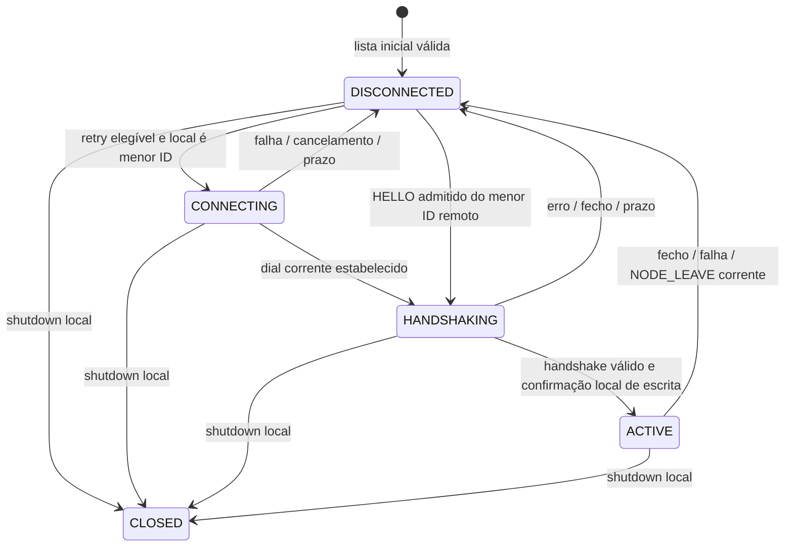

# IMP-004 — Model: vizinhança confirmada e reconexão direta

Modelo para revisão da etapa 1, preparado em 2026-11-10T14:11:43Z, após seleção explícita
de `003-overlay`, apenas Model. Iniciado em 2026-11-10T14:01:42Z; estado no bolt/construction-log.
Model revisto e Q-C-05 aprovados explicitamente, com registo em 2026-11-10T14:48:50Z.
Não é implementação ou resultado de V-007; foi autorizado apenas Design.
Fonte normativa: [ADD, IMP-004](../../../add.md#imp-004), secções 2/5/6/8/9/10/11/12;
[specs](../../../specs.md), [TASK-007](../../../docs/tasks/PHASE-02/TASK-007.md),
[contrato v1](../../../docs/07-API-AND-INTERFACES.md) e
[DoD](../../../docs/14-DEFINITION-OF-DONE.md).

## 1. Base, dependências e fronteira

Base de trabalho Denji `26aaa4ae6775e9c78e1d7658472ccaca0b376427`, igual a main
e às referências locais de origin no arranque, árvore inicialmente limpa.
001-base-validada/IMP-001 e 002-overlay/IMP-003 estão complete e integrados;
019-overlay/IMP-002 também está concluído, disponibilizando RuntimeConfiguration.
O último clean verify aprovado é o do IMP-003: 856 testes em 2026-11-04;
esse resultado é histórico neste Model, sem nova execução Java.

Inspeção real: os três ficheiros autorizados existem com **zero bytes**:

| Caminho relativo a Projeto/src | Trabalho futuro deste IMP |
|---|---|
| main/java/pt/uminho/esr/ott/overlay/Neighbor.java | Valores/estados/sessão confirmada e snapshots imutáveis |
| main/java/pt/uminho/esr/ott/overlay/NeighborManager.java | Descoberta cliente, admissão, handshake, unicidade, retry e eventos |
| test/java/pt/uminho/esr/ott/overlay/NeighborManagerTest.java | Dobras controladas, casos de estado e TCP real de V-007 |

Transport/Connection, BootstrapServer, NodeConfiguration/RuntimeConfiguration,
NodeRole e ControlMessage/MessageCodec já têm APIs implementadas. O próprio
manager consegue encapsular os adaptadores/seams como tipos internos, sem exigir
ficheiros novos ou alteração dessas fundações. Assinaturas exatas ficam para Design.

Dentro: obter a lista inicial, fechar a consulta, manter vizinhos permitidos,
confirmar um canal por par, publicar eventos imutáveis e reconectar diretamente.
O passo de consulta inicial consta expressamente da TASK-007; não se reimplementa
BootstrapServer nem se antecipa a composição de OttApplication/OverlayNode.

Fora: CLI/processos finais (IMP-005), sondas/RTT (IMP-007), rotas/subscrições/vídeo,
socket UDP, criação de novas arestas/IDs, recarga de grafo, membership central,
autenticação criptográfica e extras de recuperação fora do grafo.

## 2. Entidades e identidades

| Conceito | Identidade e dados | Invariante/proprietário |
|---|---|---|
| Execução local | nodeId estável; instanceId UUID não zero, fornecido pela composição | Uma instância constante por arranque, não gerada pelo loader ou por reconexão |
| Lista desejada | nodeId → endpoint/papel configurados, instância zero | Cópia imutável da primeira resposta inicial válida; inclui offline; não é tabela de disponibilidade |
| Neighbor | nodeId desejado, estado, tentativa corrente, vínculo confirmado opcional | No máximo uma sessão confirmada por ID; objeto/snapshot externo imutável |
| Vínculo confirmado | nodeId + peerInstanceId + connectionId; endpoint TCP/UDP permitido | Peer instance não zero; válido só enquanto esse canal estiver ACTIVE |
| Tentativa | token local de geração, alvo, fase, requestId e prazo | Não reutiliza identidade de tentativa; sucesso tardio não pode instalar canal abandonado |
| Canal provisório | connectionId, handle, instante Open e papel ainda por correlacionar | Não é Neighbor confirmado; quantidade limitada pelas reservas TCP |
| Retry | ID do vizinho, geração, backoff e ticket cancelável | Uma tentativa ou retry elegível por vizinho; só o iniciador permitido faz dial |
| Evento público | sessão completa, motivo/tipo e mensagem quando aplicável | Snapshot/valor imutável; consumidor não recebe autorização de UDP antes de ACTIVE |

Não usar IP remoto, porta TCP efémera, título de stream ou UUID ordenado como
identidade do nó. O IP pode ser partilhado e as interfaces podem diferir.
UUID de instância distingue execuções, sem relação temporal entre UUIDs.
[PRESSUPOSTO] A ordem de nodeId é lexical, sensível a maiúsculas, sobre os IDs
ASCII já aceites (`[A-Za-z0-9_-]{1,32}`); não é ordem numérica de sufixos nem locale.
Design deve tornar essa comparação única e testável em ambos os extremos.

## 3. Dono do estado e entradas/saídas

O estado mutável pertence ao **executor serial do nó** (ADR-017). Chamadas de
controlo, callbacks de Transport, futuras conclusões de dial/flush/resolução e
timers tornam-se eventos para esse mesmo dono. Nenhuma dessas threads altera
Neighbor, lista desejada ou retry diretamente. Fila limitada por eventsCapacity;
callbacks apenas oferecem eventos, sem esperar por ACK, DNS ou espaço na fila.

Um núcleo de transições sem I/O permite injetar relógio monotónico, agenda,
canais/dials/resolução e coletor de eventos. O adaptador real usa as APIs públicas
atuais. A composição futura fornece/reutiliza esse executor; não haverá dois
executores independentes a possuir o estado do mesmo nó.

Entradas conceptuais: Start/Stop; BootstrapConnected/Reply/Closed/Timeout;
Resolved/ResolveFailed; DialSucceeded/DialFailed/Cancelled; Open/Message/Closed;
WriteCompleted/WriteFailed; HelloDeadline/RetryDue. Todos os eventos assíncronos
transportam geração e, depois de conhecida, connectionId; eventos da sessão
confirmada incluem também instanceId. Mensagem fora do vínculo corrente não
pode alterar nem ser entregue como mensagem do vizinho novo.

Saídas: iniciar/cancelar dial ou timer, enviar mensagem, solicitar close,
publicar NeighborUp/NeighborDown/ConfirmedMessage e snapshot. Nomes conceptuais,
sem impor API Java antes de Design. Consumidores observam remoção da sessão
antiga antes da entrada da nova e não bloqueiam o executor; subscrições antigas
terão de ser renegociadas nos incrementos de routing, não restauradas aqui.

## 4. Descoberta inicial e lista permitida

Fases locais: NOT_STARTED → DISCOVERING → READY; erro fatal → FAILED;
Stop em qualquer fase → CLOSED. Falha transitória antes do sucesso permite
nova tentativa serializada, com prazo e backoff; erro permanente de identidade/
configuração não provoca um ciclo imediato de consultas inválidas. O mapeamento
dos ERROR remotos para retry/FAILED foi aprovado em Q-C-05: codes 10/11
permitem retry com backoff; restantes codes levam a FAILED.

Antes de criar executor/timer/socket, validar perfil SERVER/RELAY/CLIENT,
identidade local não zero, contacto bootstrap, endpoint/papel e runtime. A carga
de configuração continua offline. Descoberta valida dados recebidos depois da
rede, antes de os instalar ou usar em dials; não se promete validar uma resposta
remota antes de a receber.

REGISTER usa Endpoint local e requestId novo; senderId/instance correspondem ao
Endpoint. REGISTER_OK só é aceite na tentativa/conexão/prazo/requestId esperados,
com formato v1 e NeighborList íntegra. A resposta não é um anúncio de presença.
Rejeitar IDs próprios/repetidos, mais de 63 vizinhos, BOOTSTRAP como vizinho,
instâncias não zero e endpoints inválidos/conflituosos, sem instalação parcial.
O grafo é simétrico no bootstrap; um nó com apenas a sua lista não inventa
conhecimento do grafo global ou valida disponibilidade dos peers.

Se o grau exceder control.maxConnections, declarar incompatibilidade de capacidade
local antes de iniciar os dials de vizinhança. Não eliminar vizinhos para fingir
convergência e não aumentar o cap. A reserva do canal bootstrap e sockets ainda
em terminação também conta para o limite de transporte; indisponibilidade
temporária de uma reserva não autoriza ultrapassá-lo.

Até READY, um HELLO não dispõe ainda de allowlist confirmada: não publicar
vizinhança/UDP nem reter canais indefinidamente à espera da descoberta; o
iniciador pode repetir depois, com backoff. Após validar a lista, conservar uma
cópia, fechar a consulta e iniciar apenas os dials devidos. EOF antes de resposta completa é falha; não é lista vazia.
Não esperar por informação adicional nem prazo renovado após uma resposta válida.
Não exigir um bootstrap nodeId inventado: o perfil tem host/porta conhecidos,
não uma chave criptográfica/identidade de bootstrap autenticada.

Em READY, **nenhuma falha de peer volta a consultar bootstrap**. Desligar o bootstrap
não impede reconexão de processos que conservam a lista. Um processo reiniciado
perde-a e volta à descoberta inicial com nova instanceId; não afirmar arranque
de um processo novo com bootstrap indisponível. CP-02/03 preservadas.

## 5. Estados de Neighbor

CONNECTING inclui a resolução/abertura de uma tentativa, fora do executor serial.
Um nó maior permanece DISCONNECTED à espera; não inicia um dial por impaciência.
Conexões desconhecidas são contextos provisórios, sem criar entradas desejadas.
CLOSED é terminal por shutdown do manager; saída remota deixa o vizinho desejado
DISCONNECTED, permitindo regresso. Para cada transição, publicar estado coerente
antes de notificar consumidores; emitir Down no máximo uma vez por vínculo ACTIVE.

## 6. Iniciador e handshake v1

Só o **menor nodeId** inicia o canal persistente (ADR-019), em todos os arranques e
retries. O maior recebe HELLO e responde HELLO_OK. Socket aberto, ACCEPTED e fila
vazia não confirmam vizinhança. Não introduzir HELLO mútuo ou um terceiro ACK.

Na receção de HELLO, verificar v1/type/payload, senderId=Endpoint.nodeId,
senderInstance=Endpoint.instanceId não zero, pertença à lista desejada, iniciador
permitido, papel e endpoint TCP/UDP iguais aos configurados. Comparar hosts pela
normalização lexical já documentada: caixa/ponto final e IPv4 decimal, sem DNS
do valor recebido ou equivalência inferida do IP remoto. Papel BOOTSTRAP e ID
local são inválidos. O endereço recebido não pode reconfigurar a lista inicial.

HELLO_OK mantém **payload vazio** (`Empty.INSTANCE`), preserva requestId e identifica
o emissor no envelope. O iniciador correlaciona-o com alvo, conexão e pedido
correntes, senderId esperado e senderInstance não zero. O endpoint UDP desse lado
vem da lista configurada associada à tentativa, só se torna utilizável após
esta confirmação; não se inventa um Endpoint dentro de HELLO_OK.

O iniciador só publica ACTIVE após HELLO escrito/flush concluído e HELLO_OK
válido. O recetor só publica ACTIVE após HELLO válido e escrita/flush de HELLO_OK
concluídos. São barreiras locais, não prova de ACK remoto para todos os frames.
As duas condições podem chegar ao executor em ordens diferentes; o contexto
retém ambas, sem renovar o deadline e sem evento Up prematuro/duplicado.

Mensagens de aplicação recebidas numa janela legítima entre confirmação no fio
e processamento do evento de flush precisam de retenção **limitada** ou ordenação
equivalente no adaptador. Design deve provar essa janela; não entregar antes de
ACTIVE nem tratar tráfego corretamente confirmado como uma nova instância.
Excesso de retenção é falha explícita/local, nunca fila ilimitada.

## 7. Duplicados, reinício e eventos obsoletos

Reservar no máximo um candidato de handshake por vizinho e uma sessão ACTIVE.
Direção válida é determinada pela regra de iniciador, não pela chegada do primeiro
socket. Candidato adicional/ID já vivo não substitui um vínculo saudável: rejeitar
o excedente com DUPLICATE_ID quando seguro (docs/10), preservando o existente.
Uma nova UUID não é prova de que a execução antiga morreu.

Depois de falha/fecho observável do vínculo antigo, uma nova tentativa pode
confirmar o mesmo nodeId com instanceId diferente. Um close tardio do canal antigo
tem outra connectionId e não elimina a sessão nova, mesmo que tenha o mesmo
nodeId. O mesmo vale para mensagens, timeout, flush e retry obsoletos. Se uma nova
tentativa chegar antes de se observar a falha da anterior, os retries posteriores
permitem o regresso após essa falha, sem arbitragem central de IDs vivos.

Transport pode chamar `connectionOpen` **antes** de concluir o future devolvido
por `connect`. Não classificar esse canal como inbound só por ainda não existir
DialSucceeded, nem associá-lo por IP/porta efémera. Contexto provisório por
connectionId e token de tentativa deve permitir correlacionar Open/Message/Closed
com o resultado tardio. Um sucesso de dial cancelado/retirado fecha o handle
obtido, sem criar Neighbor ou deixar socket órfão. Design detalha os interleavings.

## 8. Autorização, ERROR (17) e entrega ao consumidor

Frames 7–16 só atravessam o manager após handshake e com o senderId/instanceId
do vínculo que transporta a mensagem. O manager entrega um evento correlacionado
ao consumidor futuro; não implementa métricas, rotas ou subscrições.
**ERROR (17) tem tratamento explícito por fase**, descrito abaixo; não fica
excluído por estar fora do intervalo 7–16.
REGISTER/REGISTER_OK não são operações de um canal persistente de peer.
HELLO repetido/HELLO_OK inesperado e identidade incompatível são erros de contexto.

NODE_LEAVE refere-se apenas ao vínculo direto corrente, nunca ao bootstrap.
Pode antecipar o Down e o fecho; não remove a aresta desejada. Envio local de
despedida é, quando usado, melhor esforço dentro do prazo de shutdown, sem
introduzir espera ilimitada ou novo requisito de entrega da mensagem.

Usar ErrorCode existente: INVALID_MESSAGE, UNAUTHORIZED_NEIGHBOR, DUPLICATE_ID,
TIMEOUT/RESOURCE_LIMIT quando aplicável. ERROR só com envelope/contexto seguros,
requestId e relatedType correlacionados, detalhe curto; erro de formato inseguro
fecha sem resposta. **Nunca responder ERROR a ERROR**, incluindo ERROR recebido
fora de fase, não correlacionado, com identidade incompatível ou rejeitado pelo
formato. A reação pode ser diagnóstico/fecho local, nunca um novo ERROR de rede.
Esta regra não exige alterar o codec ou BootstrapServer; o âmbito é o manager.
Falha de um peer não fecha peers saudáveis. O codec continua responsável por
bytes/limites e não faz autorização de estado.

### 8.1. Contrato preservado e dono da correlação

[Contrato 07, secção 4](../../../docs/07-API-AND-INTERFACES.md#4-mensagens-de-controlo-v1):
ERROR contém ErrorPayload(code, relatedType, detail), correlacionado por requestId.
relatedType é um **octeto bruto 0..255**, não um MessageType obrigatório; pode
referir tipo desconhecido/retirado. Preservar versão, requestId, senderId,
senderInstance e os três campos do payload, sem traduzir requestId, substituir
relatedType, reconstruir o envelope ou reduzir ERROR a uma exceção sem contexto.
Não fazer cast de relatedType para os 16 tipos ativos para decidir a entrega.

A receção passa primeiro pela geração/conexão e identidade da fase. Um evento
de tentativa/conexão antiga não altera a atual nem é reatribuído à sessão nova.
Uma mesma mensagem pode pertencer ao bootstrap, ao handshake ou a um protocolo
de aplicação; **o código de erro isolado não identifica o seu proprietário**.

| Fase e operação pendente | ERROR pertence à tentativa corrente quando… | Proprietário/efeito |
|---|---|---|
| DISCOVERING: REGISTER enviado | Mesma geração e connectionId da consulta, antes do prazo e com requestId do REGISTER; relatedType=1; envelope válido de resposta do contacto bootstrap | Descoberta recebe a rejeição remota completa; nunca instala NeighborList, não publica Up/UDP e termina essa consulta |
| HANDSHAKING: iniciador enviou HELLO | Mesma geração/connectionId e requestId do HELLO ainda pendente; relatedType=5; senderId é o alvo esperado e senderInstance não zero, coerente com qualquer identidade já estabelecida no contexto | Handshake recebe a rejeição; não publica ACTIVE; retry conforme Q-C-05 aprovada |
| HANDSHAKING: recetor enfileirou HELLO_OK | Q-C-05 aprovada: mesmo contexto do HELLO já validado, requestId desse HELLO, relatedType=6 e senderId/instanceId desse emissor | Rejeição da resposta local ainda em confirmação; termina só esse candidato, sem terceiro ACK no fio |
| ACTIVE: vínculo confirmado | connectionId e senderId/senderInstance correspondem ao vínculo corrente | Entrega ao consumidor responsável, preservando mensagem e sessão; o manager não exige pedido próprio pendente nem restringe os códigos aos do handshake |

Na descoberta, o contacto é host/porta configurados; não existe bootstrap nodeId
criptograficamente autenticado no perfil. Aplicar as mesmas validações de
envelope/instância das restantes respostas dessa consulta, sem inventar uma
allowlist de bootstrap. Registar o emissor observado não cria membership.
Uma rejeição remota tem origem/conteúdo preservados; timeout/erro de transporte
local tem causa local distinta, sem fabricar um ERROR recebido.

As verificações exatas para aceitar uma rejeição de HELLO_OK, o destino de ERROR
inesperado antes de ACTIVE e a classificação de retry após rejeição remota são
concretizações **aprovadas explicitamente em
[Q-C-05](../../../docs/construction-duvidas.md#q-c-05--receção-de-error-no-imp-004)**.
A fonte destas concretizações é a aprovação do utilizador registada em Q-C-05,
sem as atribuir retroativamente ao contrato 07.

### 8.2. ACTIVE: erro de aplicação não é falha automática do vizinho

Para toda mensagem ERROR válida do vínculo ACTIVE corrente, publicar o mesmo
evento de mensagem confirmada, com a **sessão imutável completa
(nodeId, instanceId, connectionId)** e o ControlMessage/ErrorPayload originais.
O consumidor de routing/monitoring/outro protocolo mantém o seu próprio conjunto
de pedidos e decide a correlação por requestId/relatedType e as regras desse
protocolo. Não criar no manager um registo central de todos os pedidos futuros.

Por exemplo, NO_ROUTE/PATH_CHANGED/UNKNOWN_STREAM/STALE_REVISION/
SOURCE_UNAVAILABLE podem ser necessários ao routing. DUPLICATE_ID ou TIMEOUT
num ERROR ACTIVE também não são, por si sós, autorização para apagar Neighbor.
Não consumir esses erros como uma tentativa HELLO concluída nem fechar o canal
saudável automaticamente só pelo code. O fecho real do transporte continua a
produzir NeighborDown pelas regras da sessão corrente.

Preservar também relatedType desconhecido, retirado ou 17; o consumidor decide
se há operação correspondente ou diagnóstico local. O manager **não descarta
silenciosamente** porque não reconhece esse relatedType ou requestId. O encaminhamento
interno não equivale a responder ERROR pela rede. Este IMP fornece a fronteira
de entrega/consumidor injetável; não implementa agora o tratamento de routing.

Se ERROR válido chegar na janela em que o peer já recebeu a confirmação no fio,
mas o executor ainda não processou o flush local, aplicar a mesma retenção
limitada/ordenação da secção 6 às mensagens de aplicação, incluindo tipo 17.
Não classificar por defeito todo ERROR de HANDSHAKING como rejeição de HELLO:
primeiro verificar se pertence à operação de handshake ainda pendente. Um ERROR
de aplicação admissível nessa janela só é entregue após ACTIVE, com os campos
originais. Se a barreira falhar, a retenção é libertada com diagnóstico/fecho,
sem entrega antecipada ou reutilização numa sessão posterior.

Mensagem com identidade de outra sessão não chega ao consumidor como legítima.
Evento obsoleto é observado/contabilizado localmente e não afeta a sessão nova;
violação de identidade no canal corrente segue a falha local de contexto, sem
ERROR de resposta. Fila cheia/consumidor indisponível não autoriza sumir com um
ERROR legítimo: aplicar a falha operacional explícita e cleanup limitado já
previstos, sem fila, retries de entrega ou logs ilimitados.

## 9. Prazos, backoff e recursos

Relógio monotónico para elegibilidade/prazos; UTC apenas nos logs. Eventos de
abertura capturam o instante antes da fila serial. helloTimeout limita a tentativa
de handshake completa, incluindo espera na fila e confirmação local de escrita;
frames adicionais/duplicados não prolongam o prazo. connectTimeout pertence ao
dial TCP; bootstrapQueryTimeout limita a consulta após ligação, como no IMP-003.
Design detalha prazos de resolução e cancelamento sem DNS no executor serial.

Enquanto o manager está ativo, um vizinho permitido offline continua desejado.
Só o iniciador agenda novo dial, com retryInitial/retryMax/retryJitterPercent
efetivos. Crescimento exponencial saturado antes de overflow, jitter controlável
e resultado final **1 ms ≤ atraso ≤ retryMax**. Nenhum ciclo imediato, retry
paralelo pelo mesmo alvo ou inferência de ausência definitiva após uma recusa.
Após ACTIVE, reinicia-se a sequência de falhas. Timer/dial antigos não podem
alterar a geração seguinte. Design fixa a função de jitter e prova fronteiras.

| Recurso | Limite/modelo de contabilização |
|---|---|
| Nós/lista desejada | ≤64 nós no deployment; ≤63 vizinhos, sem own ID |
| Reservas TCP C | control.maxConnections ≤64; inclui bootstrap, dials e workers em terminação |
| Contextos de canal | ≤C; anónimos/provisórios também contam; sem mapa de IDs arbitrários |
| Candidatos/dials | ≤1 por vizinho desejado, subordinados a C; bootstrap ≤1 tentativa |
| Timers | ≤1 retry por vizinho D; ≤1 deadline por contexto C; consulta inicial ≤1; total ≤D+C+1 |
| Fila do dono serial | eventsCapacity, default/hard cap 4096; offer sem espera |
| Saída TCP | queueCapacity ≤256 + frame em escrita; contrato existente |
| Confirmações/retidos | No máximo uma operação handshake/erro por contexto; retenção pós-handshake limitada por contexto e globalmente em Design |
| Resolução de nomes | Trabalho limitado a alvos configurados e tentativas vigentes; não lançar resolver por mensagem recebida |

Saturação da fila de controlo é erro operacional observado: parar a parte afetada
com cleanup que não precisa de mais um slot na fila cheia. Não perder Closed/Stop
silenciosamente nem deixar timers/retries vivos. O cap do transporte também pode
limitar admissão antes de o manager ver o peer; uma rejeição não aumenta o cap.
DNS deve resolver apenas destinos configurados, fora do dono serial, com resultados
tardios cercados pela geração. Design não pode prometer que cancelar um future
interrompe uma resolução do sistema que ignora interrupções; deve explicar o
limite dos workers e reportar timeout de shutdown caso não terminem.

Shutdown retira a elegibilidade para novas tentativas, cancela agenda/dials,
fecha contextos e publica snapshots sem autorização UDP antiga. Usa requestClose
e aguarda terminação fora de callbacks/executor, dentro de um budget global de
control.shutdownTimeout. Sucesso exige recursos terminados; timeout é erro explícito.
Callback/timer/future tardio não revive o manager CLOSED. Não consumir o prazo
com um join completo por recurso.

## 10. Provas previstas — M01–M22 / V-007

Todas as provas abaixo estão **planeadas, não executadas**. Design relaciona-as
com assinaturas/tipos e nomes de casos; Implement introduz testes novos/red real
antes dos comportamentos, preservando as fundações. Dobras e testes ficam nos
três ficheiros autorizados, sem modificar os testes antigos.

| ID | Oráculo de estado/efeito | Meio previsto |
|---|---|---|
| M01 | Perfil/instância/configuração inválidos rejeitados antes de criar rede/agenda | Factories espiadas, modelos diretos e loader real |
| M02 | REGISTER/REGISTER_OK e ERROR(17) correlacionados por geração/conexão/requestId/relatedType=1; rejeição preserva payload, termina consulta sem lista/Up/UDP e sem ERROR de resposta; erro antigo/tipo-pedido errado e retry/FAILED conforme Q-C-05 aprovada; EOF parcial/prazo não instalam lista | Discovery controlada e BootstrapServer/TCP real |
| M03 | Lista imutável; ID próprio/duplicado/instância viva/endpoint inválido/grau acima da capacidade rejeitados sem instalação parcial | Lista/coleções adversas e contadores de dial |
| M04 | Depois de READY não há consultas; com bootstrap parado ocorre reconexão; processo novo volta a DISCOVERING | Discovery spy e integração TCP com bootstrap encerrado |
| M05 | Só menor ID faz dial; ambas as ordens e arranque simultâneo convergem para um canal por par | Ordem de IDs controlada e três nós TCP |
| M06 | HELLO valida grafo local, identidade/instância/endpoint/papel/host lexical/direção; peer inválido não afeta outro | Canal falso e peer TCP adverso |
| M07 | HELLO_OK vazio e ERROR(17) correlacionam alvo/conexão/geração/requestId/instância; rejeição de HELLO (relatedType=5), rejeição de HELLO_OK (6) aprovada, erros antes do flush, não correlacionados/obsoletos e retry conforme Q-C-05 nunca produzem Up/UDP nem ERROR em resposta | Mensagens/flush/agenda controlados e codec existente |
| M08 | Up/UDP só depois das duas condições do handshake, qualquer ordem; frame legítimo da janela de flush não é entregue cedo | Escrita/futures bloqueáveis e relógio falso |
| M09 | Um candidato/ACTIVE por ID; duplicado/ID vivo não substitui o vínculo saudável | Interleavings e duas instâncias concorrentes |
| M10 | Instância nova é confirmada após falha; Closed/Message/Timeout/Flush antigos não removem nem alteram a nova | Gerações e connectionId/instanceId distintos |
| M11 | Tipos 7–16 e ERROR(17) de aplicação só passam após ACTIVE com identidade corrente; consumidor recebe mensagem/payload e nodeId/instanceId/connectionId intactos, sem pedido próprio do manager, filtro de code ou conversão de relatedType bruto; ERROR da janela de flush retido, erro antigo/identidade errada isolado, sem Down pelo code ou ERROR de resposta | Coletor de eventos, consumidores espiados, flush bloqueável e mensagens de tipos distintos |
| M12 | Prazo inclui fila/flush e não renova por mensagens; deadline vencido ganha de resposta tardia | Relógio monotónico falso, incluindo fronteira/wrap |
| M13 | Backoff exponencial saturado, jitter 0/100 e overrides mantêm 1..max; um retry por alvo, reset após ACTIVE | Agenda e fonte de jitter controladas, sem sleeps |
| M14 | Open/Message/Closed antes do future de dial não confundem direção nem criam vínculos órfãos | Adaptador com conclusões reordenadas e TCP real |
| M15 | Cancelar tentativa/resolução e concluir depois fecha o canal tardio, sem Up ou novo timer | Futures/resolver controlados e reservas observadas |
| M16 | NODE_LEAVE corrente produz um Down e mantém aresta desejada; evento antigo/peer inválido não afeta outra sessão | Mensagens/fechos repetidos e snapshot |
| M17 | Contextos/dials/timers/retidos respeitam C/D/limites; peer desconhecido/timeout/overflow liberta recursos | Transportes/agenda espiados e saturação TCP |
| M18 | Fila serial cheia falha explicitamente; cleanup/Stop não dependem de publicar na fila saturada | Executor controlado com capacidade reduzida |
| M19 | Shutdown antes/durante descoberta/dial/handshake/ACTIVE; nenhum callback revive o serviço; porta reutilizável e prazo global | Agenda falsa, canal bloqueável e TCP real |
| M20 | Runtime efetivo chega a Transport.Options/hello/retry/events; defaults e menores caps preservam semântica e bytes | Captura de opções e oráculos offline |
| M21 | V-007 completo: três nós em ordens diferentes, desconhecido rejeitado, reinício com instanceId nova e reconexão sem bootstrap | TCP real com serviço embutível e perfis temporários |
| M22 | Regressão atual/JDK21 e manual reproduzível com operador/JAR/hash/log próprios; review/integração antes de DONE | Test futuro; execução e revisão humana ainda pendentes |

### 10.1. Suboráculos de ERROR — planeados, sem execução

Os casos refletem Q-C-05 aprovada e continuam planeados, sem execução. Aprovar
um oráculo não é executá-lo. Mantêm-se M01–M22, sem inflacionar contagens JUnit.

| Caso | Estímulo e resultado a observar |
|---|---|
| M02-a | ERROR com geração/conexão/requestId do REGISTER e relatedType=1: uma rejeição da consulta, payload/emissor preservados, sem lista/Up/UDP; EOF subsequente não produz segunda rejeição |
| M02-b | Q-C-05 aprovada: codes 10/11 agendam uma nova tentativa inicial com backoff; restantes codes vão a FAILED com rejeição completa observável; nunca retry imediato ou consulta após READY |
| M02-c | ERROR com requestId/relatedType errados no canal corrente não é atribuído ao REGISTER; aplicar a decisão de falha local de contexto. Evento de geração/conexão anterior ou após prazo não altera a nova tentativa nem a causa já terminada |
| M02-d | Nos casos anteriores e em ERROR inválido de formato/identidade: zero ERROR de saída; diagnóstico/rejeição observável, sem confundir falha local com resposta remota |
| M07-a | ERROR do HELLO pendente: correspondência de geração/conexão/requestId/relatedType=5/identidade; antes ou depois da conclusão de escrita, nenhuma publicação ACTIVE/UDP; retry só do iniciador conforme Q-C-05 |
| M07-b | Q-C-05 aprovada: ERROR relacionado a HELLO_OK (6) só rejeita a tentativa ainda pendente com a identidade do HELLO validado e reply já enfileirado; flush tardio não a reativa; depois de ACTIVE passa por M11 |
| M07-c | ERROR de outra geração/conexão/instância não retira o candidato/vínculo novo; ERROR não correlacionado no canal corrente tem a reação aprovada em Q-C-05, sem ERROR de resposta ou alteração de outro peer |
| M07-d | ERROR de aplicação na janela legítima de flush fica retido dentro dos limites e é entregue intacto após ACTIVE; falha/prazo antes de ACTIVE liberta-o com diagnóstico, sem o entregar numa sessão posterior |
| M11-a | Consumidor espiado recebe ERROR do vínculo ACTIVE sem pedido pendente no manager: code, requestId, relatedType, detail, envelope e sessão completa iguais aos recebidos; NO_ROUTE/PATH_CHANGED chegam ao consumidor que possui o pedido, sem lógica de routing neste IMP |
| M11-b | Codes de 1..12 e relatedType ativo, 0/3/17/255 preservam a representação válida; não converter para MessageType, não filtrar ou fechar o canal só pelo code e nunca responder ERROR |
| M11-c | ERROR de requestId já concluído/desconhecido para o consumidor continua entregue; esse consumidor decide correlação/diagnóstico. Uma rejeição tardia de handshake não reabre a tentativa terminada |
| M11-d | Mesmo nodeId com connectionId/instanceId antigos não é entregue como sessão nova; identidade incompatível no canal corrente é isolada localmente, sem ERROR de resposta e sem afetar outro vínculo |
| M11-e | Saturação/indisponibilidade na entrega produz falha operacional explícita e cleanup limitado; não perder ERROR silenciosamente, não bloquear callback nem criar filas/retries ilimitados |

M21/M22 não demonstram automaticamente CLI, GUI, CORE ou vídeo. O manual deste
incremento usa a base embutível disponível; processos finais e CORE têm provas
próprias posteriores. O humano repete o manual antes da aprovação de Test, como
nos incrementos anteriores. Não reaproveitar o total de 856 como nova execução.

## 11. ADR e condições de revisão

Aplicação prevista de ADR-012/013/018/019/021/024, com os contratos transversais
014/015/016/017/020/026 preservados. ADR-003 permanece Substituída por ADR-013.
Não se cria ADR nova, dependência, tipo wire ou política de vizinhança neste Model.
A análise formal de conformidade pertence à etapa ADR após aprovação de Design.
A revisão do utilizador identificou a lacuna ERROR (17); o tratamento por fase
e os oráculos M02/M07/M11 foram ampliados. Q-C-05 conserva as concretizações
não determinadas pelas fontes com a aprovação explícita posterior, sem
aprovação inferida. Design está autorizado; a análise ADR formal permanece pendente.

Não foi identificada contradição que exija alterar as fundações nesta inspeção.
Riscos a resolver no Design: classificação antes do future de dial, janelas de
flush, limites concretos da retenção, DNS cancelável/resultado tardio, executor
partilhado com o futuro nó e cleanup quando a fila está saturada. Se a solução
exigir alterar ficheiros fora dos três autorizados ou uma decisão aceite se tornar
inviável, registar evidência em construction-duvidas e aplicar ADD secção 11 antes
de intervir. Não transformar uma limitação real em hipótese de teste aprovada.

Sem gates externos adicionais. Permanecem obrigatórios V-007, regressão atual,
manual, aceitação final do revisor atribuído **Denji** e integração em main antes
de DONE. A atribuição legada de responsável é Waheed; autoria do agente e
confirmações humanas serão registadas com a proveniência real.

## 12. Checkpoint Model

Entregue para revisão: entidades/identidades, proprietário serial, estados,
barreiras de handshake, unicidade/reinício, falhas/prazos/limites, fronteira dos
três ficheiros e M01–M22. Nenhum ficheiro de Projeto/ alterado; não há código,
build, teste V-007, regressão ou manual novos nesta etapa.

Model aprovado e concluído em 2026-11-10T14:48:50Z; autorizada apenas Design. O bolt
fica in-progress/current_stage=adr, com Model/Design em stages_completed e completed=null;
história e TASK-007 continuam em progresso, critérios de implementação por cumprir.
Parar antes de ADR/Implement/Test; sem commits, push, fecho ou outro IMP.

Evidências desta inspeção e da preservação ficam em
`experiments/construction/003-overlay/`; a validação documental não executa V-007.

Revisão de Model preparada em 2026-11-10T14:24:46Z, por pedido explícito do utilizador:
ERROR (17) distinguido por fase; M02/M07/M11 ampliados. Q-C-05 posteriormente
aprovada explicitamente, conforme registo acima.
Esta revisão não inicia Design nem altera Java ou os artefactos anteriores de evidência.

Aprovação posterior: o utilizador aceitou expressamente todas as decisões da tabela
Q-C-05, incluindo fecho local após ERROR inesperado antes de ACTIVE. Permanece
proibido responder ERROR a ERROR e obrigatório entregar ERROR ACTIVE intacto.

Continuação aprovada em 2026-11-10T15:13:50Z: Design concluído, incluindo o prazo próprio
resolução/bind de Q-C-06. Apenas ADR autorizada; [revisão para validação](adr-review.md)
preparada em 2026-11-10T15:20:09Z. Oráculos mantidos e ainda não executados; parar antes de Implement/Test.
