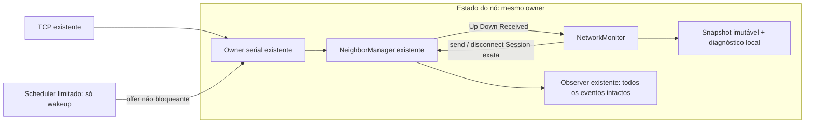

# IMP-007 — Design para aprovação

✅ Model e decisões Q-C-23/24 aprovados pelo utilizador nesta retoma.
⏳ Design preparado, ainda não aprovado. ADR/Implement/Test não iniciados.
Base operacional: 3dedf007f52f43f53eaf254bef7c25e35f986e5a, main.
Não existem APIs novas implementadas ou testes executados por este documento.

## 1. Âmbito e allowlist exata de implementação futura

1 - `Projeto/src/main/java/pt/uminho/esr/ott/monitoring/NetworkMonitor.java`
    — agregado, portas e scheduler/relógio/adaptadores internos limitados.
2 - `Projeto/src/main/java/pt/uminho/esr/ott/monitoring/LinkMetrics.java`
    — record imutável e funções puras de idade/custo.
3 - `Projeto/src/test/java/pt/uminho/esr/ott/monitoring/NetworkMonitorTest.java`
    — oráculos V-010 com relógio, owner, scheduler e transporte falsos.
4 - `Projeto/src/main/java/pt/uminho/esr/ott/overlay/OverlayNode.java`
    — exceção Q-C-23: composição com o owner/manager existentes e shutdown comum.
5 - `Projeto/src/test/java/pt/uminho/esr/ott/overlay/OverlayNodeMonitoringTest.java`
    — novo teste próprio da composição, eventos e terminação física integrada.

Esta lista concretiza a extensão de composição/testes autorizada e é apresentada
para aprovação de Design. Nenhum Java é alterado nesta etapa. Não alterar
NeighborManager, OttApplication, config, protocolo, transporte, POM, fixtures ou
testes históricos; não criar TimeSource.java separado. Tipos auxiliares são
aninhados nos ficheiros acima. Necessidade de outro caminho exige parar e obter
extensão explícita. O fecho histórico de IMP-005/034/035 não é reaberto.

## 2. Decisões já aprovadas e desenho proposto

Q-C-23: monitor integrado em OverlayNode, mesmo SerialOwner/NeighborManager e
sessões, eventos alheios preservados, shutdown global; sem transporte/CLI novo.
Q-C-24: t0 na criação/admissão local, RTT inclui filas até tratar PONG; reset
completo em qualquer nova Session/connectionId mesmo com instanceId igual;
elegível no Up, uma pendência, sem bursts. Eco do requestId já decorre de docs/07.

As políticas concretas das secções seguintes são **proposta de Design**, não uma
nova ADR aceite. A revisão de conformidade ADR será a etapa posterior, só após
aprovação. Mantêm-se TCP v2, 19 tipos 1,2,4..20, 3 rejeitado, máscaras3 e UDP OTT1.

Não há executor novo para estado, listener, socket, pool DNS ou codec. O único
worker novo permitido é o helper de temporização: não lê/muta estado de domínio,
não escreve rede, não faz logging nem executa callbacks do consumidor.

## 3. APIs futuras e ownership

### 3.1. LinkMetrics

Assinatura de valor proposta:
`public record LinkMetrics(Neighbor.Session session, State state, OptionalDouble ewmaMicros, OptionalLong costMicros, long sampleCount, boolean sampleCountSaturated, OptionalLong lastSampleAtNanos, int missedCount)`.

State local: UNMEASURED, MEASURED, SUSPECT; sem códigos wire/ordinal serializado.
Ausência de amostra implica count=0 e opcionais vazios. Com medição: count>0,
EWMA finita >=1 µs, cost>=1 e instante presente; missedCount>=0. UNMEASURED pode
ter perdas sem amostra; SUSPECT conserva amostra identificada/idade. Ao invalidar,
remover a entrada corrente e emitir Invalidated; não manter tombstones ilimitados.

`public OptionalLong sampleAgeNanos(long now)` calcula subtração local sem mutar.
Instantes nanoTime podem ser negativos/zero: não validar timestamp absoluto como
não negativo. Elapsed negativo fora do horizonte suportado é erro explícito,
nunca idade/amostra negativa. Session/Optional são imutáveis e não expõem canais.

### 3.2. NetworkMonitor

`public final class NetworkMonitor implements AutoCloseable`.
Construtor público proposto:
`NetworkMonitor(NodeConfiguration config, UUID instanceId, NeighborManager.SerialOwner owner, ControlPort control, Observer observer)`.

Valida argumentos, papel overlay, identidade local/configuração e N/E antes de
alocar coleções ou helper de timers; não abre sockets, cria owner ou inicia sondas
no construtor. Não gera identidade diferente da instância real de OverlayNode.

Tipos aninhados:

- `ControlPort.send(Session, ControlMessage): CompletionStage<Connection.SendResult>`;
- `ControlPort.disconnect(Session): CompletionStage<Boolean>`;
- `Observer.onEvent(Event)` — callback rápido no owner;
- Event local: Updated(LinkMetrics), Invalidated(Session, Reason),
  LocalFailure(Optional<Session>, Reason, boolean fatal); não estender o Event
  sealed de NeighborManager nem criar ERROR wire;
- `Snapshot(long publishedAtNanos, Map<String,LinkMetrics> links, Diagnostics diagnostics)`;
  valida links.size<=63 antes de Map.copyOf e mantém Session/key coerentes;
- Diagnostics: fase, sessões/pendências/tickets/timers/fechos e último motivo/sessão,
  com contadores limitados/saturados; sem lista de erros, Throwable ou payloads retidos;
- Scheduler/Ticket/Factory e relógio LongSupplier, aninhados. Construtor de testes
  package-private injeta relógio, scheduler e gerador de probeId para fronteiras.

Operações públicas propostas:

| Operação | Contexto / garantia |
|---|---|
| start(): void | só owner; idempotente, sem sonda até Up; instalar hook de cleanup |
| onEvent(NeighborManager.Event): void | só owner; tratar Up/Down e 7/8; restantes são observados/preservados pela composição |
| snapshot(): Snapshot | leitura não bloqueante de volatile imutável, antes/depois de start incluídos |
| requestClose(): CompletionStage<Void> | qualquer thread; fecha admissão imediatamente e solicita cleanup serial, idempotente |
| awaitTermination(Duration): boolean | fora do owner; verifica cleanup, helper/tickets físicos no tempo fornecido |
| close(): void | início de paragem + espera externa limitada pelo primeiro budget configurado; no owner só pede paragem |

A conclusão de requestClose confirma cleanup lógico, não terminação física.
Snapshot indica fase STOPPED/CLOSING, último diagnóstico e métricas vazias após
cleanup; idade corrente é calculada pelo consumidor no mesmo domínio monotónico.
Callback do Observer que lança exceção produz falha local fatal observável e stop;
não converter erro local em peer timeout. Snapshot/diagnóstico continuam observáveis
mesmo quando o consumidor externo deixa de receber eventos.

### 3.3. OverlayNode — extensão mínima

Preservar construtor público, start/snapshot/diagnostics/discoveryStatus/candidates/
recoveryStatus/failure/requestShutdown/awaitTermination/close atuais.
Adicionar `public NetworkMonitor.Snapshot monitoringSnapshot()` para consumo
programático, sem novo comando CLI. Antes do arranque devolve vista vazia; depois
publica o snapshot do monitor. Sem getter de Connection, manager ou owner.

Construtor package-private de teste aceita NetworkMonitor.Factory. A factory
pública aninhada em NetworkMonitor recebe config/UUID/owner/ControlPort/Observer;
a implementação normal é o construtor do monitor. O teste de composição pode
registar as dependências recebidas sem expor recursos publicamente. Fakes completos
ficam no teste do pacote monitoring; integração usa serviços reais quando aplicável.

Monitor.Observer interno conserva diagnósticos no snapshot e regista em failure()
apenas motivos locais fatais. Diagnósticos e métricas normais não matam a CLI.
Não acrescentar tipos ao observer existente de NeighborManager.

## 4. Composição, eventos e falhas de arranque

1 - Validar perfil/UUID como hoje, antes de criar owner/serviços. Criar um owner.
2 - Instanciar manager emprestado e monitor com esse mesmo owner. ControlPort
    delega apenas para manager.send/disconnect com Session capturada; sem casts
    a Channel nem escrita direta.
3 - Instalar monitor antes de manager.start, evitando perder primeiro Up. A
    inicialização lógica/start do monitor e arranque do manager são despachados
    para o owner; ambos recebem configuração efetiva e a mesma instanceId local.
4 - No callback manager, executar tap do monitor e entregar ao observer original
    **o mesmo evento, uma vez, na mesma ordem**. A entrega original fica protegida
    por finally mesmo se o tap falhar. Preservar o processamento atual de failure().
5 - NetworkMonitor trata Up/Down e Received 7/8; não consome ERROR, Diagnostic,
    RepairStarted, anúncios ou outros tipos. Mesmo 7/8 continuam observáveis no
    observer original. Learner continua a tratar18/19 antes do Received existente.
6 - Exceção do tap é registada como falha local fatal e inicia paragem dos recursos,
    sem impedir a observação original desse evento. Exceção do observer original
    conserva o tratamento histórico do manager; não enfraquecer esses testes.
7 - Falha parcial de factory/start/offer aciona rollback de todos os componentes
    criados, mesmo que start não tenha completado. Não manter lock do nó ao esperar
    por futures/joins ou ao chamar consumidor externo.

Sessões admitidas por HELLO5 e REPAIR_HELLO20 são equivalentes para métricas.
Candidatos da cache não geram entradas/sondas; reset por nova Session retira todos
os tokens do canal anterior. Não modificar política de reparação ou descoberta.

## 5. Sondas, tempo e precisão

No Up, criar UNMEASURED, contador de perdas zero, elegível agora. Antes de enviar
PING, revalidar sessão, obter probeId não negativo/requestId UUID novo e guardar
pendência/t0 **antes** de chamar ControlPort.send. A pendência já ocupa a única
posição mesmo enquanto o future de admissão não conclui.

PONG recebido requer type8/payload Probe válido, Session integral corrente,
identidade remota, requestId e probeId exatos. PING recebido gera PONG type8 na
mesma sessão, com identidade local e eco dos dois IDs. Ambas as direções podem
ter sonda local; eco não cria amostra nem apaga a pendência local.

RTT usa o instante de **tratamento serial** do PONG e t0; inclui filas locais,
sem confirmar escrita nem comparar relógios remotos. Prazo válido: elapsed < T;
em elapsed>=T vencer por timeout uma vez, independentemente da ordem do callback
físico do timer. Cálculos por subtração de nanoTime e durações limitadas, sem
ordenar valores absolutos ou somar timestamps sujeitos a wrap.

Amostra em double µs: max(1, deltaNanos/1000.0). Primeira inicializa EWMA; seguintes
usam alpha efetivo, fórmula do Model. Reter EWMA double finita e publicar custo
long = max(1, ceil(EWMA)), depois de verificar domínio/overflow antes de converter.
Não arredondar cada passo da EWMA. Limite de RTT admitido é T configurado, portanto
não aceitar valor acima do domínio temporal por um PONG tardio. Exemplo: 1000,
2000,3000 µs e alpha0.2 →1000,1200,1560; fração 1.2 µs publica custo2.

sampleCount satura em Long.MAX_VALUE com flag explícita; não embrulha. missedCount
incrementa só até F e então retira o registo utilizável, logo não excede int válido.
probeId percorre 0..Long.MAX_VALUE sem reutilização na geração; esgotamento local
é fatal observável e não culpa o peer. Teste injeta sequência curta até ao limite.
Timestamp absoluto negativo é legal; elapsed negativo/incoerente gera CLOCK_ERROR
local fatal, nunca amostra/timeout remoto fabricado.

Após conclusão no tempo t1, próxima criação só quando não há pendência e
elapsed desde t0>=I: efetivamente max(t1,t0+I), calculado sem soma absoluta.
Tick atrasado cria no máximo uma sonda nova; não compensar todos os intervalos
perdidos. Falha local recuperável usa nova elegibilidade futura I, sem spin/burst.

## 6. Corridas de admissão/PONG/deadline

Cada pending captura Session + geração + probeId/requestId/t0 e estado
ADMITTING/WAITING. No máximo **um** EarlyPong correlacionado (apenas instante local,
sem reter ControlMessage) por pending; duplicados não substituem o primeiro.

| Situação | Decisão serial |
|---|---|
| PONG antes do resultado de send | validar/capturar um EarlyPong; não publicar ainda uma amostra |
| ACCEPTED com EarlyPong recebido antes do prazo | concluir com RTT até ao instante de tratamento já capturado, sem acrescentar atraso posterior de admissão |
| Recusa/exceção com EarlyPong | descartar EarlyPong; tratar falha local, nunca amostra de tentativa não admitida |
| ACCEPTED sem PONG, ainda no prazo | passar a WAITING com restante contado desde t0 |
| ACCEPTED após prazo, sem PONG válido | concluir exatamente um timeout da sonda admitida; não renovar T |
| Timer vence ainda ADMITTING | marcar deadlinePassed; não contar perda enquanto não houver admissão conhecida, não agendar um timer de zero repetidamente |
| PONG/timeout simultâneos | elapsed>=T é timeout; tokens asseguram uma conclusão, sem reset por PONG tardio |
| Nova sessão/sonda antes de callback antigo | descartar efeito no estado novo, mas libertar a reserva física do callback antigo |

O future real de manager termina ao processar o comando ou no seu shutdown/falha.
Não criar localmente timeout/future cancelado que alegue desfazer um PING já
aceite. Future retido em fake deixa ticket físico pendente até ser realmente
resolvido; await não pode declarar sucesso só porque o estado lógico foi retirado.

## 7. Política concreta de falhas locais e fecho

| Resultado / condição | Métrica/pendência | Ação proposta |
|---|---|---|
| ACCEPTED | ainda não é amostra; aguardar PONG/deadline | nenhuma confirmação de escrita/ACK presumida |
| CLOSED fora de stop local | abortar pendência, invalidar sessão corrente, sem missed++ | diagnóstico ADMISSION_CLOSED; disconnect esperado best effort, sem tocar substituto |
| OVERFLOW | abortar/invalidate sem missed++ | transporte já fecha o handle; pedir disconnect esperado se ainda corrente, diagnóstico OUTPUT_OVERFLOW |
| INVALID_MESSAGE local | não culpar peer nem pedir seu fecho como castigo | diagnóstico fatal INVALID_LOCAL_MESSAGE; parar monitor, failure local do nó leva a cleanup normal/3 |
| Future de comando excecional ou throw síncrono | abortar sem missed++ | ADMISSION_FAILURE fatal, salvo cancelamento decorrente de stop já pedido; não retry em ciclo |
| CLOSED/cancelamento durante stop | retirar trabalho restante | diagnóstico de stop, sem nova falha do peer/fecho por sonda |
| Capacidade própria de envios indisponível antes de criar PING | não criar nova pendência/amostra/perda | LOCAL_CAPACITY recuperável; elegibilidade futura I, outros peers mantidos |
| PING remoto com eco já em admissão ou quota própria cheia | nenhum buffer extra/sonda/perda local | ECHO_BACKPRESSURE observável, descartar eco excedente sem ERROR a ERROR ou fila ilimitada |
| Scheduler rejeita / owner rejeita offer | cancelar trabalho e preservar motivo | falha local fatal SCHEDULER_REJECTED/OWNER_REJECTED; cleanup via hook se owner já parou |

As mesmas regras de resultado aplicam-se à tentativa de eco. Não contar falhas
locais como três timeouts remotos. Limite F é ausência de PONG admitido no prazo,
que pode refletir filas/congestão e não prova morte física do peer.

Ao atingir F: remover métrica utilizável, invalidar pending, emitir Invalidated
uma vez e solicitar disconnect da Session exata. Há uma fila/set limitada de
fechos, sem duplicados; no máximo um comando de fecho físico do monitor de cada
vez. False significa sessão já retirada: concluir sem fechar outra. Exceção do
fecho é falha local fatal/observável, não um loop de novas tentativas.
Down posterior é idempotente; desconexão/repair/retry são do manager existente.

## 8. Limites lógicos e físicos

Definições derivadas, sem configuração nova:
N = min(63, control.maxConnections); E = overlay.eventsCapacity;
B = min(E, 2×N), positivo. Validar antes de alocar.

| Recurso do monitor | Máximo e retenção |
|---|---|
| Registos correntes / pending / EarlyPong | N / um por sessão / um por pending |
| Envios normais PING/PONG em admissão/conclusão | B tickets totais; por sessão no máximo um PING e um eco em admissão |
| Fechos lógicos / comando físico de fecho | N Sessions em set/fila limitada / um ticket reservado independente de B |
| Tickets de ControlPort, incluindo callbacks retirados | B+1; manter até future/conclusão e continuação física realmente terminarem |
| Estado retirado à espera de conclusão | só referências necessárias dos B+1 tickets, sem mapas/históricos adicionais |
| Último diagnóstico | um motivo/sessão e contadores saturados; sem fila de logs própria ilimitada |
| Scheduler | um worker helper; zero ou um próximo compromisso lógico global |
| Jobs físicos de timer | no máximo dois: callback em curso + substituto agendado; canceled-running conta até finally |
| Wakeups oferecidos ao owner | no máximo um enfileirado + um em execução; memória/tokens limitados |
| Snapshot | até N entradas correntes, Map.copyOf após validar cap; nenhuma lista de amostras |

A quota B+1 não aumenta commandSlots do manager; compete pelos limites existentes.
Saturação desse owner/manager continua erro operacional explícito, não é garantia
de ausência de saturação. A reserva para fecho impede o monitor de consumir todos
os seus próprios tickets apenas com sondas. Fechos são servidos antes de novas
sondas quando libertar ticket; percorrer até N estados por evento, cursor justo
sem reoferta de eventos em ciclo imediato. Limite próprio cheio difere de corrupção
ou de RejectedExecutionException do manager, que já pode ter iniciado falha do nó.

### Scheduler e cancelamentos

Um ScheduledThreadPoolExecutor JDK com um worker e removeOnCancel; encapsular toda
admissão com ledger máximo2, incluindo running/canceled. A fila interna do JDK não
é usada como licença de crescimento: uma terceira reserva é rejeitada **antes**
de schedule/alocar job retido. Não usar scheduleAtFixedRate/catch-up ou scheduler
por peer. Cada estado guarda próxima elegibilidade/prazo; o owner arma só o menor.

Callback de timer oferece um wakeup **genérico**, sem aplicar decisão capturada
sobre peer; o handler serial lê relógio e todos os tokens correntes. Assim um
wakeup antigo/coalescido não expira sonda nova nem perde um prazo que entretanto
ficou devido. Limpar a flag wakePending no início do handler antes de drive/rearm;
um sucessor pode ficar enfileirado enquanto ele corre, sem perder notificações.
Timer cancelado liberta ticket só quando removido fisicamente ou após retornar.

Conclusões de ControlPort carregam identidade/geração. Retirar estado lógico não
liberta a reserva enquanto callback físico/conclusão oferecida ainda existir.
O ledger de reservas físicas pode usar atomics; não é segundo dono do estado da
rede. Na paragem, callbacks não oferecem trabalho novo ao owner parado; terminam
as suas reservas, enquanto o hook serial retira estado/continuações canceladas.

## 9. Shutdown, budget único e invariantes de compatibilidade

requestClose do monitor fecha admissão de PING/PONG imediatamente, cancela timers
e publica cleanup no mesmo owner. Hook onStop trata a via de emergência se o offer
for rejeitado; não fechar owner/manager emprestados nem declarar timeout como join.
O monitor não pede disconnect de todos os peers só porque a paragem é local.

OverlayNode conserva t0 e budget do primeiro pedido. No seu requestShutdown:

1 - solicitar paragem não bloqueante do monitor;
2 - solicitar requestShutdown do manager com o restante desde t0, preservando
    NODE_LEAVE e a reserva já aprovada na versão anterior;
3 - combinar conclusões lógicas sem get/join/locks bloqueantes; falha de um lado
    não impede solicitar fecho ao outro. Chamadas repetidas não renovam o prazo.

Em awaitTermination, **fora do owner e sem lock do nó durante as esperas**:
aguardar conclusões lógicas, manager físico, monitor físico e finalmente pedir
fecho/aguardar o owner; cada espera recebe apenas o restante. O timer foi parado
antes da primeira espera de rede, permitindo terminar em paralelo. Se já não há
tempo, consultar terminações físicas/solicitar fecho a todos e devolver false;
não somar um timeout completo por participante. Sem short-circuit que deixe de
pedir fecho/observar os restantes recursos depois de uma falha.

close imediato também para monitor antes do manager e mantém o atalho no próprio
owner (só solicita paragem). close-before-start/rollback são idempotentes, sem
reviver monitor/nó e sem novos serviços. Despacho tardio verifica admissão/geração;
Callback monitor fora de stop que falha nunca altera o evento original entregue.
Não é necessário mudar NeighborManager/send/transportes ou a política de repair.

## 10. Testes e oráculos para as fases futuras

Nenhum teste escrito/executado nesta etapa; todos os nomes abaixo são planeados.
Preservar M01–M22 do Model, agora com Q-C-23/24 resolvidas, e ampliar com:

| ID | Oráculo independente e meio |
|---|---|
| D01 | configurar/default/overrides/argumentos inválidos antes de worker/timer/socket |
| D02 | RTT/EWMA 1000/2000/3000→1000/1200/1560, frações e ceil; idade monotónica e ausência de amostra |
| D03 | mesmo instanceId/connectionId novo e instanceId nova resetam integralmente |
| D04 | primeira elegível Up, I<T/I>T, ticks atrasados e uma pendência sem bursts |
| D05 | early PONG válido antes de ACCEPTED: amostra só após aceite, RTT usa instante capturado |
| D06 | early PONG com CLOSED/OVERFLOW/INVALID_MESSAGE/exceção: nenhuma amostra/perda remota falsa |
| D07 | deadline em ADMITTING, aceite tardio, PONG no limite, duplicados e ordem trocada: uma conclusão |
| D08 | probeId/requestId/instanceId/connectionId/geração errados e callbacks antigos inócuos |
| D09 | F=3 e overrides: contar sondas admitidas, não ticks; EOF imediato; reset por PONG válido |
| D10 | cada falha local da tabela7, incluindo eco e observer: motivo/efeito verificáveis |
| D11 | grauN, B tickets, reserva de fecho, echo flood e fechos serializados, sem crescimento por churn |
| D12 | timer canceled-running ainda ocupa slot; terceiro rejeitado; wakeup antigo/coalescido não perde deadline |
| D13 | owner rejeitado/parado, callback retido, timer rejeitado; logical close não prova join físico |
| D14 | clock wrap, timestamp negativo legal, probeId esgotado e contadores sem overflow |
| D15 | shutdown em qualquer fase, deadline global restante, sem self-join, sem novo trabalho após stop |
| D16 | LinkMetrics/Snapshot cópias defensivas/validação antes de cópia e custo ausente sem amostra |

NetworkMonitorTest usa owner manual, LongSupplier, scheduler físico controlado,
ControlPort que devolve futures completáveis e gerador de IDs injetado. Resultados
esperados calculados como fixtures independentes; relógio não avança por sleeps.

OverlayNodeMonitoringTest cobre integração própria:

1 - factory confirma mesma identidade/owner/capacidade e ControlPort delegado;
2 - dois nós e bootstrap reais validam PING/PONG type7/8 v2, custo só depois de
    amostra e EOF/Down sem aguardar limiar; configuração usa portas efémeras;
3 - mesma JVM de integração observa o snapshot sem adicionar CLI metrics; um
    subprocesso de smoke usa CLI existente para provar composição automática;
4 - Up/Down/ERROR/Diagnostic/RepairStarted e Received de outro tipo chegam ao
    observer original, mesmo objeto/ordem/exatamente uma vez; tap que falha não o oculta;
5 - sessão admitida por REPAIR_HELLO20 tem monitorização como a configurada,
    sem reimplementar a admissão/repair; fixtures/serviço real da integração são
    identificados, sem editar os testes históricos para os tornar fáceis;
6 - requestShutdown/close/start parcial e fecho dentro de callback terminam
    monitor/scheduler/manager/owner fisicamente no budget comum, sem ressuscitar;
7 - comando/worker antigo não fecha nem contamina sessão substituta; ERROR
    recebido não tem resposta ERROR; bootstrap não cria monitor.

Se for necessária demonstração mais ampla de reparação/mortes reais, usar ensaio
reproduzível na etapa autorizada e separar dados do manual humano. V-010/relógio
falso, regressão atual e manual humano antes de aprovar Test continuam obrigatórios.
Na etapa Test correr `mvn -B -ntp clean verify`, guardar log novo/XML/JAR/hash e
ambiente. Os1113 de IMP-035 são históricos, nunca total presumido deste incremento.
GUI/CORE, metas/FPS e êxito de manual/revisão não são inferidos de fakes/loopback.

## 11. Conformidade e checkpoint

Aplicam-se ADR-004/016/017/018/020/022/024/025/026 e contratos de controlo
033/034/035, com transversais de codec/transportes/validação. Não se substitui ADR
ou acrescenta dependência, comando, transporte, formato/cap ou configuração.
ADD8/contratos registam a exceção de composição autorizada. Análise ADR não foi
executada/aprovada por se preparar Design; é o checkpoint seguinte, não este.

Critérios de Design: APIs e cinco caminhos apresentados, precisão/tempo/reset,
limites lógicos/físicos, política de falhas, corridas, composição e teardown
especificados, M01–M22/D01–D16 mais integração mapeados para testes futuros.
Responsável previsto Waheed; revisão final humana Fillmore e integração da versão
revista antes de DONE. Sem gates externos adicionais.

**Parar em Design para aprovação, antes de ADR/Implement.** Sem alterações Java,
testes/Maven/serviços nesta etapa, staging, commits, push ou fecho de bolt/TASK.
