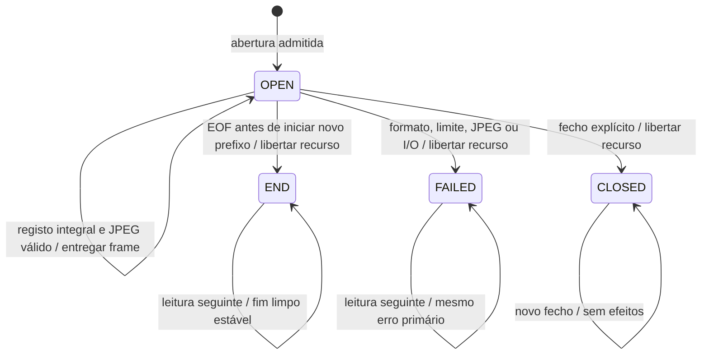

# IMP-018 — Model: leitura do perfil MJPEG confirmado

Model eIMP-018-LOCAL-01/02 aprovados explicitamente pelo utilizador;
registo 2026-11-25T15:40:54Z. Apenas Design autorizado; nenhuma decisão aplicada em Java.
O utilizador pediu o próximo bolt; pela ordem do ADD, inicia-se025-video,
TASK-020 **parte B**, após009-arvores e011-video complete. Apenas Model.

## 1. Contexto delimitado, fontes e âmbito

[ADD/IMP-018](../../../add.md#imp-018), [specs](../../../specs.md),
[história007](../../intents/001-ott-streaming/units/005-video/stories/007-ler-o-perfil-mjpeg-confirmado.md),
[unidade005](../../intents/001-ott-streaming/units/005-video/unit-brief.md),
[TASK-020](../../../docs/tasks/PHASE-05/TASK-020.md),
[perfil normativo](../../../docs/07-API-AND-INTERFACES.md#7-perfil-de-ficheiro-mjpeg-confirmado-na-task-002),
[auditoria da parte A](../../../experiments/construction/011-video/test-01/README.md)
e [fecho da parte A](../011-video/closure-walkthrough.md).

Leitura sequencial e validada de registos de um ficheiro local: cinco octetos
decimais ASCII, comprimentoL, seguidos deL octetos JPEG. O leitor entrega
os bytes comprimidos originais de **um frame completo**, EOF limpo ou uma
falha localizada; nunca publica prefixo, payload incompleto ou imagem inválida.

Reutilizar ADR-006/009/021/024: perfil fixado, fixtures independentes, validação
antes de alocar e incremento atómico. Sem nova ADR proposta nesta etapa;
APIs/classes reais só serão conferidas em ADR, após Model/Design aprovados.
Não foram lidos, analisados ou modificados fontes de aplicação/teste.

Âmbito futuro do ADD: apenas `server/VideoSource.java` e
`server/VideoSourceTest.java`. Novos auxiliares, fixtures persistentes ou outros
caminhos exigem proposta de âmbito antes de alteração. Os nomes de entidades
abaixo são conceitos de domínio, não novas classes/assinaturas já impostas.

**Fora:** preparação/conversão dos quatro conteúdos já entregue emIMP-017;
cópia/instalação runtimeLOCAL-03, configuração final de entrega; pacing,
procura, loop, sequência wire/mediaTime e emissão deIMP-019; fragmentação,
forwarding UDP, montagem, player/Swing, CLIplay, CORE ou demonstração.
ImageIO headless valida o JPEG, mas não entrega uma reprodução de vídeo.

## 2. Linguagem ubíqua

| Termo | Significado |
|---|---|
| Fonte/cursor | Uma instância de leitura, com posição e recurso próprios |
| Registo | Prefixo de5 bytes seguido do payload JPEG deL bytes |
| Prefixo | Exatamente5 octetos ASCII0–9, sem newline/sinal/espaço |
| ComprimentoL | Número decimal do prefixo; exclui os5 bytes do prefixo |
| Frame validado | Payload íntegro e JPEG descodificável, pronto para entrega local |
| Índice local | Número do registo na fonte; não é frameSeq do protocolo |
| Offset | Posição absoluta, em bytes, a partir do início do ficheiro |
| EOF limpo | Ausência de qualquer byte de um novo prefixo numa fronteira de registo |
| Truncatura | EOF depois de iniciar um prefixo ou antes de completarL bytes |
| Publicação/entrega | Devolver bytes ao consumidor local; não anuncia nem transmite dados |
| Falha localizada | Diagnóstico com fonte, índice, offset e etapa, sem expor o payload |

## 3. Entidades e objetos de valor

| Entidade | Estado/propriedades | Regras |
|---|---|---|
| Sessão de leitura | Identidade local, recurso, estado, próximo índice e offset | Uma sessão não partilha posição ou erro com outra, mesmo para o mesmo ficheiro |
| Recurso de origem | Caminho configurado e base permitida, ou entrada controlada em testes | Abertura só por configuração admitida; sem URLs, download, conversão ou resolução por dados recebidos |

| Objeto de valor | Conteúdo | Invariantes |
|---|---|---|
| Limite efetivo | B=min(99999, limite configurado da fonte, máximo UDP2MiB) | 1≤B≤99999; umL>B é rejeitado após prefixo e antes de reservar/ler corpo |
| Localização | Índice≥0, offset do prefixo≥0, início do payload=offset+5 | Aritmética verificada; sucesso avança por5+L; não confundir offset com posição de descodificação |
| Frame validado | Bytes JPEG, comprimento e localização | Comprimento=bytes.length=L; nenhum buffer mutável do leitor é partilhado com o consumidor |
| Resultado da leitura | Um frame, fim limpo ou falha | Alternativas distintas; fim não é um frame vazio nem uma falha escondida |
| Diagnóstico | Categoria, localização, esperado/observado quando conhecidos, causa local | Texto finito e localizado; não inclui bytes de vídeo, stack acumulada ou métricas fictícias |

L não é tamanho da imagem descomprimida. Design deve concretizar também
o orçamento da validação JPEG e a proteção de dimensões/alocação antes da
descodificação integral, sem inventar chaves de configuração ou restrições
incompatíveis com os conteúdos aprovados. Não é assumido limite de memória
apenas por o ficheiro comprimido ter≤99999 bytes.

## 4. Agregado e invariantes

Raiz: **sessão de leitura**; possui o recurso, a posição de leitura, um registo
em preparação e o primeiro erro terminal. O consumidor pode conservar frames
já entregues, mas a sessão não guarda um histórico nem carrega o vídeo inteiro.

1. Consumir todos os5 bytes do prefixo, tolerando leituras parciais. EOF sem
   primeiro byte significa fim limpo; com1–4 bytes significa prefixo truncado.
2. Aceitar somente ASCII0–9, incluindo zeros à esquerda. `00000`, caracteres
   não decimais eL>B falham sem alocação proporcional ao corpo anunciado.
3. Ler exatamenteL bytes, tolerando fragmentação das leituras. Não tomar uma
   leitura curta como EOF nem devolver um frame parcial. Progresso nulo não
   pode originar um ciclo ocupado ilimitado; política concreta fica para Design.
4. JPEG tem de ser integral e descodificável antes de entrega. Marcadores ou
   extensão por si só não provam validade. Não recodificar/normalizar bytes.
5. A entrega é atómica por registo. Se o segundo registo falhar, o primeiro
   continua correto e imutável; nunca se entrega parte do segundo.
6. Posição física pode avançar ao ler um registo inválido, mas o índice de
   frames entregues não avança. Não tentar adivinhar outro prefixo ou saltar
   corrupção: após falha, a sessão é terminal.
7. Uma chamada de leitura por vez e uma entrada local por sessão. Não criar
   owner, thread, fila, scheduler, cache global ou execução concorrente neste
   IMP. A leitura síncrona não promete prazo de I/O/decode ou cancelamento
   assíncrono de uma chamada bloqueada; composição futura fica fora deste bolt.
8. Libertar ficheiro e recursos transitórios do decoder em todos os terminais;
   fecho explícito idempotente. Falha de cleanup não apaga o erro primário.
9. EOF não rebobina nem abre novamente a fonte. Loop, FPS e cronologia são
   decisões do emissor deIMP-019; este cursor não incrementa frameSeq wire.
10. Ler/fechar uma sessão não altera outra sessão, stream, catálogo, árvore,
    origem ou disponibilidade anunciada. Não executar I/O deste leitor no
    owner de controlo por consequência implícita desta modelação.

## 5. Estados, resultados e transições propostas

Falha de abertura não cria uma sessão utilizável. Ler depois deCLOSED é uso
inválido explícito, nunca EOF limpo. Fechar END/FAILED preserva o resultado
terminal de leitura, sem reabrir recursos; comportamento público exato e
exceções serão concretizados em Design/ADR, sem inventar APIs reais aqui.

**IMP-018-LOCAL-01 — aprovada com Model:** sessão toma posse
do recurso de leitura admitido; fecha-o em EOF/falha/close e conserva o
primeiro erro. Uma entrada de teste transferida para a sessão segue a mesma
posse, tornando cleanup verificável. Argumentos rejeitados antes de admissão
não transferem posse nem abrem um ficheiro. A instância não faz resync/retry/loop.

Um ficheiro vazio permite EOF limpo ao cursor, sem frame entregue. Isso não
aprova um **conteúdo de vídeo vazio**: a auditoria de preparaçãoIMP-017 exige
conteúdo identificável e não vazio, mantendo o seu negativo `empty` e as suas
asserções. Contratos do cursor e de aceitação do conteúdo têm finalidades
distintas; não se altera a auditoria anterior.

**IMP-018-LOCAL-02 — aprovada com Model:** validar JPEG
integralmente, em modo headless, com um registo/imagem de cada vez e rejeição
de imagem ausente, erro ou aviso de corrupção/truncatura do decoder. Exigir
um JPEG único, SOI no início/EOI no fim e rejeição de bytes extra dentro deL,
em coerência com os negativos da auditoria anterior. Bytes
entregues são cópia imutável do payload original; imagem descodificada é apenas
transitória para validação e nunca o retorno obrigatório do leitor.
Design concretizará reconhecimento JPEG, orçamento de dimensões/pixels,
gestão de ImageIO e classificação dos avisos, antes da conferência das APIs.
Não se cria player nem se autoriza ampliar âmbito por esta decisão.

## 6. Categorias de falha

Nomes abaixo são semântica do Model, não enums wire ou novas mensagens ERROR.

| Categoria | Situação | Localização mínima |
|---|---|---|
| OPEN_IO | Ausência, acesso, tipo de ficheiro ou abertura falhada | Fonte e operação de abertura; sem frame publicado |
| INVALID_PREFIX | Byte nãoASCII0–9 | Registo, offset do prefixo e posição relativa do byte |
| TRUNCATED_PREFIX | EOF depois de1–4 bytes | Offset do prefixo e quantidade lida |
| INVALID_LENGTH | `00000` | Offset do prefixo, L=0 |
| FRAME_LIMIT | L>B, ainda queL≤99999 | Offset do prefixo, L e B; sem leitura de corpo |
| TRUNCATED_BODY | EOF com menos deL bytes de payload | Offset do prefixo/payload, L e quantidade lida |
| INVALID_JPEG | Corpo completo não é um JPEG íntegro/descodificável | Offset do registo e etapa JPEG |
| READ_IO | Erro de leitura ou ausência de progresso finito | Offset/etapa conhecidos e causa preservada |
| CLOSE_IO | Fecho falha sem erro anterior | Fonte/etapa; quando há erro anterior, anexar apenas como secundário |
| POSITION_LIMIT | Avanço de índice/offset não representável | Última posição válida; nunca overflow silencioso |
| CLOSED_USE | Leitura após fecho explícito | Identidade da sessão; não simular EOF |

Falha de fecho é informação secundária quando já existe erro. Quando um
fecho é a primeira falha observada, deve ser reportado; não se promete cleanup
bem-sucedido se o sistema de ficheiros o rejeitar. Design define a política
exata de propagação sem silenciar erros ou criar histórico ilimitado.

## 7. Eventos e serviços de domínio

| Evento conceitual | Quando | Informação |
|---|---|---|
| FrameValidado | Prefixo+corpo+validação completos | Localização, comprimento, bytes prontos para entrega |
| FimDeFonte | Fronteira sem novo prefixo | Posição e quantidade de frames entregues |
| LeituraFalhou | Primeiro erro terminal | Diagnóstico localizado e estado terminal |
| FonteFechada | Recurso libertado explicitamente/por terminal | Resultado do cleanup |

São resultados locais observáveis em testes, não event bus, novos logs por
frame, mensagens TCP/UDP ou callbacks no owner. A aplicação futura decide se
algum resultado implica retirar uma oferta; este IMP não toma essa decisão.

Serviços conceituais: interpretar prefixo com limites, ler corpo integral,
validar JPEG, entregar frame imutável e libertar recursos. A sequência é
pull/síncrona: abrir→pedir próximo→frame/fim/falha→fechar.

## 8. Repositórios e fronteira de infraestrutura

Não é necessário repositório persistente nem base de dados. O **porto de
entrada sequencial** representa abrir, ler e fechar uma origem configurada,
com posição reportável; permite uma entrada controlada para leituras curtas,
falhas e verificação de fecho nos testes. Operações e ownership são conceitos,
não assinaturas Java já verificadas. Uma abstração interna deve caber nos
dois caminhos do ADD; necessidade de outro ficheiro será apresentada antes.

Paths vêm de configuração local admitida. O domínio não resolve caminhos
recebidos da rede, não escolhe vídeos por título e não modifica permissões.
Design concretizará a validação real de `media.base`, ficheiro/symlinks e a
fronteira de responsabilidade com configuração, preservando contratos.

## 9. Oráculos planeados — V-020-B, nenhum executado

| Grupo local | Caso e resultado exigido |
|---|---|
| M01 | Dois JPEGs independentes com prefixos conhecidos: dois payloads byte a byte, ordem e offsets0/5+L1; sem prefixos no retorno |
| M02 | Entrada devolve1 byte/leituras curtas: mesmos resultados e fronteiras; nenhuma entrega parcial |
| M03 | EOF após segundo registo e repetição de EOF: fim limpo, fecho verificado; entrada inicialmente vazia dá fim sem aprovar vídeo vazio |
| M04 | Cada corte1–4 do prefixo do primeiro e do segundo registo: TRUNCATED_PREFIX localizado; primeiro frame preservado |
| M05 | NãoASCII, sinal, espaço/newline e byte não decimal em cada posição: INVALID_PREFIX; zeros à esquerda aceites quandoL>0 |
| M06 | `00000`, limitesB−1/B/B+1 e99999: parser respeita intervalo, rejeita excesso antes de ler/alocar corpo; sucesso de frame continua condicionado aJPEG válido |
| M07 | Todas as truncaturas do corpo das fixtures pequenas: erro localizado e nenhum frame parcial; não transformar leitura curta emEOF |
| M08 | Prefixo completo+payload nãoJPEG, JPEG corrompido, sem fim íntegro, decoder nulo/erro/aviso relevante: rejeição antes de entregar |
| M09 | IOException na abertura/prefixo/corpo e falha de cleanup: primeiro erro preservado e fecho verificável, sem resync |
| M10 | Fecho antes de ler, após um frame, emEOF/falha e repetido: sem recursos pendentes; leitura após close explícita |
| M11 | Reutilizar entrada/buffers e alterar bytes devolvidos pelo consumidor: frames anteriores e leitor não são corrompidos |
| M12 | Duas sessões intercaladas, mesmo ficheiro ou streams diferentes: posição, EOF, erro e fecho isolados |
| M13 | Validar JPEG emheadless com orçamento transitório finito e descarte de recursos do decoder; imagem enorme declarada não provoca alocação sem guarda |
| M14 | Limites de índice/offset sem wrap; comportamento de leitura sem progresso finito, sem busy loop ilimitado |

Fixtures/oráculos devem ser independentes do futuro leitor. Dimensão/L=1 ou
99999 do parser não implica que exista um JPEG válido desse tamanho: testar
limite antes de decode, e testar frame válido no limite com dados apropriados,
sem gerar expected bytes pelo componente em teste. Formato/localização e
bytes esperados não podem vir de uma segunda execução do próprio leitor.

Os16 negativos e22687 JPEGs da auditoriaIMP-017 são evidência **histórica da
preparação**, não execução do futuro VideoSource. A contagem1537 do último
incremento Java também é histórica. Neste Model: zero Java/Maven/decoder novo
executado; M01–M14/V-020-B por executar.

## 10. Dependências, limites de aceitação e checkpoint

G-MEDIA técnico da parteA aceite e011-video integrado; não repetir downloads,
conversões, auditoria ou materialização LFS nesta etapa. LOCAL-03 (cópia/hash
runtime posterior) eLOCAL-04/G-MEDIA-DISTRIBUTION (créditosB ilegíveis,
redistribuição/publicação/licença) permanecem conforme fecho, sem virar gates
externos adicionais deIMP-018. Se emImplement faltar um dado necessário,
apresentar evidência/âmbito, sem inventar instalação da entrega.

Revisor final previsto: Denji; fecho requer critérios, regressãoJDK21,
manual/aceitação humanos aplicáveis, revisão final e integração. Este Model
não aprova nenhuma dessas etapas. TASK-020 só fecha comA/B/C; C/pacing não
está iniciado. Respeitar as remoções locais da demo, negativos e limitaçãoR17.

Checkpoint original (histórico): aprovação deste Model e deIMP-018-LOCAL-01/02. Até lá,
`current_stage=model`, `stages_completed=[]`, história planned/sem nova
implementação. Sem Design/ADR/Java/Implement/Test, commits, push ou outro IMP.

Aprovação posterior registada em 2026-11-25T15:40:54Z: Model/LOCAL-01/02 concluídos,
current_stage=design; apenas Design. Seis problemas V-ADD pendentes antes
do fecho,sem validação aprovada;M01–M14/V-020-B continuam por executar.
