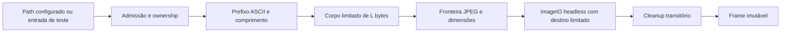

# IMP-018 — Design: leitor MJPEG com validação e recursos delimitados

Model/LOCAL-01/02 e este Design,incluindo guardas,aprovados pelo utilizador.
Registo 2026-11-25T15:52:32Z: apenas revisão ADR autorizada,sem implementação.
M01–M14/V-020-B não executados.
As assinaturas abaixo são propostas; a compatibilidade com fontes Java do
projeto será conferida na etapa ADR, após autorização. Nenhum fonte de
aplicação/teste foi lido ou analisado nesta etapa.

## 1. Decisões e fronteira

[Model aprovado](ddd-01-domain-model.md), [ADD/IMP-018](../../../add.md#imp-018),
[perfil](../../../docs/07-API-AND-INTERFACES.md#7-perfil-de-ficheiro-mjpeg-confirmado-na-task-002),
[TASK-020](../../../docs/tasks/PHASE-05/TASK-020.md) eADR-006/009/021/024.

Componente local síncrono, pull e sem dependências novas. A leitura admite
uma origem configurada, delimita um registo, valida JPEG e entrega um valor
imutável. Não há API web, persistência, filas, threads ou base de dados.

Somente dois caminhos futuros autorizados:

- `Projeto/src/main/java/pt/uminho/esr/ott/server/VideoSource.java`:
  classe e tipos auxiliares **aninhados** no mesmo ficheiro.
- `Projeto/src/test/java/pt/uminho/esr/ott/server/VideoSourceTest.java`:
  testes e fixtures pequenas independentes incorporadas neste ficheiro;
  entradas temporárias produzidas pelo teste, não novos recursos persistentes.

Nenhuma alteração de configuração/protocolo, POM, outros componentes ou
recursos. Sem pacing, loop, emissão, fragmentação, player, instalação de media,
alteração de créditos/licenças ou intervenção na demo. APIs reais e eventual
necessidade de ampliar âmbito devem ser apresentadas antes de código.



## 2. API Java proposta e tipos locais

Superfície pública proposta de `VideoSource`, classe final implementando
`AutoCloseable` (não há construtor público):

```java
public static VideoSource open(Path mediaBase, Path file, int maxFrameBytes)
        throws SourceException;
public Optional<Frame> nextFrame() throws SourceException;
public State state();
public void close() throws SourceException;
```

| Elemento aninhado | Contrato proposto |
|---|---|
| `State` público | `OPEN`, `END`, `FAILED`, `CLOSED` |
| `Frame` público final | `long index()`, `long prefixOffset()`, `int length()`, `byte[] bytes()`; construtor privado |
| `Diagnostic` público imutável | origem limitada, índice/offset do prefixo, etapa, categoria, esperado/observado e detalhe limitado |
| `SourceException` pública, estende `IOException` | `Diagnostic diagnostic()` e `Reason reason()`; causa preservada; sem setters |
| `Stage` público | `OPEN`, `PREFIX`, `BODY`, `JPEG`, `CLOSE` |
| `Reason` público | categorias do Model; refinamentos locais `IMAGE_LIMIT` e `DECODER_UNAVAILABLE`, sem códigos wire |

Forma exata proposta do diagnóstico aninhado:

```java
public record Diagnostic(String sourceId, long recordIndex, long prefixOffset,
        Stage stage, Reason reason, long expected, long observed,
        long consumedInStage, String detail)
```

Índice/offset/consumedInStage são não negativos; expected/observed aceitam-1
quando desconhecidos. Para prefixo/corpo, unidades são bytes; emIMAGE_LIMIT
o detalhe identifica WIDTH/HEIGHT/PIXELS/RASTER e a unidade correspondente.
INVALID_PREFIX inclui byteIndex e valor no detalhe; NO_PROGRESS mantém os
bytes já consumidos na etapa e observed=0. Um decoder que não informe posição
interna não recebe um offset inventado: o diagnóstico aponta o registo/etapa.
Frame eSourceException são tipos aninhados static/final com construção privada;
Reason/Stage/State são enums aninhados. Reason contém exatamente:
OPEN_IO,INVALID_PREFIX,TRUNCATED_PREFIX,INVALID_LENGTH,FRAME_LIMIT,
TRUNCATED_BODY,INVALID_JPEG,IMAGE_LIMIT,DECODER_UNAVAILABLE,READ_IO,CLOSE_IO,
POSITION_LIMIT,CLOSED_USE. São categorias locais, sem alteração do protocolo.

`Optional.empty()` significa somente EOF limpo com cleanup bem-sucedido.
`Optional.of(frame)` entrega um registo completo; uma falha checked lança
`SourceException`. `state()` não faz I/O nem valida uma fonte novamente.
Não há método para seek, rewind, alterar limites, consultar FPS ou emitir dados.

`Frame` guarda uma cópia privada dos bytes validados e `bytes()` devolve uma
nova cópia. Não é um record com accessor que exponha um array mutável.
O array usado nas leituras e pelo decoder não é o array privado do frame:
mesmo uma entrada de teste que retenha o buffer não pode alterar o valor entregue.

Portos de teste package-private, também no mesmo ficheiro:

```java
static VideoSource fromOwnedInput(InputStream input, String sourceId,
        int maxFrameBytes);
static VideoSource fromOwnedInput(InputStream input, String sourceId,
        int maxFrameBytes, ReaderFactory readerFactory);
```

`ReaderFactory` aninhada, package-private: cria um `ImageReader` a partir do
`ImageInputStream` do **payload limitado** e pode lançar `IOException`.
Produção usa a seleção JPEG do JDK; testes fornecem um reader controlado para
demonstrar ordem de chamadas, imagem nula, aviso e cleanup. Não se altera
registro global de providers nem se cria um caminho público de bypass.

As entradas dos testes são propriedade da sessão apenas após retorno com
sucesso de `fromOwnedInput`. Argumentos nulos ou `maxFrameBytes` fora de
1..99999 são rejeitados antes de transferência; o chamador conserva a posse.
Não se fazem leituras/descodificação no construtor ou factory de entrada.

## 3. Admissão de ficheiro e ownership

`open(mediaBase,file,maxFrameBytes)`:

1. Validar argumentos e limite antes de abrir um recurso. Não mascarar um
   limite inválido com clamp. No intervalo de configuração aprovado, B é
   `maxFrameBytes`, já inferior a99999 e ao limite UDP2MiB.
2. Resolver `mediaBase` por caminho real; resolver `file` relativo à base,
   ou aceitar o absoluto apenas se permanecer dentro da base real. Resolver
   symlinks e rejeitar escape, a própria base e alvo não regular.
3. Abrir o caminho real para leitura, sem seguir um novo symlink na componente
   final. A factory é dona desde essa abertura até entregar a sessão; se a
   construção falhar, fecha o recurso e preserva a falha de construção.
4. Não materializar Git LFS, descarregar, copiar/converter conteúdos ou abrir
   outros ficheiros por inferência. Um ponteiro LFS não é JPEG: falhará como
   entrada de formato, não desencadeará comandos externos.

Este controlo cobre caminhos estáveis numa configuração local administrada;
não promete isolamento atómico perante substituição hostil concorrente de
diretórios-pai. Nenhuma credencial/TLS, sandbox de filesystem ou alteração de
ConfigLoader é introduzida. Os testes de path/symlink ficam nos dois caminhos.

| Recurso | Dono | Duração e fecho |
|---|---|---|
| Entrada do ficheiro/sessão | factory antes da entrega; sessão depois | Uma tentativa em EOF, erro ou close explícito |
| Array comprimido | chamada de `nextFrame` | Até validação/cleanup; nunca publicado parcialmente |
| ByteArrayInputStream do payload | validador transitório | Fechado separadamente; não é a entrada da sessão |
| MemoryCacheImageInputStream | validador transitório | Fechar em todos os caminhos, sem cache em disco |
| ImageReader | validador transitório | `dispose()` em todos os caminhos após criação |
| Raster/imagem de validação | validador transitório | Um destino por vez; `flush()` e remover referências antes de retorno |
| Array privado de Frame | valor entregue/consumidor | Leitor não mantém histórico; acesso devolve cópia |

Fechar `MemoryCacheImageInputStream` não fecha a sua entrada subjacente;
por isso os dois recursos são tratados explicitamente. [JDK21: close](https://docs.oracle.com/en/java/javase/21/docs/api/java.desktop/javax/imageio/stream/MemoryCacheImageInputStream.html#close()).

## 4. Leitura, progresso e posição

### 4.1 Prefixo e corpo

- Manter estado `OPEN`, próximo índice de registo e offset do seu prefixo.
  Um cursor físico separado permite localizar consumo parcial sem fingir que
  um registo foi entregue. Contadores `long`, somas/incrementos verificados.
- A primeira leitura bulk do novo prefixo pede no máximo1 byte. Se for EOF,
  terminar antes de reservar espaço para outro registo. Se houver byte,
  verificar prefixOffset+5 e próximo índice antes de pedir os restantes4;
  overflow guarda a posição anterior e bytes observados sem fazer wrap.
  Ler o resto do prefixo em pedidos positivos limitados ao que falta. Validar os
  bytes recebidos como ASCII0–9, sem charset permissivo ou whitespace. Um byte
  inválido já observado termina a leitura sem esperar por outro byte.
- EOF sem nenhum byte de prefixo: tentar fechar a entrada; só publicar END
  se o fecho não falhar. EOF após1..4 bytes: `TRUNCATED_PREFIX`.
- Converter os5 dígitos por acumulação decimal limitada. Zero é
  `INVALID_LENGTH`; L>B é `FRAME_LIMIT`, sem alocar/ler o corpo.
- Antes do corpo, verificar `prefixOffset+5+L` e próximo índice. Overflow é
  `POSITION_LIMIT`, nunca wrap. EOF continua distinguível de um novo registo
  no limite: não rejeitar uma fronteira sem sequer observar se há prefixo novo.
- Alocar somenteL bytes; completar exatamenteL com leituras positivas.
  Leitura curta é progresso, não EOF; `-1` antes deL é `TRUNCATED_BODY`.
  Nunca usar `available()` para decidir EOF, `readAllBytes` ou tamanho do ficheiro
  para presumir que um registo está íntegro.

### 4.2 Zero progresso — política exata

Para qualquer `read(buffer,off,n)` comn>0:

| Resultado | Ação |
|---|---|
| 1..n | Contabilizar e continuar enquanto necessário |
| -1 | EOF limpo ou truncatura conforme etapa/quantidade já lida |
| 0 | Falhar imediatamente com `READ_IO`, detalhe `NO_PROGRESS`; fechar entrada |
| Menor que-1 ou maior quen, numa entrada defeituosa de teste | `READ_IO`, detalhe `INVALID_READ_COUNT` |

Não há retry, sleep, chamada fallback a `read()`, uso de `available()` nem
busy loop após0. Um byte de valor0 devolvido por uma leitura unitária não
seria "sem progresso"; esta política trata a **contagem** de uma leitura bulk.
O contrato de InputStream para pedidos positivos prevê dados ouEOF; a defesa
é para entradas defeituosas. [JDK21: read](https://docs.oracle.com/en/java/javase/21/docs/api/java.base/java/io/InputStream.html#read(byte%5B%5D,int,int)).

Sem prazo de relógio para uma chamada de I/O/decode que não retorna; sem
threads para fingir cancelamento. Cada chamada que retorna ou avança pelo
menos um byte ou termina. A composição futura deve executar este I/O fora
do owner de controlo, mas essa composição não pertence aIMP-018.

### 4.3 Publicação

Validar corpo, executar cleanup transitório e só então criar/devolver Frame
com cópia defensiva e avançar índice/offset comprometidos. Falha de validação
ou de cleanup antes da publicação impede esse frame. Um frame anterior não
é afetado por erro no registo seguinte. A próxima chamada após falha não
consome mais bytes, não procura outro prefixo e não reabre a fonte.

## 5. Guardas de JPEG e compatibilidade dos quatro conteúdos

### 5.1 Evidência de dimensão reutilizada

Foram lidos apenas os JSONL da auditoria aprovada deIMP-017, conferidos pelos
hashes do seu consolidation.json. **Nenhum vídeo foi reaberto nem JPEG
descodificado nesta etapa.** [Resumo e hashes](../../../experiments/construction/025-video/design-01/approved-audit-dimensions.json).

| Conteúdo | Frames nos registos aprovados | Dimensão em todos os registos | Máximo JPEG |
|---|---:|---|---:|
| A |500|384×288|13967 bytes|
| B |5965|640×360|41769 bytes|
| C |8880|640×360|66091 bytes|
| D |7342|640×360|56322 bytes|

### 5.2 Limites locais propostos, sem configuração nova

Constantes internas de VideoSource, sujeitas à aprovação deste Design:

| Guarda | Valor e cálculo |
|---|---|
| Payload comprimido |1..B, B≤99999, antes de reservar corpo|
| Largura |1..4096|
| Altura |1..4096|
| Pixels |`(long)width * height <= 4194304`|
| Raster de destino |Tipos allowlist de1,3 ou4 bytes/pixel; `pixels * bytesPerPixel <= 16777216`|
| Buffers e histórico |Um payload/registo em preparação, um destino de decode; sem cache de frames|

ComB=99999 (default documentado), A/B/C/D ficam abaixo destas guardas;
640×360=230400 pixels. Para aceitar os quatro conteúdos, B tem de ser pelo
menos66091; limites configurados menores continuam a ser respeitados e podem
rejeitar o conteúdo correspondente, sem clamp ou override silencioso. A auditoria
anterior usou o JPEGImageReader do JDK, sem avisos, mas isso **não prova** a
compatibilidade do futuro código ou a imposição destas guardas: M13 e a
verificação pertinente dos conteúdos continuam obrigatórias emImplement/Test.

Guardas de largura/altura e de produto aplicam-se **em conjunto**. Por exemplo,
4096×1025 ultrapassa o teto de pixels embora ambas as dimensões caibam. Os
cálculos usam `long` antes de multiplicar; não se deduz memória do tamanhoL.
Limite excedido: `IMAGE_LIMIT` em etapaJPEG, sem chamar `read` do decoder.

### 5.3 Preflight estrutural no payload limitado

Antes de criar raster ou chamar descodificação, verificar uma única imagem,
fronteiras e dimensões. O scanner interno avança estritamente dentro deL:
SOI inicial, segmentos com comprimentos delimitados, SOF com dimensões
positivas e guardas; scans/byte stuffing e restart markers respeitados.
O primeiro EOI estrutural deve terminar exatamente no último byte do payload;
rejeitar outra imagem ou sufixo. APP/COM são saltados pelo comprimento, não
por procura de FF D9 dentro dos seus dados. O scanner não descodifica entropia;
ImageIO continua necessário para validade integral. [T.81, anexosB/F](https://www.w3.org/Graphics/JPEG/itu-t81.pdf).

Regras concretas da guarda local:

- Sem ler posições fora do array: comprimento de segmento≥2 e cabeçalho/
  segmento inteiro dentro deL, com aritmética verificada.
- Largura/altura são retiradas do SOF antes do provider. SOF com dimensões
  diferidas/zero não passa a guarda. Todas as dimensões encontradas devem ser
  coerentes e limitadas; não interpretar DHT/DAC como SOF.
- A máquina distingue cabeçalhos e dados de scan. Bytes escapados, segmentos
  de aplicações e scans progressivos não são tratados como JPEG concatenado.
  Um marcador desconhecido/incoerente que impeça uma fronteira inequívoca
  produz `INVALID_JPEG`; não se tenta reparar/reinterpretar o payload.
- Exigir cabeçalho de imagem e scan antes do EOI. Testar EOI precoce seguido
  de lixo/outroJPEG/EOI final para não aceitar um payload só por começar e
  terminar com os dois marcadores esperados.

O scanner é defesa de enquadramento/tamanho, não novo codec ou expansão de
formatos. Aceitação continua dependente do JPEG decoder do JDK; variantes
fora desse suporte são erro localizado, sem promessa de descodificação universal.

### 5.4 Validação ImageIO, depois das guardas

1. Envolver só o payload limitado em ByteArrayInputStream e
   MemoryCacheImageInputStream, sem temporário em disco ou alterações globais
   de ImageIO. Criar um reader JPEG por frame.
2. Registar um listener de avisos que guarda apenas flag e primeiro detalhe
   limitado. Política conservadora: **qualquer warning dessa leitura rejeita
   o frame**, sem classificar por texto traduzido. Não declarar que o aviso
   identifica por si só a causa da corrupção.
3. `setInput` e consultar largura/altura de imagem0. Repetir guardas e exigir
   concordância com o preflight, antes de alocar o destino. Selecionar apenas
   um tipo suportado da allowlist BYTE_GRAY,3BYTE_BGR ouINT_RGB (1/3/4 bytes).
   Se não houver um tipo admitido, erro localizado, sem alocação de tipo livre.
4. Construir um destino desse tipo/dimensões já limitadas, com offset0 e
   sem subsampling ou seleção parcial. Passá-lo pelo ImageReadParam.
5. Ler integralmente imagem0; null, erro ou warning impedem entrega. A imagem
   retornada tem de ser o destino fornecido e manter dimensões previstas.
6. `flush`, `dispose` e fecho das entradas transitórias, mesmo em erro. Nenhuma
   BufferedImage fica no Frame; só os bytes JPEG originais são entregues.

Consultar tamanho e libertar reader são operações documentadas em
[ImageReader/JDK21](https://docs.oracle.com/en/java/javase/21/docs/api/java.desktop/javax/imageio/ImageReader.html).
O destino explícito é fornecido por
[ImageReadParam/JDK21](https://docs.oracle.com/en/java/javase/21/docs/api/java.desktop/javax/imageio/ImageReadParam.html#setDestination(java.awt.image.BufferedImage)).

**Limite da garantia de memória:**16MiB é o teto de armazenamento dos pixels
do destino admitido; não é uma garantia de heap/nativo total do provider ou
da JVM. Há overhead, buffers de compressão e cópias do consumidor. Tamanho
comprimido/dimensões limitados e um decode de cada vez delimitam o trabalho
admitido, sem prometer interromper um decoder bloqueado ou recuperar deOOM.
Não converter Error/falha fatal em `INVALID_JPEG` ou EOF.

## 6. Erro primário, cleanup e fecho exatos

Estado interno guarda o primeiro terminal de leitura e flags de recurso
destacado/fecho tentado. Antes de fechar, destacar a referência: cada recurso
tem uma tentativa, mesmo se o próprio close/dispose falhar. Uma falha de
cleanup é reportada, nunca descrita como libertação bem-sucedida.

| Situação | Resultado e estado |
|---|---|
| Frame válido e cleanup transitório bem-sucedido | Devolver Frame; sessão OPEN, ficheiro aberto |
| EOF na fronteira e fecho do ficheiro bem-sucedido | `Optional.empty()`, END; chamadas seguintes retornam fim sem I/O |
| Erro de formato/I/O/decodeP | Guardar SourceExceptionP com diagnóstico e causa; tentar cleanup; FAILED; lançarP |
| Cleanup falha depois de erroP | Anexar secundário uma vez, manterP como lançado e guardado |
| Cleanup é a primeira falha | SourceException CLOSE_IO, etapa e causa; FAILED, nenhum frame/fim publicado |
| close explícito emOPEN, bem-sucedido | CLOSED; leitura seguinte lança CLOSED_USE, sem I/O |
| close explícito emOPEN falha | Guardar CLOSE_IO como primeiro erro; FAILED; lançar nessa chamada |
| close emEND/FAILED/CLOSED | Retornar sem nova tentativa e sem relançar erro já notificado |
| nextFrame emFAILED | Relançar o mesmo primeiro erro, sem acrescentar suprimidas ou consumir bytes |

**Try-with-resources:** se nextFrame já lançouP e fechou/tentou fechar os
recursos, close posterior emFAILED é inócuo. Nunca lançarP de novo nesse close:
Java tentaria suprimirP em si própria e poderia mascarar o erro original.
Se o corpo do chamador lança outra exceçãoX e o primeiro close falha, o
comportamento normal de try-with-resources mantémX e suprime a falha de close.

O coletor de cleanup guarda apenas o primeiro primário e um secundário por
recurso (máximo5: destino,reader,cache,entrada do payload,entrada da sessão). Evitar a mesma
identidade do primário, causa ou secundário já registado; sem autosupressão,
ciclos ou histórico que cresça com nextFrame/close repetidos. Mensagem local
limitada: origem≤256 caracteres, detalhe≤256, contadores numéricos e categoria;
causa original preservada, sem payload ou novo sistema de logs.

Uma RuntimeException/Error inesperada de infraestrutura/programação continua
fatal: libertar/tentar libertar os recursos no finally e relançar **o mesmo
objeto**, com cleanup secundário, sem embrulhar como erro de JPEG. Guardar o
terminal permite que novas chamadas emFAILED não retomem a leitura. A API
declara SourceException para falhas checked; não oculta as falhas unchecked.

## 7. Plano M01–M14, ainda não executado

Os grupos do Model conservam-se; os detalhes abaixo concretizam os oráculos.
Nenhum resultado é PASS por existir este documento.

| Grupos | Concretização de Design |
|---|---|
| M01/M02 | Dois JPEGs literais/independentes, payloads/offsets esperados e entrada que limita cada leitura a1/2/3 bytes; retornos sem prefixos |
| M03/M04 | EOF limpo em entrada vazia/fronteira e cada corte1..4 de prefixo dos dois registos; fecho contado; auditoriaempty anterior intacta |
| M05/M06 | Caracteres inválidos por posição, zeros à esquerda, zero/B−1/B/B+1/99999; spy prova que L>B não lê corpo nem cria decoder |
| M07/M08 | Cada corte de corpo das fixtures pequenas, marcadores inválidos, JPEG concatenado/lixo dentroL, EOI precoce+EOI final e segmentos/scans legais; nenhum frame parcial |
| M08/M13 | Reader controlado nulo/erro/warning e decoder real headless; comparar bytes originais sem usar leitor para gerar o esperado |
| M09/M10 | Read e close falham com exceções distintas e com a mesma identidade; try-with-resources preserva o primário, sem autosupressão; próximo read reusa erro e fecho não se repete |
| M10/M12 | Close emcada estado, duas sessões intercaladas e falha localizada; uma sessão nunca fecha/avança outra |
| M11 | Entrada retém/muda buffer e chamador muda cópia de bytes(); Frame/leituras seguintes não se alteram |
| M13 | Cabeçalho excede4096 ou4194304 pixels: ReaderFactory/read não chamados; reader anuncia dimensões incompatíveis/excessivas: read não chamado; destino respeita16MiB |
| M13 | Guardas em4096,4MP e fronteiras vizinhas, multiplicação65535×65535 sem overflowint; compatibilidade com A384×288 eB/C/D640×360; tipo de destino restrito e recursos transitórios fechados |
| M14 | InputStream retorna0 comn>0: uma chamada, NO_PROGRESS e cleanup; contagens inválidas; soma de índice/offset no limite sem wrap |

Os testes de guarda podem usar cabeçalhos pequenos fabricados independentemente
e um reader-spy; isso demonstra rejeição **antes de decode**, não sucesso de
um JPEG incompleto. Casos positivos headless exigem JPEGs integrais. Limites
de posição podem ser exercitados por helper interno de aritmética, sem criar
ficheiro gigante ou API pública para forjar offsets. Fixtures/controlos ficam
aninhados no teste; sem novos ficheiros de produção ou recursos persistentes.

Antes de aceitar Implement/Test: conferir em ADR as APIs/classes existentes e
as chamadas JDK propostas, e implementar verificações significativas de
cleanup/ordem/caps, sem trocar asserções por checks que espelhem o código.

## 8. Pendência V-ADD e obrigações de fecho

Os **seis problemas registados no Model são pendência obrigatória a resolver
antes do fecho**, por instrução explícita do utilizador. Não são uma validação
aprovada nem um gate externo adicional. [Lista duradoura](../../../experiments/construction/025-video/design-01/v-add-pendencias.md).

Dois fences de templates e quatro referências a ficheiros da demo ausentes.
Não alterar templates, restaurar ficheiros ou remover referências para fazer
passar o relatório por inferência; uma proposta de resolução deve respeitar
as remoções e o âmbito. Design pode ser revisto mantendo a pendência explícita.

Fecho: M01–M14/V-020-B executados, regressãoJDK21, manual humano aplicável,
revisão final Denji e integração. TASK-020 apenas fecha apósA/B/C;parteC não
é iniciada aqui. LOCAL-03/04/G-MEDIA-DISTRIBUTION e R17 preservam as limitações
anteriores, sem alegar instalação, redistribuição ou causa deR17 estabelecida.

Checkpoint original (histórico): aprovação de **Design**, depois apenas revisão ADR
se autorizada. Até lá: current_stage=design, apenas Model emstages_completed;
sem Implement, Java, testes, Maven, commits, push ou outro IMP.

Aprovação registada em 2026-11-25T15:52:32Z: Design concluído,current_stage=adr;
apenas revisão ADR,sem Implement,commits ou push. Guardas e âmbito aprovados.
