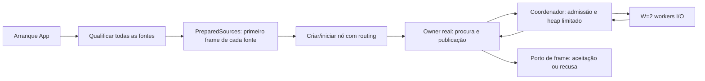

# IMP-019 — Design: cadência exata, procura e recursos finitos

**Design aprovado pelo utilizador**, incluindo W=min(2,S), coordenador único
e limites; registo 2026-11-28T15:28:10Z. Apenas revisão ADR autorizada.
O checkpoint de Design abaixo é histórico; APIs reais ainda por conferir nesta aprovação.
Na etapa Design, nenhum fonte de produção/teste foi lido, analisado ou alterado. As assinaturas,
primitivas e ligações abaixo são propostas; não afirmam que as APIs existem.
P01–P20/V-020-C não executados; sem Implement, commits/push ou outro IMP.

## 1. Âmbito e arquitetura

[Model aprovado](ddd-01-domain-model.md), [ADD/IMP-019](../../../add.md#imp-019),
ADR-006/009/021/024 e regras de owner/época/fatal de017/018/020. Três caminhos:

1. `server/StreamingServer.java`: produtor, valores/portos/coordenação aninhados.
2. `server/StreamingServerTest.java`: relógio, owner, leitor e entrega controlados,
   integração pertinente com a aplicação nos testes deste ficheiro.
3. `app/OttApplication.java`: composição e shutdown existentes, preservando CLI,
   construtores/factories e tratamento fatal. Não abrir outro owner de routing.

Sem alterar VideoSource, RoutingService, OverlayNode, codecs, configuração ou
POM. Sem StreamForwarder/replicação/socket UDP, montagem ou player antecipados.
A entrega é um frame local; não se afirma emissão UDP nem receção/playback.
Helpers aninhados mantêm estes três caminhos. Impedimento real ou extensão
identificados emADR devem ser apresentados antes de qualquer código.

Separação: owner do nó possui lógica de publicação/procura; coordenador físico
possui recursos I/O e timers; workers apenas executam operações bloqueantes.
O coordenador não se torna proprietário das tabelas de routing/catálogo.



## 2. W, filas e ownership concretos

S é o número de definições locais admitidas,2..256 na configuração de SERVER.
**W=min(2,S)**; zero workers fora do papel SERVER. Não há propriedade nova.
Nos outros papéis não se cria também coordenador.
São propostos W workers daemon e **um** coordenador daemon por conjunto de
fontes. Nenhuma thread por stream/cliente/frame e nenhuma thread adicional de
timer. São limites desta proposta, não mudanças já aplicadas ao runtime.

| Estrutura | Capacidade e disciplina |
|---|---|
| SourceSlot/ResourceSlot | Exatamente S slots, uma identidade corrente por fonte; sem histórico crescente |
| IntentCell por fonte |1 intenção coalescida (preparar/ler/reabrir/fechar); CLOSE domina o resto |
| Fila de fontes elegíveis | FIFO com no máximo S índices únicos; só coordenador muta, reentrada na cauda |
| CommandMailbox por worker |1 comando; o slot físico cobre fila+execução+resultado ainda não recolhido |
| WorkerResultMailbox por worker |1 resultado, publicado só depois de a operação e cleanup retornarem |
| Resultado para o owner por fonte |1 resultado de leitura; bloqueia nova leitura da mesma fonte até consumo/ack |
| Frame preparado | No máximo1 por fonte, incluindo resultado ainda não consumido; não coexistem dois frames preparados |
| TimerRequest por fonte |1 estado corrente (armado/cancelado), substituído pelo token corrente |
| Heap de deadlines | No máximo S entradas indexadas; rearmar substitui/remove a entrada antiga |
| EventCell por fonte | Flags coalescidas de resultado/timer/capacidade, sem lista por tick |
| Wakeup do owner | Até1 Runnable pendente e1 emexecução, total≤2 para o conjunto, na fila limitada **já existente** do nó |
| Quota por turno do owner | Até16 fontes reconciliadas/entregas tentadas; continuação única se resta trabalho |

Capacidades são partilhadas entre recursos/gerações, não recriadas por pausa,
loop, timeout ou cancelamento. Fonte com frame pronto não pede outra leitura.
Fonte com operação física/resposta não consumida não pode iniciar outra leitura.
Pedidos já obsoletos são descartados/reconciliados, não empilhados.

O coordenador usa a intenção/flags e um heap indexado, espera até ao primeiro
vencimento ou sinal de trabalho. Propõe-se park/unpark com sinal coalescido:
o unpark anterior ao park não pode perder trabalho. Sem polling por milissegundo,
submit em ciclo ou DelayQueue sem limite estrutural. A escolha JDK concreta e
seus caminhos de falha serão conferidos na revisão ADR; não há execução aqui.

Protocolo de wakeup: publicar as EventCells antes de tentar IDLE→ENQUEUED;
só o vencedor chama offer. O pump entra RUNNING, drena até ao orçamento,
publica IDLE e volta a verificar as células; um publicador concorrente ou o
próprio pump pode ganhar a única passagem IDLE→ENQUEUED. Assim não se perde
um evento entre esvaziar e desarmar, nem se enfileira uma chamada por evento.
Na cauda do callback pode coexistir um Runnable emexecução com a continuação
já enfileirada: o limite físico é2, não se declara apenas1 nesse intervalo.
Uma CommandMailbox/WorkerResultMailbox inesperadamente ocupada nunca é escrita
por cima nem recebe put bloqueante; é falha de invariante/fatal, não retry.


### 2.1. Reservas físicas

Cada job tem (slotWorker, opToken, sourceLife, readerGeneration). Um slot só fica
FREE quando o coordenador recolhe o resultado que o worker publicou **após**
a função da operação retornar, incluindo cleanup. Future.cancel, timeout,
retirada lógica, revogação de token ou ACK do owner não provam esse retorno.
Duplicado/resultado antigo nunca liberta uma reserva nova nem reduz o contador
duas vezes. A identidade do opToken deve coincidir com a reserva viva.

O recurso VideoSource nunca é chamado pelo owner. Fica no ResourceSlot físico,
emprestado exclusivamente ao worker da operação; o coordenador não o fecha
nem outro worker o lê enquanto esse job estiver vivo. O owner recebe só um
Frame imutável, EOF/falha e identidade. Não recebe um handle para usar em paralelo.

Depois da leitura física terminar, a reserva W pode voltar ao coordenador,
mas a fonte fica WAIT_OWNER_RESULT até o resultado ser consumido/rejeitado.
Assim um owner atrasado não cria backlog de frames ou novas leituras. Emfecho,
o coordenador pode eliminar resultados e limpar handles sem depender de um
owner já terminado; não altera routing nesse caminho.

No máximo S handles de ficheiro, S frames comprimidos retidos e W operações
com raster emcurso. Com B=99999, o payload privado dos S frames é no máximo
25599744 bytes; existem cópias temporárias/objetos/cache adicionais. Os rasters
destino podem ocupar até W×16MiB em simultâneo, **sem** ser teto de memória total
ImageIO/JVM. Não se promete recuperar de OOM ou interromper decoder bloqueado.

### 2.2. Fairness e saturação

A fonte entra uma vez na cauda quando existe intenção elegível. Ao obter um
worker sai da fila; só reentra na cauda após a conclusão e, para leitura normal,
após o owner consumir o resultado e pedir novo trabalho. Um vídeo rápido não
retém slot para a leitura seguinte. Pausados, terminados e pedidos revogados
não ocupam worker; fechar um recurso continua elegível mesmo sem procura.

Com jobs que terminam e oportunidade de CPU, uma fonte elegível tem no máximo
S−1 fontes distintas à frente num ciclo. Um job bloqueado ocupa só seu slot:
com W=2 resta um worker para as outras fontes. Se ambos bloquearem, não existe
garantia temporal de progresso; há limite de memória/reservas e shutdown com
resultado incompleto observável. Não chamar isso isolamento temporal absoluto.

O pump do owner também roda por cursor entre S fontes, com orçamento16. Pendência
não cria16 callbacks novos: mantém uma continuação coalescida. Se offer do owner
recusar por capacidade, iniciar fatal/fecho pelo porto existente a conferir;
não executar callback no worker nem repetir offer até ficar verde.

## 3. Aritmética exata de Q-C-48

Unidades: F inteiro1..60, N=1000000000 ns/s, U=1000000 µs/s. Frames de ficheiro
não fornecem FPS. Não usar float/double ou relógio civil nestas decisões.

### 3.1. frameSeq e mediaTimeUs

k é o próximo ordinal, inicialmente0. Para calcular floor(k×U/F) sem o produto
grande intermediário:

```text
q = k div F
r = k mod F
mu = checkedAdd(checkedMultiply(q,U), (r*U) div F)
```

0≤r<F, logo r×U≤59000000. Antes de uma tentativa validar kNext=checkedAdd(k,1)
e media(kNext), além de mu atual; não deixar um estado já publicado com próximo
contador inválido. Overflow recusa aquela tentativa e termina só a publicação,
retirando sua disponibilidade. Não girar a época comum nem resetar k.

O envelope oferece (streamId,serverEpoch,k,mu,JPEG), separado do index/offset de
VideoSource. Só após revalidação e pré-verificações fazer uma chamada ao porto.
A decisão ADMITTED ou REFUSED consome k e o frame; kNext torna-se o próximo.
Recusa gera lacuna legítima e contador local, nunca retry do mesmo ordinal.
Exceção inesperada do porto é fatal, preservando o objeto; não repetir a chamada.
Qualificação, tick vazio, pausa e resultado sem autorização não consomem k.

### 3.2. Período fracionário e ausência de drift

Por fonte manter phase∈[0,F), inicialmente0. No commit de cada tentativa:

```text
base = N div F
rest = N mod F
t = phase + rest
gap = base + (t >= F ? 1 : 0)
phaseNext = t >= F ? t-F : t
```

Todos os intermediários são pequenos; gap é positivo e≤1s. Após F tentativas
pontuais, soma(gap)=N e phase regressa ao mesmo valor. Exemplos:
F=3:333333333/333333333/333333334ns; F=60:16666666/16666667/16666667ns,
repetidos20 vezes. Não arredondar todos os períodos para o mesmo inteiro.

Guardar lastAttemptStamp e **gap já calculado para a próxima tentativa**.
Uma tentativa tardia emt só arma uma próxima elegibilidade t+gap emsentido
relativo; não calcula quantos períodos faltam nem consome frames por atraso.
Conservar phase/k na pausa e no loop. Só tentativa real avança phase.

### 3.3. Relógio monotónico, horizonte e deadlines

Timestamps brutos de nanoTime podem ser negativos. Guardar um DeadlineStamp
(anchor,delay), sem somar instantes absolutos e sem os comparar por ordenação
signed. delay≥0, sempre menor que2^63ns.

Δ(now,anchor)=signed64((now−anchor) mod2^64), válido quando0≤Δ<2^63.
Esta subtração modular é **deliberada apenas no relógio bruto**, para suportar
seu wrap. Sequência, timeline, durações e contadores de domínio continuam sem
wrap, com aritmética verificada. Δ negativo rejeita a observação como relógio
não monotónico/horizonte inválido, emvez de esperar indefinidamente.

Deadline venceu se Δ≥delay; remaining=delay−Δ se ainda não venceu, senão0.
Converter ms para ns com multiplicação verificada, sem int intermediário.
O orçamento máximo configurável2147483647ms corresponde a2147483647000000ns,
dentro do horizonte. Não existe adição absoluta de deadline que possa fazer
wrap silencioso emLong.MAX_VALUE. Os testes de fronteira incluem wrap do clock
legítimo e overflow de domínio ilegítimo, com resultados distintos.

## 4. Fronteiras de procura, pausa e retoma

### 4.1. DemandView é proposta, não API assumida

DemandPort.observeOnOwner(streamId,epoch,now) deve consultar a **autoridade
atual do routing**, já no owner correto. Retorna DemandView imutável com:
stream/origem/época, publicação local disponível, pelo menos uma referência
confirmada efetiva, token de versão e limite temporal dessa autorização.

Referência válida exige Session viva, confirmação/revisão compatível e validade
remanescente positiva. Não derivar procura de catalog/routes selecionadas,
ACTIVATE pendente, intenção isolada ou snapshot antigo com downstream não vazio.
A validade de existência de procura dura até ao máximo dos fins efetivos das
referências atualmente válidas; uma referência local confirmada sem lease
usa revogação explícita pelo gate. Não copiar/substituir o ledger de leases.

O limite temporal é as-of(capturedAt,remainingValidity), relativo como secção3.3.
Um token troca em qualquer alteração relevante (origem/época/disponibilidade,
referências/Sessions/revisões). Tokens são identidades opacas, não um histórico
crescente nem rotação de serverEpoch. A forma de extrair esses factos é obrigação
A02 de ADR; uma projeção sem validade suficiente não satisfaz este contrato.
Mudança que possa retomar uma fonte suspensa deve sinalizar a reconciliação
no owner; a instalação do listener e o varrimento inicial têm de cobrir a
janela de arranque. Não substituir a ausência de hook existente por pressuposta
API, polling novo ou leitura de um snapshot fora do owner. A03 confere esse
ponto; se não couber no âmbito, a proposta de adaptação precede código.
onDemandChangedOnOwner não faz entrega nem I/O reentrante no callback de routing:
revoga imediatamente o permit ainda não claimed e marca a fonte dirty para o
pump coalescido. Não basta marcar dirty mantendo um permit antigo utilizável;
P09 força a corrida entre o evento de retirada e o claim do worker.


### 4.2. Antes da leitura: intenção não é autorização

1. Uma intenção READ que espera na FIFO não contém licença permanente de leitura.
2. Quando há oportunidade física, solicitar a reconciliação da fonte no owner;
   o owner observa agora DemandView e confirma lifecycle/geração/ausência de frame.
3. Armar um ReadPermit para aquele opToken, ligado à versão da procura e ao seu
   limite temporal. Worker/coordenador não consultam tabelas de routing.
4. Imediatamente antes de nextFrame, o worker lê o relógio, verifica validade
   e tenta CAS de ARMED→CLAIMED. Revogação no owner faz ARMED→REVOKED. Se perdeu
   o CAS, a época mudou ou a autorização temporal expirou, retorna NO_READ,
   sem chamar nextFrame, sem mexer no cursor/k/timeline.
5. O claim bem-sucedido é a fronteira linearizada da leitura já iniciada. Uma
   pausa posterior pode coexistir com essa única leitura emcurso; não se promete
   desfazer syscall/decode já autorizado. A verificação e claim formam a operação
   de início; P09 força as ordens claim/pausa/expiração, não aceita só um bool velho.

Não deixar permissões expirar numa fila ilimitada: uma por fonte e no máximo
W jobs físicos. Expirar/recusar o permit não liberta W: o worker retorna NO_READ
e o coordenador recolhe o resultado pelo mesmo protocolo de conclusão física.
Qualificação inicial tem permit próprio, limitado a uma leitura antes da oferta;
não usa uma autorização de procura fabricada.

### 4.3. Antes da entrega

O owner só tenta entrega quando há um frame pronto, época/lifetime corretos,
lifecycle aberto e elegibilidade temporal. **Volta a observar DemandView agora**,
sem reutilizar o permit da leitura. Confirma disponibilidade local/autoridade
confirmada e valida counters antes da única chamada a FramePort.tryOffer.
Nenhum outro evento do owner se intercala entre essa observação e a chamada;
o porto é não bloqueante, sem reentrância/mutação de routing ou I/O no owner.

Procura passou a0: suspender e conservar um frame, sem entrega. Época/lifetime
mudou ou houve stop: eliminar o resultado/cached frame, nunca reativar a fonte.
ADMITTED significa apenas aceitação local do porto finito, não entrega remota.
A revogação não desfaz um frame já aceite; os consumidores futuros devem aplicar
seu próprio contrato de forwarding. Não alterar esse contrato emIMP-019.

### 4.4. Pausa/retoma, incluindo alternâncias rápidas

| Fronteira | Efeito exato |
|---|---|
| Procura positiva→0 | SUSPENDED, revogar permit não claimed, cancelar token de timer; sem novas leituras/entregas |
| Leitura já claimed | Termina ocupando a mesma reserva; no máximo um frame retido se lifetime ainda atual |
| Procura0→positiva | Nova observação; preservar recurso/cursor/k/phase/frame; novo token/âncora de elegibilidade |
| Retoma sem tentativa anterior | Primeiro frame pode ser elegível imediatamente |
| Retoma com tentativa anterior | Espera=max(0,gapToNext−Δ(now,lastAttempt)); novo stamp(now,espera) |
| Resultado chega após nova pausa | Conservar só um frame, sem consumir k/phase; nenhum novo READ |
| Resultado após stop/geração inválida | Só cleanup/descarte; nunca disponibilizar fonte nova |

A guarda da retoma impede flapping de procura de exceder FPS. Não guarda a dívida
do timer antigo: só o intervalo mínimo da última tentativa. Exemplo F=10,
última tentativa em0, pausa em30ms: retoma em50ms aguarda50ms; retoma em150ms
pode tentar já, apenas uma vez. A próxima elegibilidade usa o instante real dessa
nova tentativa. phase/gap não são recalculados ou avançados só pela retoma.

### 4.5. Prefetch e conclusão de EOF

Depois de consumir um frame, pode pedir exatamente o seguinte enquanto a procura
é confirmada; assim decode pode completar antes do próximo vencimento. Cache
pronta proíbe outro READ. Se o timer venceu sem resultado, fica só flag DUE;
quando o resultado chegar, reconciliação entrega no máximo um frame e reancora.
Sem polling de ficheiro/EOF quando suspenso. Um EOF de leitura já iniciada é
processado mesmo se houve pausa, sem uma leitura extra.

## 5. Impedir ofertas prematuras: composição em duas fases

Não tentar esconder a janela publicando false **depois** de iniciar o nó.
Um construtor/start pode já instalar ofertas: não se presume que seja inerte.

### 5.1. PREPARE antes de criar/iniciar routing

1. App valida configuração offline e papel com os mecanismos existentes.
2. EmSERVER instala o caminho de cancelamento/fecho antes de iniciar recursos.
3. StreamingServer.prepare usa o coordenador e W workers para abrir cada fonte
   com VideoSource e validar seu primeiro frame. O owner transitório desta fase
   é o coordenador de preparação, serial, **sem instância de routing/publicação**.
   A thread de arranque pode esperar de forma interrompível; nunca o owner do nó.
4. Cada sucesso guarda um primeiro Frame e handle, k=0/phase=0. Nenhum segundo
   frame, tick de produção, ANNOUNCE, availability(true) ou entrega é permitido.
5. PreparedSources só completa quando **todas** as S fontes são não vazias/válidas
   nesse primeiro registo e todos os jobs de qualificação realmente retornaram.
6. Só depois App cria/inicia o nó/factory com routing e as definições qualificadas.
   Se criação/construção já anuncia, continua a ser posterior à qualificação total.

Falha inicial: não criar/iniciar origem com ofertas parciais, fixar o primeiro
erro, passar a fecho e limpar também qualificações que terminem tarde. Sem
auditoria integral ou promise de timeout de decoder; interrupção/fecho do arranque
usa a mesma infraestrutura de shutdown, a conferir emADR, sem bloquear routing.

### 5.2. BIND/START no owner real

PreparedSources é transferível uma vez, somente após sucesso; não reinicia W,
quotas ou recursos. Depois de o nó fornecer sua identidade/época de origem,
App solicita bind/start **no owner real desse nó**, passando contratos de procura,
disponibilidade, wakeup, fatal e entrega. Sem inventar época na preparação.

Bind verifica correspondência exata de streamIds/origem/FPS e assume frames já
qualificados. Runtime só aceita comandos após o handover PREPARED→BOUND único.
startOnOwner varre a procura atual de todas as fontes: não depende de um evento
futuro para descobrir referências confirmadas durante o arranque do controlo.
Preparação nunca prossegue como um segundo owner concorrente de routing.

Se bind/start falhar depois de o nó existir, revogar a produção e fechar também
esse nó no mesmo orçamento global, preservando o primário. Não deixar ofertas
vivas numa aplicação cujo produtor falhou no arranque.

### 5.3. Publicar e retirar disponibilidade

O catálogo inicial só pode conter as definições já qualificadas. Caso o runtime
exija instalação explícita, AvailabilityPort.setOnOwner marca true apenas para
essas definições, com a época que o nó forneceu; não se assume assinatura
setLocalAvailable ou factory que aceite oferta inicialmente suprimida.

EOF sem loop, erro checked emexecução ou overflow produz um evento correlacionado.
No owner verificar sourceLife/epoch/readerGeneration atuais, invalidar primeiro
permit/timer e marcar ENDED/FAILED; só depois retirar aquela oferta pela autoridade
local. Assim uma notificação síncrona da retirada não rearma a publicação.
Retirada recusada/não aplicada não é silêncio: iniciar o fatal/fecho do nó se a
autoridade não conseguir suprimir a oferta, sem retry ilimitado ou declarar retirada
que não ocorreu. A04 confere o resultado/garantias reais dessa operação.
Resultados antigos não retiram uma oferta nova. Nunca chamar RoutingService
no worker/coordenador nem enviar WITHDRAW construído à margem do seu ledger.
Anúncios futuros de uma stream retirada devem permanecer suprimidos pelo estado
local de disponibilidade. Não criar um catálogo paralelo emStreamingServer.

Fecho/fatal pode ocorrer com owner já encerrado: bloquear imediatamente a
produção e fechar recursos físicos sem ele. Não tentar corrigir disponibilidade
chamando APIs owner-only no thread errado; a composição deve iniciar o shutdown
do nó, que termina seus anúncios/controlos. A05/A06 da secção11 exigem conferir
esse comportamento real antes de Implement.

## 6. APIs propostas e ownership de fronteira

Os seguintes nomes/assinaturas são um **contrato a conferir**, não APIs existentes.
Tudo novo fica aninhado emStreamingServer; adaptações ficam emOttApplication.

```java
public static PreparedSources prepare(PreparationPlan plan, Cancellation cancel)
        throws IOException;
public static StreamingServer bindOnOwner(PreparedSources prepared, Binding binding);
public void startOnOwner();
public void onDemandChangedOnOwner(UUID streamId);
public Snapshot snapshotOnOwner();
public void requestClose(ShutdownBudget budget);
public Termination awaitTermination(ShutdownBudget budget) throws InterruptedException;
```

| Tipo/porto aninhado proposto | Contrato obrigatório |
|---|---|
| PreparationPlan/SourcePlan | Cópias imutáveis; papéis/IDs/FPS/loop/B/paths já validados, sem config nova |
| PreparedSources | Posse dos recursos do conjunto; transferência só em bind com sucesso; se falhar, quem preparou continua responsável por requestClose/await |
| SourceFactory/Reader | Adaptar VideoSource.open/nextFrame/close aprovados; invocação exclusivamente nos workers |
| OwnerPort | isOnOwner + offer(Runnable) não bloqueante; mesma autoridade de routing, não outro executor criado para disfarçar acesso |
| DemandPort | observeOnOwner fornece confirmação efetiva e horizonte temporal atual, sem copiar leases |
| AvailabilityPort | setOnOwner por stream/época; instalar/retirar pela autoridade local, nunca mensagens soltas |
| Clock | Stamp monotónico controlável; sem relógio UTC no pacing |
| FramePort | tryOffer(PublicationFrame)→ADMITTED/REFUSED; finito/não bloqueante, sem reentrância; não abre UDP aqui |
| FatalPort | Thread-safe, não bloqueante; preserva objeto e inicia o caminho fatal real da aplicação |
| Cancellation/ShutdownBudget | Scope de shutdown do App fornecido antes de prepare; beginClose captura uma única âncora/teto por CAS e devolve sempre o mesmo budget |
| Snapshot/Termination | Valores imutáveis; não expõem handles, arrays mutáveis ou futures com autoridade de cancelamento |

PreparedSources só entrega o conjunto uma vez. Falha de bind não consome a posse.
prepare lança o primeiro IOException observado preservando identidade/causa;
RuntimeException/Error inesperados continuam o mesmo objeto. Condições locais
novas (por exemplo fonte vazia) recebem exceção checked local específica, sem
reclassificar a exceção original do leitor ou mudar SourceException deIMP-018.

Reutilizar construtores/factories existentes se houver; só decidir overloads ou
factories de adaptação após conferência emADR. Nenhuma assinatura histórica é
removida pelo Design e nenhum porto inventado é apresentado como já ligável.

FramePort real pode ainda não existir, porque IMP-020 não está feito. A ligação
provisória explícita UNWIRED recusa com UNAVAILABLE e contabiliza a recusa;
**não** retorna ADMITTED num no-op, não simula rede nem cria socket UDP. O sink
controlado emP01–P20 prova o boundary do produtor, não encaminhamento real.
Composição de dados completa só nas tarefas correspondentes; CLI play permanece
com o comportamento já existente, sem antecipar player neste incremento.

## 7. Loop, erros e ownership terminal

EOF sem loop: retirar apenas aquela oferta no owner, cancelar trabalho futuro,
eliminar o frame pendente se algum e aguardar/limpar físicos; não rearmar por
nova procura. EOF com loop: quando houver procura, fechar/recolher completamente
a operação/recurso anterior antes de OPEN_FIRST do mesmo path configurado.
Recurso novo tem readerGeneration opaco novo; k/phase/serverEpoch não mudam.
OPEN_FIRST vazia/inválida falha só essa stream, não cria loop de reopen vazio.

Se uma fonte tem resultado pendente para o owner, close global pode ignorar
esse resultado, mas conserva contabilização e limpa o handle físico. Cada
ResourceSlot tem proprietário/geração e flag de tentativa: ninguém fecha o
handle de um job ainda emcurso, e a limpeza de handle já fechado por EOF/erro
segue a idempotência aprovada de VideoSource, não outra chamada ao InputStream.
Um close inócuo emVideoSource.FAILED não é prova de sucesso de um cleanup
anterior: a API aprovada evita relançar o primário para impedir autosupressão.
Se a informação disponível não comprovar fecho, manter CLEANUP_UNCERTAIN e
reportar Termination com falha/indeterminação; não inferir sucesso pela ausência
de exceção nessa repetição nem apagar o primário. A07 deve conferir se o adapter
consegue distinguir esses resultados sem alterar VideoSource; qualquer API
adicional necessária será proposta antes de código, não assumida aqui.


Erro primário é o primeiro **observado**, não uma causa inferida da ordem de
logs. O primário tem âmbito: operação/publicação e incidente global que iniciou
o shutdown. Erro checked de uma fonte já tratado localmente não se torna o
primário de um fatal posterior de outra fonte. No incidente global novo, guardar
a sua primeira causa; erros locais anteriores continuam no diagnóstico da fonte.
Cleanup secundário, inclusive Error, não substitui o primário desse incidente. Evitar
identidade do primário/causa/repetição ao suprimir; no máximo um erro adicional
por fonte, W por worker e um do coordenador (S+W+1 refs adicionais), sem truncar
os suprimidos já existentes na exceção de VideoSource. Falha de limpeza não se
converte em EOF ou sucesso físico. Não esconder Runtime/Error emFuture ignorado.

## 8. Shutdown global e independência do owner

D vem de control.shutdown.timeout.ms já existente (default3000ms). Capturar
**uma vez** ShutdownBudget(start,Dns), conversão verificada. App conserva essa
âncora global para fontes, nó, transporte e escritor/CLI relevantes. O porto de
fontes proposto aceita esse objeto; **não** se assume que os componentes atuais
aceitem um novo tipo ShutdownBudget. O adaptador no App calcula remaining(now)
antes de cada chamada à API real: nanosegundos quando suportados, ou milissegundos
arredondados **para baixo**. Se resta menos de1ms numa API apenas de ms, não fazer
uma espera positiva; nunca passar0 a uma API que possa interpretá-lo como infinito.
O mesmo scope é dado a prepare e bind: falha durante a qualificação também
obtém seu budget antes de iniciar cleanup, emvez de esperar pelo catch do App.
requestClose e awaitTermination reutilizam esse budget; chamadas repetidas não
reiniciam a âncora. Não admitir um scope novo após timeout ou troca de geração.
Nenhuma espera recebe D inteiro novamente por fonte/componente. A06 deve conferir
também os prazos internos iniciados por requestClose, não apenas o join do App;
se não permitirem o orçamento comum no âmbito atual, apresentar o impedimento.

1. App/fatal/cancelamento obtém primeiro o único budget do scope partilhado;
   requestClose(budget) faz CAS global OPEN→CLOSING imediato. Permits
   não claimed ficam inválidos, novos intents READ/OPEN/timers são recusados,
   e nenhuma nova entrega passa o gate, inclusive antes de o owner atender.
2. Sinalizar coordenador e owner, sem bloquear. O owner, se disponível, invalida
   estados e retira disponibilidade; App inicia também requestClose do nó.
3. Coordenador descarta intenções normais e heap, recolhe jobs reais e percorre
   FIFO de handles a fechar com os mesmos W workers. Um job já emcurso mantém
   a reserva; emCLOSING devolve/limpa recursos antes de publicar conclusão.
4. Resultados antigos são contabilizados pela reserva/opToken, não pelo novo
   sourceLife. Nenhuma geração nova começa enquanto o recurso antigo estiver
   emuso. Nenhum callback necessita de um owner vivo para cleanup físico.
5. awaitTermination ocorre fora do owner; workers e coordenador só são dados
   como terminados após terminação real, não interrupt/cancel/flag lógico.
6. Se remaining chegou a0: devolver Termination incompleta com jobs/handles/
   threads residuais e falhas de cleanup. Não declarar CLOSED nem libertar
   reservas que ainda vivem. O fatal/exit real mantém erro de recurso conforme
   a política existente a conferir emADR.

Os três threads propostos são daemon para não criar um bloqueio novo de saída
da JVM quando I/O não coopera. Isso **não** comprova limpeza do recurso: após
o prazo a devolução ao App é limitada, os resíduos continuam diagnosticados;
coordenador/worker podem completar cleanup tardio sem publicar/disponibilizar.
Não matar thread, não esperar por join infinito nem criar executor de substituição.

Termination.complete exige workers/coordenador terminados, jobs=0, handles=0 e
nenhum cleanup indeterminado. Se owner já morreu, um estado lógico antigo pode
continuar CLOSING; o Termination físico é reportado separadamente, sem mutar
routing fora do owner. Emqualquer caminho preservar o primeiro erro até à saída.

## 9. Observabilidade e segurança

Snapshot por fonte: identidade/estado, nextSeq/nextMediaTimeUs, ready flag,
read/qualification/reopen/close counts, tentativas/aceites/recusadas, razões,
slots físicos e máximo observado; não payloads/paths de rede. Contadores de
qualificação são separados das leituras normais para tornar visível a exceção
inicial sem procura. Estado do conjunto inclui W, filas/células ocupadas e
Termination pendente. Captura owner-only; leitura física de terminação separada.

Só transições/erros/sumários pela saída limitada existente, sem log por frame,
novo sistema de logs, stacktrace no wire ou I/O de console no owner. Se o writer
existente falhar, conservar o tratamento fatal. Sem TLS/autorização nova por UDP.
MediaBase/paths, B≤99999 e as guardas4096/4194304pixels/16MiB de raster são as
aceites emIMP-018. Não descarregar/copiar/configurar media por esta etapa.
LOCAL-03/04 e licenças/distribuição mantêm as limitações já registadas.

## 10. P01–P20 / V-020-C — desenho dos oráculos, não executados

| Oráculo | Concretização no futuro teste |
|---|---|
| P01 | Preparação S≥2: observar zero criação/start de nó/routing antes de todos os primeiros frames; primeiro payload entregue é o retido |
| P02 | View seleção/ACK pendente/Session fechada/lease vencido recusa READ/entrega; confirmação atual autoriza |
| P03 | Referências2→1 mantêm um produtor;1→0 suspende, sem duplicar posições por cliente |
| P04 | F1/3/10/60: somar F gaps=N, mu=floor(kU/F); vectors independentes, sem float |
| P05 | Duplicar/reordenar tokens de timer e notices de geração antiga não produz segundo frame/job |
| P06 | Atrasar relógio por40 períodos: uma tentativa, próxima com gap completo desde tentativa real, sem ler40 frames |
| P07 | Pausa antes do claim cancela sem nextFrame; depois do claim retém uma conclusão e a reserva até retorno físico |
| P08 | Pausas longas/curtas e flapping: manter k/phase/cursor, aplicar guarda lastAttempt/gap e novo token |
| P09 | Forçar ordens owner authorize, expiração, claim, pausa, resultado, entrega; revalidação nos dois boundaries |
| P10 | Duas fontes/FPS/loop distintos e um worker bloqueado: outro worker continua; não prometer progresso com ambos bloqueados |
| P11 | Ficheiro1/2frames, EOF real e reabertura: handle antigo fechado/job retornado antes do novo; seq/time não resetam |
| P12 | EOF loop=false só retira oferta corrente no owner correto; outras streams/época mantidas |
| P13 | Vazio/erro de qualificação inicial: nenhum nó/oferta iniciado, primeiro erro e cleanup tardio preservados |
| P14 | Reabertura/read falha: retirar apenas a publicação, sem leitura extra/retry infinito ou EOF falso |
| P15 | ADMITTED/REFUSED/UNWIRED: uma tentativa por ordinal, contador/phase/gap avançam; recusas não são entrega remota |
| P16 | SaturarS intents/event cells, W slots, heap e wake owner único; ring justo sem crescimento nem submit em ciclo |
| P17 | Stop/cancel/novo token não devolvem slot físico; callback duplicado não liberta reserva de outro job ou fecha handle novo |
| P18 | D global consumido por vários componentes/fontes; owner parado e workers atrasados geram Termination incompleta honesta |
| P19 | Checked/Runtime/Error e secundários: mesmo primário, sem autosupressão; fatal chega ao App e nenhuma mensagem em thread errada |
| P20 | Long.MAX/clock wrap/limites de duração e integração SERVER→fonte→porto controlado; preservar outras CLI/papéis e construtores |

Amostras aritméticas documentais não são execução desses testes. Fakes são portos
explícitos, nunca prova de sockets/UDP/player. RegressãoJava/JDK21 e manual humano
aplicável antes de aprovar Test mantêm-se obrigatórios. O fecho de025 não dispensou
o manual de026. Não executar testes/Maven para escrever este Design.

## 11. Conferência obrigatória emADR antes de Implement

| ID local | Conferir nos fontes reais, sem presumir existência |
|---|---|
| A01 | Adiar toda criação/start com routing até PreparedSources; instalar cancelamento/fecho antes de workers; nenhum anúncio em caminho anterior |
| A02 | Obter owner real e DemandView efetiva com validade/versões; acesso a fontes/Sessions/revisões e epoch da origem |
| A03 | Vincular notificação de mudança de procura/revogação ao owner e varrimento inicial; nenhum espelho de leases ou polling substituto presumido |
| A04 | Instalar/retirar disponibilidade local por UUID/época no owner; anúncios periódicos não ressuscitam EOF/FAILED |
| A05 | Propagar Runtime/Error e falha de offer do owner ao fatal existente, inclusive na preparação/bind/quit |
| A06 | Compartilhar mesmo ShutdownBudget com lifecycle atual, aceitar fecho de preparação sem nó/owner e fechar recursos com owner morto |
| A07 | Conservar construtores/factories/projeções/CLI; getters SourcePlan e resultado de cleanup/close após FAILED de VideoSource, sem presumir API adicional |
| A08 | FramePort real/UNWIRED explícito, hooks de teste controlados e primitivas JDK/queues dentro dos três caminhos, sem alegar integração de dados futura |

Não há impedimento factual declarado nesta etapa documental: **não se inspecionou
código**, logo não se conclui que A01–A08 já sejam realizáveis sem alteração externa.
Se qualquer ligação obrigatória não couber nos três caminhos, a revisão ADR deve
apresentar reprodução/impacto e patch/contrato proposto para autorização, antes
que Implement comece. Não criar API fictícia, invocar owner-only fora do owner,
alargar scope ou marcar o comportamento como funcional para contornar isso.

## 12. Checkpoint

**Adenda de conferência, sem alterar o Design aprovado — 2026-11-28T15:33:45Z:**
[Revisão ADR](adr-review.md) confirmou que as pontes propostas de §6 não estão
disponíveis nos três caminhos. Q-C-50 propõe oito caminhos e tipos de integração
aninhados em OverlayNode/RoutingService, preservando os tipos do produtor em
StreamingServer. A ampliação/contrato não estão aprovados; §6/âmbito aprovado
continuam a referência, com impedimento explícito para integração integral.
Qualificação e orçamento cabem na composição do App; FAILED continua incerto.
Não implementar polling, owner paralelo, reflexão ou sucesso UNWIRED fictício.

**Adenda de aprovação ADR / Q-C-50 — 2026-11-28T15:48:00Z:**
Revisão ADR e Q-C-50 aprovadas pelo utilizador: o âmbito de `IMP-019` / `026-video`
fica ampliado de 3 para 8 caminhos (acrescentando `OverlayNode.java`,
`RoutingService.java`, `OverlayNodeRoutingTest.java`, `RoutingServiceTest.java` e
`OttApplicationTest.java`), com o contrato de ponte aninhada definido em
[adr-review.md](adr-review.md) para execução em `Implement`.

**Adenda de âmbito — 2026-11-28T16:15:00Z:**
`RouteTraceTest.java` autorizado como 9.º caminho estritamente para fornecer
vídeos `.Mjpeg` mínimos aos fixtures de `CliGraph` (`t14`–`t16`), sem alterações
de produção fora dos oito caminhos nem validação de `implement`.

**Checkpoint histórico de Design, anterior à aprovação:**

Design preparado para revisão; current_stage=design, só Model concluído,
stages_completed não inclui Design. P01–P20/V-020-C continuam por executar.
Nenhum fonte lido/analisado/alterado; sem Implement, commits/push ou outro IMP.
Mantidos negativos, remoções da demo e limitação R17 (causa inicial desconhecida,
não explicada pela integração com métricas controladas). Fecho requer regressão
JDK21, manual humano aplicável antes de Test, revisão final Denji e integração.
TASK-020 só fecha apósA/B/C; sem gates externos adicionais.
