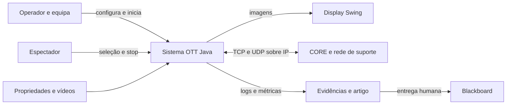

# Contexto do sistema OTT

## Atores e fronteira

Operador/equipa configura e inicia processos; espectador escolhe uma stream e
pára a receção; docente define avaliações e verifica a solução. Construction
implementa e valida os bolts, preservando revisores humanos; Operations pode
assumir a operação posterior quando solicitada.

O sistema é o projeto Java em Projeto/, com processos bootstrap, origens, relays
e clientes. CORE fornece IP, interfaces/links/namespaces; não decide as árvores.
Ficheiros fornecem configuração/media; o display permite a GUI. JDK/Maven e
ferramentas de captura/preparação são ferramentas de construção/avaliação.
Blackboard é externo ao runtime e só participa na submissão humana final.

## Fluxos e garantias

- REGISTER/REGISTER_OK: consulta inicial de configuração, sem membership vivo.
- HELLO e controlo TCP: identidade/contexto, métricas, anúncios, ativação/poda.
  Escrita TCP não confirma processamento remoto.
- Dados UDP: JPEG fragmentado apenas em ramos confirmados; tratar perdas,
  duplicação e reordenação com limites e descarte.
- I/O publica eventos; proprietário serial altera estado; snapshots imutáveis
  alimentam o encaminhamento. Swing recebe frames prontos no EDT.

## Disponibilidade e exclusões

IDs configurados entram/saem dinamicamente. Alternativa pode recuperar até à
mesma origem; morte da origem não encontra o mesmo conteúdo noutra fonte.
Sem caminho usa-se UNAVAILABLE. Não há DB, HTTP, contas, seek, pause ou
autenticação criptográfica de nós no âmbito adotado.

## Fontes e riscos

[Arquitetura](../../../docs/04-ARCHITECTURE.md),
[invariantes](../../../docs/06-DATA-MODEL.md) e
[gates](../../../docs/17-INCEPTION-AUDIT.md).
IPs publicitados têm de pertencer aos nós e ser alcançáveis. Validação offline
não o prova. Separar recuperação IP de adaptação da overlay nos testes CORE.

## Autoridade e limitação aprovadas

Arquitetura normativa: [ADD](../../../add.md). Parametrização validada em TASK-032; deteção automática continua TCP. A perda exclusiva UDP é uma limitação documentada, sem watchdog. Não há CI/linter ou limiar percentual novos.
